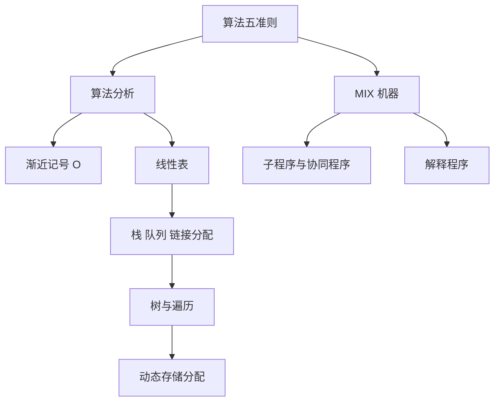

# 计算机程序设计艺术 卷1：基本算法 点化学习系统

## 这本书在讲什么

这一卷回答两个问题：什么样的东西才算算法，算法又要用什么材料搭起来。第 1 章把「算法」拆成五条可检验的准则，把分析所需的数学工具备齐，再用一台虚构计算机 MIX 把算法落成指令。第 2 章转向数据结构：线性表、树、多链结构、动态存储分配。后面三卷的全部分析，都建立在两章的语言之上。

## 全书心智模型

## 学习路径（推荐顺序）

| 步骤 | 主题 | 章节 | 检查点 |
|---|---|---|---|
| 01 | 先弄懂「算法」这两个字 | ch01 | 能对任意流程判定是否满足五条准则，并手算 gcd(119, 544) |
| 02 | 补齐分析算法的数学 | ch02 | 能独立证明 1+2+…+n 的求和公式，写出 F10 与 H10 的数值 |
| 03 | 看懂机器层的算法 | ch03 | 能解释 MIX 的字结构、子程序如何靠链接字返回、解释程序的三段循环 |
| 04 | 线性表：栈、队列与链接 | ch04 | 能画出链表插入删除的指针变化，说清循环链表与双链表各解决了什么问题 |
| 05 | 树与存储管理 | ch05 | 能写出三种遍历序列，算对扩充二叉树的 E 与 I，解释标记-清扫与伙伴系统 |

## 章节索引

- 第 1 章：算法是什么，怎么衡量它（难度 ★☆☆，约 4 小时）→ [chapters/ch01-算法与算法分析.md](chapters/ch01-算法与算法分析.md)
- 第 2 章：分析算法要用的数学工具箱（难度 ★★☆，约 6 小时）→ [chapters/ch02-数学工具箱.md](chapters/ch02-数学工具箱.md)
- 第 3 章：MIX 与基本程序设计技术（难度 ★★☆，约 5 小时）→ [chapters/ch03-MIX与程序设计技术.md](chapters/ch03-MIX与程序设计技术.md)
- 第 4 章：线性表（难度 ★★☆，约 5 小时）→ [chapters/ch04-线性表.md](chapters/ch04-线性表.md)
- 第 5 章：树、多链结构与动态存储（难度 ★★★，约 6 小时）→ [chapters/ch05-树与动态存储.md](chapters/ch05-树与动态存储.md)

## 前置知识（零基础缺口补讲）

| 缺口 | 补讲位置 | 学完标志 |
|---|---|---|
| 求和符号 Σ 与下标记法 | ch02 概念 2 | 看到 Σ 能逐项展开，能把上下界换成具体数字算出结果 |
| 对数与指数增长直觉 | ch01 概念 3 | 能说出 n=1000 时 log2 n 约等于 10，并解释折半查找为何快一个量级 |
| 指针与内存地址 | ch04 概念 2 | 能画出三个节点互相指向的图，说清删除中间节点要改哪两条指针 |
| 递归 | ch05 概念 1 | 能写出递归遍历函数，并说出每次递归在栈上留下什么 |

## 术语表 / 模式库 / 速查表

- 术语：[glossary.md](glossary.md)
- 模式库：[patterns.md](patterns.md)
- 速查表：[cheatsheet.md](cheatsheet.md)
- 测验：[quiz.md](quiz.md)
- 抽认卡：[flashcards.md](flashcards.md)

## 怎么学

打开同目录的 `taocp-v1学习伴侣.html`，按「学习路径」推进。每章读完做自测题，答对再走下一步。
