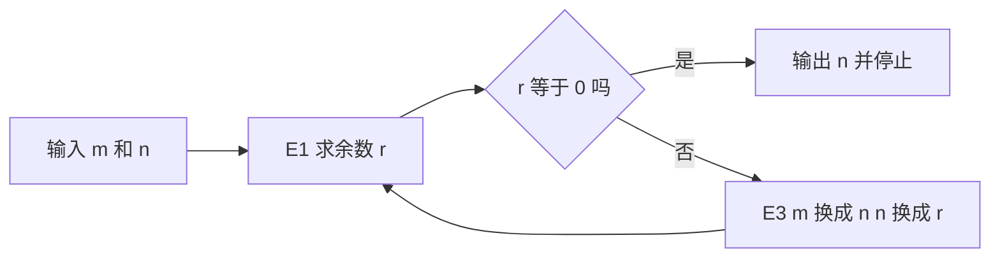

# 第 1 章：算法是什么，怎么衡量它

- **难度**：★☆☆ | **预估学时**：4 小时 | **前置**：会写循环与赋值语句

## 学习目标

学完本章，你能：
1. 用五条准则逐条检验一段流程是不是算法，指出它缺哪一条。
2. 手工执行欧几里得算法，写出每一轮的中间值，并说对最终答案取的是哪个变量。
3. 说清「算法分析」在算什么，并用大 O 记号给一个多项式表达式定阶。

## 一句话核心

算法不是「一段能跑的代码」，而是**满足五条准则、并且值得衡量代价的有限计算过程**。

## 零基础讲解

### 概念 1：算法的五条准则（难度：基础）

高德纳给算法下的定义有五个条件，这是后面四卷全部内容的地基。

1. **有限性**。执行有限步之后必须停止。烧一壶水不算算法，因为不知道什么时候停；求最大公因数算，因为余数必然越来越小，迟早到 0。
2. **确定性**。每一步的动作唯一确定，不能靠执行者的「常识」判断。同一个输入跑两次，结果与中间状态都必须一样。
3. **输入**。有 0 个或多个输入，取自指定的集合。输入是「允许长什么样」的约定，不只是数据本身。
4. **输出**。至少有 1 个输出，并且与输入有指定的关系。没有输出的过程只是副作用。
5. **可行性**。每一步都能在有限时间内做完。注意「可行」和「实际做得到」不是一回事：枚举全部棋局在理论上满足有限性，但步数大到人类等不到，第 5 条只算勉强合格。

**类比**：菜谱。有限性 = 最后一道工序是「关火装盘」，不会让你一直翻炒；确定性 = 写「盐 3 克」，不写「盐适量」；输入 = 食材清单；输出 = 一道菜；可行性 = 家里的厨房做得到。
**类比失效的地方**：菜谱允许「尝一口再决定加不加盐」，算法不允许这种依赖主观判断的分支，除非把判断标准写成明确规则（例如「咸度低于 1.2% 则加盐 2 克」）。

### 概念 2：算法分析在算什么（难度：进阶）

给定算法之后，高德纳不问「能不能算出来」，而问「要花多少次基本操作」。衡量对象是**执行次数关于输入规模的函数**。

以欧几里得算法为例，把「求余数」定为基本操作（步骤 E1）。记第二个输入为 n，执行 E1 的次数为 T(n)。要回答的是：T(n) 的平均值、最大值分别是多少。

这里有个容易被忽略的前提：平均值必须说清「在什么范围内取平均」。书里问的是 m 固定、n 在 1 到 m 之间取遍时的平均；换一个取值范围，答案就变。**任何平均值都要连同取值范围一起说**，否则这句话没有意义。

### 概念 3：大 O 记号（难度：进阶）

n 很大时，低次项与常数系数对增长速度的影响可以忽略。于是只保留增长最快的一项，写成 O(某个函数)。

判定步骤（按定义展开，不跳步）：
1. 把表达式按次数排序，例如 3n² + 5n + 7。
2. 只留最高次项：3n²。
3. 丢掉常数系数：n²。
4. 结论：3n² + 5n + 7 = O(n²)。

为什么可以丢：需要证明存在常数 c 与 n₀，使 n ≥ n₀ 时 3n² + 5n + 7 ≤ c·n²。取 n₀ = 1，此时 5n ≤ 5n²、7 ≤ 7n²，左边 ≤ 15n²，c 取 15 即成立。这就是「丢掉低次项」的依据，不是偷懒。

## 图示

**看图说明**：看两处。第一，循环只有一个出口（E2 的「是」分支），这保证有限性；第二，回路上的每一轮都让 n 严格变小（新 n 是旧 n 除以旧 m 的余数，必小于旧 m），而 n 是非负整数，不可能无限下降。两句合起来就是「算法会停」的证明骨架。

## 类比与实例

- 类比：欧几里得算法像拿两把长短不一的尺子互相量，每次把长的换成「量剩下的那一截」。剩下的那截一定比短的还短，于是越量越短，终会量尽。
- 类比失效：如果允许实数长度，两段可能永远量不尽（不可通约，正方形边长与对角线就是例子）。这也说明「输入必须是整数」这个前提不能省。

**实例（可逐行复核）**：m = 119，n = 544。算法规定「用 m 除 n」，所以第一轮商是 0。

| 轮次 | m | n | 计算 | r | 下一轮 |
|---|---|---|---|---|---|
| 1 | 119 | 544 | 119 = 0×544 + 119 | 119 | m=544, n=119 |
| 2 | 544 | 119 | 544 = 4×119 + 68 | 68 | m=119, n=68 |
| 3 | 119 | 68 | 119 = 1×68 + 51 | 51 | m=68, n=51 |
| 4 | 68 | 51 | 68 = 1×51 + 17 | 17 | m=51, n=17 |
| 5 | 51 | 17 | 51 = 3×17 + 0 | 0 | 终止，输出 n = 17 |

验算：119 = 7×17，544 = 32×17，公因数 17；再没有更大的公因数，所以答案是 17。注意第 5 轮终止时输出的是 **n（除数）**，不是 m。很多实现写 `return m`，是因为它们在循环末尾已经把 m 更新成了 n，写法不同但语义必须一致。

## 常见误解

- **别以为「能跑出结果就是算法」**——实际上要过五条。一个随机停机的程序不满足有限性；一个靠人判断输入含义的程序不满足确定性。
- **别以为 O(n²) 一定比 O(n) 慢**——实际上大 O 只描述 n 增大时的趋势。n 很小时，常数项可能让 O(n²) 的实现更快。要比具体规模上的快慢，得看完整表达式。
- **别以为 O 表示「大约等于」**——实际上它是上界：f(n) = O(g(n)) 说的是 f 增长不快于 g，不排除 f 比 g 小得多。

## 自测题（答案）

1. 单选题：下列哪一条不属于算法的五条准则？
A. 有限性 B. 确定性 C. 可读性 D. 可行性
（答案：C；解析：可读性是工程要求，不在定义里。五条是有限性、确定性、输入、输出、可行性。）

2. 填空题：执行欧几里得算法求 gcd(119, 544)，第一轮的余数是 ___。
（答案：119；解析：用 m 除 n，119 = 0×544 + 119，余数是 119。写成 544 mod 119 = 68 是把除数和被除数弄反了。）

3. 简答题：把 4n³ + 2n² + 100 化成大 O 形式，并说明丢掉常数系数的依据。
（答案：O(n³)；解析：最高次项是 4n³，去系数得 n³。依据是取 n₀ = 1、c = 106，则 n ≥ 1 时 4n³ + 2n² + 100 ≤ 106n³ 恒成立。）

## 复习锚点

- 五条准则：有限、确定、输入、输出、可行。
- 算法分析问的是执行次数关于输入规模的函数，平均值必须带取值范围。
- 大 O 只留最高次项、丢掉系数，依据是「存在 c 与 n₀」的上界定义。
