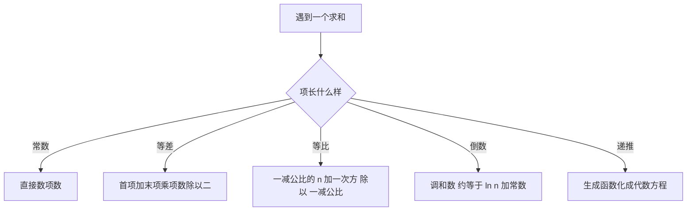

# 第 2 章：分析算法要用的数学工具箱

- **难度**：★★☆ | **预估学时**：6 小时 | **前置**：第 1 章；高中代数

## 学习目标

学完本章，你能：
1. 用数学归纳法证明一个求和公式，写清奠基与归纳两步。
2. 展开 Σ 记号，算出等比级数的闭式，并代数字核对。
3. 写出二项式系数的帕斯卡递推，用它算出具体数值。
4. 说出调和数、斐波那契数、生成函数各自在算法分析里派什么用场。

## 一句话核心

算法分析里出现的求和，绝大多数能化成**几种标准形式**：等比级数、二项式展开、调和级数、斐波那契递推。认出来就能直接套。

## 零基础讲解

### 概念 1：数学归纳法（难度：基础）

要证明「对所有正整数 n，命题 P(n) 成立」，分两步：

1. **奠基**：验证 P(1) 成立。
2. **归纳**：假设 P(n) 成立，用它推出 P(n+1) 也成立。

两步缺一不可。只做奠基是「验了几个例子」，只做归纳是「如果成立则成立」，合起来才是全部。

**实例**：证明 1 + 2 + … + n = n(n+1)/2。
奠基：n = 1 时左边 1，右边 1×2/2 = 1，成立。
归纳：假设 1 + … + n = n(n+1)/2，则
1 + … + n + (n+1) = n(n+1)/2 + (n+1) = (n+1)(n+2)/2，
这正是把 n 换成 n+1 的形式。证毕。
代数字核对：n = 5 时左边 15，右边 5×6/2 = 15。

**类比**：多米诺骨牌。奠基是推倒第一块，归纳是保证每一块倒下时能撞倒下一块。
**失效边界**：如果骨牌间距不规则（命题只在部分 n 成立），这个类比不管用，要改用强归纳或分段证明。

### 概念 2：和与积的记号（难度：基础）

Σ 表示连加，Π 表示连乘。Σ 下方写起点，上方写终点，右边写被加的项。

- 常数求和：Σ(k=1 到 n) 1 = n。
- 等差求和：Σ(k=1 到 n) k = n(n+1)/2。
- 等比求和：Σ(k=0 到 n) x^k = (1 − x^(n+1))/(1 − x)，x ≠ 1。

第三式代入 n = 3、x = 2 核对：左边 1 + 2 + 4 + 8 = 15；右边 (1 − 16)/(1 − 2) = 15，对得上。

**为什么要记等比级数**：二进制位权、进制转换、容量翻倍、分摊分析里的「每次翻倍」都长这样。闭式一写，复杂度立刻能估。

### 概念 3：整数函数与初等数论（难度：基础）

- 下取整 floor(x)：不超过 x 的最大整数。floor(3.7) = 3，而 floor(−3.5) = −4（负数往更小方向取）。
- 上取整 ceil(x)：不小于 x 的最小整数。ceil(3.2) = 4。
- 取余 a mod b：a 除以 b 的余数，要求 0 ≤ a mod b < b。
- 整除记号 a | b：存在整数 k 使 b = ak。

**实例**：−7 mod 3 = 2。因为 −7 = (−3)×3 + 2，余数必须非负。散列函数里这一步写错，就会出现负下标越界。初学者常按「−7 ÷ 3 余 −1」算，那是截断除法，不是这里定义的模。

### 概念 4：排列、阶乘与二项式系数（难度：进阶）

- n 的阶乘 n! = 1×2×…×n，规定 0! = 1（空排列只有一种）。
- 从 n 个不同对象里取 k 个排成一列：n(n−1)…(n−k+1) = n!/(n−k)!。
- 从 n 个里选 k 个、不管顺序：C(n, k) = n!/(k!(n−k)!)。

**帕斯卡恒等式**：C(n, k) = C(n−1, k−1) + C(n−1, k)。含义是「必含某个特定对象的选法」加「必不含它的选法」，两类互斥且穷尽。

**实例**：C(5, 2) = 5!/(2!3!) = 120/(2×6) = 10。用递推核对：C(4,1) + C(4,2) = 4 + 6 = 10。
**整行求和**：Σ(k=0 到 n) C(n, k) = 2^n。n = 5 时 1+5+10+10+5+1 = 32 = 2^5，对得上。这条在分析「子集枚举」类算法时天天用。

### 概念 5：调和数、斐波那契数与生成函数（难度：进阶）

- **调和数** H_n = 1 + 1/2 + 1/3 + … + 1/n。增长极慢：H10 = 2.928968…，H100 也只有 5.187377…。
- **斐波那契数** F0 = 0，F1 = 1，F(n) = F(n−1) + F(n−2)。前十一项：0, 1, 1, 2, 3, 5, 8, 13, 21, 34, 55。它按 φ = (1+√5)/2 ≈ 1.618 的比例指数增长，所以「欧几里得算法最坏情况」会跟它挂钩。
- **生成函数**：把数列 a0, a1, a2… 打包成 G(z) = a0 + a1z + a2z² + …。用处是把「递推关系」翻译成「代数方程」。

**实例**：数列 1, 1, 1, … 的生成函数是 1/(1−z)。因为 |z| < 1 时等比求和给出 1 + z + z² + … = 1/(1−z)。
**为什么算法分析需要它**：解递推式时，先把递推两边乘 z^n 再求和，化成 G(z) 的方程，解出 G(z)，最后展开成系数——系数就是通项。

## 图示

**看图说明**：这张图是「认型」用的。拿到一个 Σ，先看被加的项是常数、一次、指数还是倒数，分别走到四个出口；只有「带递推」的才需要动生成函数。多数人卡住，是因为没先认型就直接硬算。

## 类比与实例

- 类比：这几种标准求和像厨房里的几把固定量勺——量盐用 3 克勺，量糖用 5 克勺。遇到新菜先看用哪把，而不是每次现做一把勺。
- 类比失效：真遇到没有闭式的求和（例如 Σ 1/(k²+1)），量勺就不存在，只能估上下界。这正是第 1 章「大 O」的用武之地。

**实例（生成函数解递推）**：数列 a(n) = a(n−1) + 1，a(0) = 0，通项是什么？
设 G(z) = Σ a(n)z^n。把递推两边乘 z^n 并对 n ≥ 1 求和，左边 G(z) − a(0) = G(z)，右边 Σ a(n−1)z^n + Σ z^n = zG(z) + z/(1−z)。于是 G(z) = z/(1−z)²。展开得 a(n) = n。代 n = 3 核对：a(3) = 3，而逐项算是 0,1,2,3，对得上。

## 常见误解

- **别以为「验了前 10 项都对」就算证明**——实际上归纳法的重量在第二步。很多猜想前几项成立、后面翻车。
- **别以为 Σ 只是个记号，没有运算规则**——实际上可以换元、可以拆项、可以交换求和次序。分析复杂度时靠这些规则化简。
- **别以为 C(n, k) 就是「n 除以 k」**——实际上它是组合数。C(5,2)=10，而 5/2=2.5，两者毫无关系。

## 自测题（答案）

1. 填空题：C(6, 3) = ___。
（答案：20；解析：6!/(3!3!) = 720/(6×6) = 20。）

2. 单选题：floor(−2.4) 等于？
A. −2 B. −3 C. 2 D. 3
（答案：B；解析：下取整往更小的方向取，−3 是不超过 −2.4 的最大整数。）

3. 简答题：H4 等于多少？它和 ln 4 的关系说明了什么？
（答案：H4 = 1 + 1/2 + 1/3 + 1/4 = 25/12 ≈ 2.0833；解析：ln 4 ≈ 1.386，加上欧拉常数 0.5772 得约 1.963，与 2.083 相差约 0.12，说明 n 较小时近似式仍有可见误差，n 越大越贴。）

## 复习锚点

- 归纳两步：奠基 + 由 n 推 n+1，缺一不可。
- 等比求和闭式 (1 − x^(n+1))/(1 − x)，是复杂度估算的主力。
- 生成函数的作用：把递推翻译成代数方程，再展开取系数。
