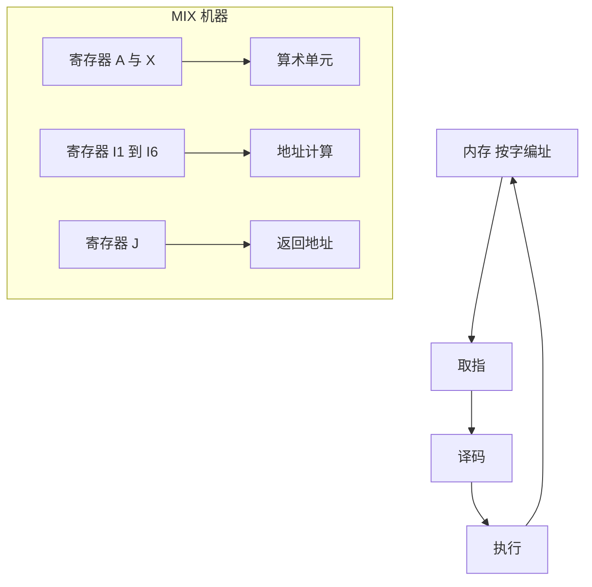

# 第 3 章：MIX 与基本程序设计技术

- **难度**：★★☆ | **预估学时**：5 小时 | **前置**：第 1 章（算法与代价）、第 2 章（进制与取整）

## 学习目标

学完本章，你能：
1. 说清 MIX 的字、字节、寄存器各是多少位，为什么字节的取值范围是 0 到 63。
2. 解释一条 MIX 指令由哪几部分组成，看到 `LDA`、`ADD`、`JMP` 能说出它做什么。
3. 说明子程序、协同程序、解释程序三者的区别，以及 MIX 没有硬件栈时子程序靠什么返回。

## 一句话核心

MIX 是为了**让算法可被精确描述、又不绑死在任何一台真实机器上**而设计的虚构计算机。它的寄存器少得可怜，正因为少，才逼你把「算法到底要存什么」想清楚。

## 零基础讲解

### 概念 1：MIX 的机器结构（难度：基础）

MIX 是一台「理想化」的机器，规格如下。

- **字（word）**：1 个符号位加 5 个字节。字节是 6 位，取值 0 到 63。所以一个字能表示 −(64⁵−1) 到 +(64⁵−1) 之间的整数，约正负 10.7 亿。
- **字节为什么是 0 到 63**：6 位二进制正好 64 种组合。MIX 用「一个字节装一个字符」的方式处理文本，64 个码位刚好够一套大写字母、数字和标点。
- **寄存器**：A 与 X 各 1 个字（5 字节加符号），I1 到 I6 各 2 字节加符号（存地址，所以最大 4095），J 是 2 字节加符号（存返回地址）。另外有一个溢出开关和一个比较指示器（小于、等于、大于三态）。
- **内存**：按字编址，每个字有一个地址。地址可以放进 I 寄存器，说明它的范围受 2 字节限制。

**类比**：MIX 像一张只有六个抽屉的办公桌。抽屉少，你就必须决定哪些纸必须留在桌面（寄存器），哪些丢进柜子（内存）。真实 CPU 有几十个寄存器，反而让人不必做这种取舍。
**类比失效**：真实 CPU 有缓存层级和流水线，MIX 完全没有。所以 MIX 上数出的指令次数只能比较算法，不能直接换算成现代机器上的耗时。

### 概念 2：指令与汇编语言（难度：基础）

一条 MIX 指令占一个字，包含四样东西：**操作码**（做什么）、**地址**（对哪个内存字做）、**变址**（用哪个 I 寄存器加到地址上）、**域**（只取该字的哪几个字节）。

常见指令族：
- 装入/存储：`LDA`、`LDX`、`LD1`…`LD6`，`STA`、`STX`…，把内存的字搬进寄存器或搬回去。
- 算术：`ADD`、`SUB`、`MUL`、`DIV`。乘法结果占 A 和 X 两个寄存器，除法用 A 和 X 拼成的被除数。
- 比较与跳转：`CMPA` 设置比较指示器，`JMP` 无条件跳，`JGE`、`JNE` 等按指示器跳。
- 地址算术：`ENTA`、`ENT1`、`INCA`、`INC1` 等，直接给寄存器赋常数或加减。

一个小例子，求 A 的绝对值：

```
        CMPA  ZERO     比较 A 与内存里的 0
        JGE   DONE     A 大于等于 0 就跳走
        ENNA  0       否则 A 取负，A = -A
DONE    ...           继续
```

`ENNA 0` 的意思是「把 A 的相反数放回 A」，后面的 0 是占位地址，这条指令不需要地址。

**MIXAL** 是 MIX 的汇编语言，除了指令还有几条伪指令：`ORIG` 指定代码起点，`EQU` 给符号赋值，`CON` 定义常量，`ALF` 把五个字符打包成一个字，`END` 表示程序结束。

### 概念 3：子程序怎么返回（难度：进阶）

MIX 没有硬件栈。如果像现代编译器那样「调用时压栈、返回时弹栈」，MIX 做不到。它用的是**链接字**。

做法是：调用方先把「返回后该从哪继续」这个地址存到一个约定的位置，再跳到子程序入口。子程序执行完，从那个位置取出地址跳回去。

- MIX 里有一个专门的 J 寄存器，执行跳转指令时硬件顺手把「下一条指令的地址」存进 J。所以调用只写一条 `JMP SUB`，J 就自动记住了返回点。
- 子程序最后执行一条「跳到 J 所指地址」的指令返回。书中把这条写成 `JMP 0`，地址 0 是「取 J 的值」的约定。
- 如果子程序里还要再调用别的子程序，J 会被覆盖，所以必须先把 J 存进内存（这叫保存链接字），返回前再取回来。

**实例**：主程序在地址 100 处调用子程序，子程序入口是 500。
1. 执行 `JMP 500`，硬件把 101 存进 J，跳到 500。
2. 子程序里如果想再调用别人，先把 J 的值（101）存到内存某个格子，比如 `STJ RET`。
3. 子程序结束前 `LDJ RET` 把 101 取回 J，再 `JMP 0` 跳回 101。

### 概念 4：协同程序与解释程序（难度：进阶）

**协同程序**：两段程序彼此平等，谁都可以跳到对方，没有「调用者/被调用者」的上下级关系。经典例子是「生产者—消费者」：生产者算出一批数据就跳给消费者，消费者处理完再跳回来，两边各自保留自己的进度。

它和子程序的区别：子程序每次被调用都从入口重新开始，协同程序从上次停下的地方继续。

**解释程序**：用软件模拟另一台机器。它反复做三段：
1. **取指**：从「被模拟机器的程序计数器」所指的内存取出下一条指令。
2. **译码**：拆出操作码、地址、变址、域。
3. **执行**：按译码结果修改被模拟机器的寄存器与内存。

MIX 的模拟程序就属于这一类。它的意义在于：MIX 是虚构机器，没有硬件能直接跑，靠解释程序才能验证书里的程序。

**类比**：解释程序像一个翻译跟着演讲者逐句翻译；编译器像提前把整篇稿子翻译好再上台。
**类比失效**：解释程序不一定慢，现代解释器会做即时编译；这里的类比只强调「逐条处理」这一点。

## 图示



**看图说明**：看三层关系。内存与「取指—译码—执行」构成指令循环；寄存器 A、X 是数据通路；I 寄存器只参与地址计算，不参与运算。这张图解释了一个常见困惑：为什么 MIX 的数组访问要先算地址再取数——地址计算和数据运算是两条路。

## 类比与实例

- 类比：MIX 像一套只有六个抽屉、一张桌子、一个大柜子的办公室。你把当前要用的纸摊在桌上（A、X），把「第几个抽屉」记在便签上（I 寄存器），其余的进柜子（内存）。
- 类比失效：办公室的柜子可以无限加，MIX 的内存地址被 2 字节的 I 寄存器卡死在 4095，超出就得分段或换机器（这也是后来 MMIX 把地址扩到 64 位的原因）。

**实例（算一次指令周期）**：执行 `LDA 1000`。
1. 取指：从程序计数器所指地址取出这条指令。
2. 译码：操作码是 LDA，地址 1000，无变址，域是整字。
3. 执行：把内存 1000 号字复制进 A，其他寄存器不变。
4. 程序计数器加 1，取下一条。

## 常见误解

- **别以为 MIX 是真实存在的机器**——实际上它是虚构的，只有模拟程序。书上所有 MIX 程序都要靠解释程序才能跑。
- **别以为 MIX 的字节是 0 到 255**——实际上是 0 到 63，因为一个字节只有 6 位。按现代「字节 = 8 位」的直觉去算会全错。
- **别以为子程序返回靠硬件栈**——实际上靠 J 寄存器和内存里的链接字。这也是为什么「递归」在 MIX 上必须自己造栈。

## 自测题（答案）

1. 单选题：MIX 的一个字节取值范围是？
A. 0 到 63 B. 0 到 255 C. −32 到 31 D. 0 到 4095
（答案：A；解析：字节是 6 位，2⁶ = 64 个值，从 0 到 63。）

2. 填空题：MIX 子程序返回时，返回地址通常存在 ___ 寄存器。
（答案：J；解析：跳转指令执行时硬件把下一条指令地址存进 J，子程序据此返回；嵌套调用要先把它存进内存。）

3. 简答题：协同程序和子程序最本质的区别是什么？
（答案：协同程序从上次停下的地方继续，两边地位平等；子程序每次调用都从入口重新开始，有明确的调用者与被调用者。解析：前者靠保留各自的位置实现交替推进，后者靠链接字实现一进一出。）

## 复习锚点

- 字 = 符号 + 5 字节，字节 6 位取 0 到 63。
- 指令四要素：操作码、地址、变址、域。
- MIX 无硬件栈，子程序靠 J 与链接字返回；协同程序靠各自保存位置交替推进。
