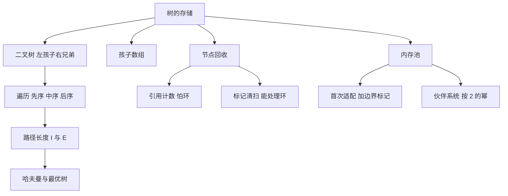

# 第 5 章：树、多链结构与动态存储

- **难度**：★★★ | **预估学时**：6 小时 | **前置**：第 4 章（链接分配）

## 学习目标

学完本章，你能：
1. 判断一个结构是不是树，并用「节点数 = 边数 + 1」做快速校验。
2. 写出同一棵二叉树的先序、中序、后序序列。
3. 把一棵一般树用「左孩子—右兄弟」表示成二叉树，并说清映射规则。
4. 算扩充二叉树的外部路径长度 E 与内部路径长度 I，用 E = I + 2n 复核。
5. 解释标记-清扫、边界标记、伙伴系统各自解决什么问题。

## 一句话核心

树把「一对多」的关系压成「每个节点只有一个上级」，于是任何节点到根只有一条路；存储管理的全部麻烦，都来自节点的生死不由一个人说了算。

## 零基础讲解

### 概念 1：树的定义与基本术语（难度：基础）

**有根树**是一组节点加一组「父子」关系，满足：
- 恰有一个节点没有父节点，称为根；
- 除根以外每个节点恰有一个父节点；
- 从根出发能走到所有节点，且不走重复的路。

后两条合起来等价于「任意两个节点之间的路径唯一」，也就是**没有环**。

术语：节点的**层**是从根到它的边数（根在第 0 层）；**度**是它子节点的个数；度为 0 的节点叫**叶**；从根到某节点的节点序列叫**路径**，路径上的边数叫**路径长度**。

**快速校验**：一棵有 n 个节点的树恰有 n−1 条边。因为除根以外每个节点都恰好贡献一条「连向父节点」的边。

### 概念 2：二叉树与三种遍历（难度：基础）

**二叉树**是每个节点最多有两棵子树的树，而且左右子树**有顺序**：左为空、右不空，和反过来，是两棵不同的树。

三种遍历的区别只在「什么时候访问根」：

- **先序**：根 → 左子树 → 右子树
- **中序**：左子树 → 根 → 右子树
- **后序**：左子树 → 右子树 → 根

**实例**：这棵树

```
        A
       / \
      B   C
     / \   \
    D   E   F
```

- 先序：A、B、D、E、C、F
- 中序：D、B、E、A、C、F
- 后序：D、E、B、F、C、A

核对方法：先序的第一个必是根 A；后序的最后一个必是根 A；中序里 A 左边的 D、B、E 全在左子树，右边的 C、F 全在右子树。

### 概念 3：一般树怎么表示（难度：进阶）

二叉树每个节点只有两个链位，一般树的节点可能有任意多个孩子。常用两种表示：

1. **每个节点开一个孩子数组**：节点存「孩子个数 + 孩子指针数组」。找第 k 个孩子是 O(1)，但节点大小不一，浪费空间。
2. **左孩子—右兄弟**：每个节点只存两个链，`LCHILD` 指向第一个孩子，`RSIB` 指向下一个兄弟。一般树就此变成二叉树。

映射规则：原树中「父 → 第一个孩子」变成左链，「同级兄弟」变成右链。这条规则是一一对应的，所以一般树的遍历可以完全借用二叉树的三序。

**实例**：A 有三个孩子 B、C、D。映射后 A 的左链指向 B，B 的右链指向 C，C 的右链指向 D。于是「A 的所有孩子」变成「B 这一条右链」。

### 概念 4：路径长度与扩充二叉树（难度：进阶）

把二叉树里所有空链都换成方形节点，得到的叫**扩充二叉树**，方形节点叫外部节点，原来的节点叫内部节点。

- **内部路径长度 I**：所有内部节点的深度之和。
- **外部路径长度 E**：所有外部节点的深度之和。
- **恒等式**：E = I + 2n，n 是内部节点数。

**为什么成立**（不跳步）：每个内部节点有 2 个孩子链位，n 个内部节点共 2n 个链位。其中 n−1 个被「连向子节点」占用，剩下 2n − (n−1) = n+1 个变成外部节点。而每条从根到外部节点的路径，比到它父节点的路径多一条边，把所有外部节点的深度加起来，正好等于「所有内部节点的 2 倍深度之和」再加 2n……更直接的算法是逐层数：设第 d 层有 n_d 个内部节点，则第 d+1 层的外部节点数等于 2n_d 减去第 d+1 层的内部节点数，逐层累加即得 E = I + 2n。

**实例（用上面的树复核）**：n = 6，深度分别是 A 0、B 1、C 1、D 2、E 2、F 2，I = 0+1+1+2+2+2 = 8。
外部节点 7 个，深度分别是：D 的两个孩子 3、3；E 的两个孩子 3、3；C 缺的左孩子 2；F 的两个孩子 3、3。E = 3+3+3+3+2+3+3 = 20。
核对恒等式：I + 2n = 8 + 12 = 20，与直接数出来的一致。

**它有什么用**：哈夫曼编码、最优二叉搜索树的代价，都能写成「外部路径长度最小化」的问题。

### 概念 5：表与垃圾回收（难度：进阶）

链表节点被删除后，空间要还回去。麻烦在于节点可能被多处共享，甚至互相指向成环，这时「没人用了」很难判断。

两种做法：

- **引用计数**：每个节点记一个「有多少人指向我」的计数。计数归零就回收。问题是**环**：两个节点互相指向，计数永远不为零，谁也回收不了。
- **标记-清扫**：从根（程序的活跃指针）出发，把所有能走到的节点打上标记；走完后，没标记的一律回收。它能处理环，代价是要暂停程序扫一遍。

**实例**：节点 P 与 Q 互相指向，外部已无指针指向它们。引用计数：P 的计数是 1（来自 Q），Q 的计数是 1（来自 P），都不归零，泄漏。标记-清扫：从根出发根本走不到 P、Q，两者都无标记，一起回收。

### 概念 6：动态存储分配（难度：高难）

程序运行时按需申请大小不一的块。内存池要同时解决「找一块够大的空地」与「归还后怎么合并」。

- **首次适配**：从头扫，遇到第一个够大的空闲块就切。快，但会在低地址留下很多小碎片。
- **最佳适配**：找所有够大的块里最小的那个。省空间，但要扫全表。
- **边界标记**：在每个块的头部和尾部各存一份块大小。释放时看「物理相邻的下一个块」是否空闲，是就合并。没有尾部标记，就只能单向找前一个块，合并效率低。
- **伙伴系统**：只按 2 的幂切分。申请 5 个单位就向上取到 8；释放时只与「同尺寸的伙伴」合并。伙伴的地址可以用异或算出来，合并极快。

**实例（伙伴系统）**：总容量 16，申请 5 个单位。
1. 16 对半切成两个 8，取左边 8。
2. 8 对半切成两个 4，但 4 不够 5，于是退回上一层，用整个 8。
3. 返回地址 0、长度 8。释放时检查地址 8 的伙伴 8 是否空闲；若空闲，合并成 16。

## 图示



**看图说明**：这棵树有三条主线——表示（怎么存）、度量（路径长度）、回收（怎么还）。三条线共同指向同一个问题：节点是动态生灭的，结构必须能在运行中改变。

## 类比与实例

- 类比：树像公司的组织架构，每个员工只有一个直属上级，汇报线唯一。左孩子—右兄弟的表示法像「先找我第一个下属，再让他介绍同级的同事」。
- 类比失效：公司里可以有一个人向两个上级汇报（矩阵式管理），树不允许；这种「多上级」关系必须用多链结构或图来表示。

**实例（多链结构）**：稀疏矩阵的每个非零元素既要挂在「所在行」的链上，又要挂在「所在列」的链上。于是节点有两个链字段 `ROW-LINK` 与 `COL-LINK`，这就是多链结构：同一个节点同时属于两条链。它比正交表更进一步，不再需要单独的行列头数组，行列头本身也是节点。

## 常见误解

- **别以为「树」和「二叉树」是一回事**——实际上二叉树允许左子树为空而右子树不空，这种形态在一般树里不合法（不能有「没有第一个孩子却有第二个孩子」）。
- **别以为中序序列能唯一确定一棵二叉树**——实际上只给中序不够，必须配先序或后序才能重建。
- **别以为标记-清扫一定比引用计数慢**——实际上引用计数的写入开销摊在每次指针赋值上，标记-清扫的开销集中在回收那一刻；哪种更好取决于分配频率与暂停能否接受。

## 自测题（答案）

1. 单选题：一棵有 10 个节点的树有多少条边？
A. 9 B. 10 C. 11 D. 取决于形状
（答案：A；解析：除根以外每个节点贡献一条连向父节点的边，所以是 n−1 = 9。）

2. 填空题：对上面的示例树做后序遍历，序列的最后一个节点是 ___。
（答案：A；解析：后序最后访问根，根是 A。）

3. 简答题：n = 4 的扩充二叉树，若 I = 6，E 等于多少？
（答案：14；解析：E = I + 2n = 6 + 8 = 14。）

4. 简答题：为什么引用计数无法回收互相指向的两个节点？
（答案：因为两者的计数都来自对方，外部已无引用但计数仍为 1，永远不归零；标记-清扫从根出发判定可达性，能识别这种环。）

## 复习锚点

- 树：n 个节点、n−1 条边、路径唯一、无环。
- 三序遍历的差别只在访问根的时机；先序首项与后序末项都是根。
- 一般树用左孩子—右兄弟变成二叉树；E = I + 2n。
- 回收：引用计数怕环，标记-清扫怕暂停；分配：首次适配快、最佳适配省、伙伴系统合并快。
