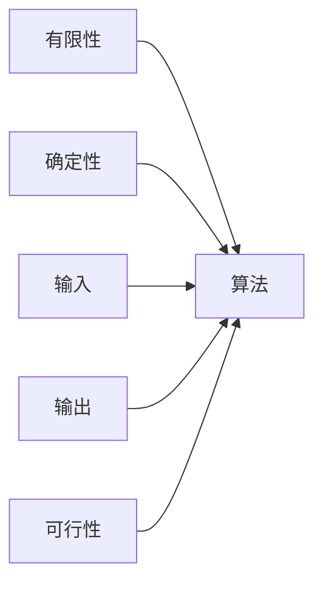

# 算法五准则

- **难度**：基础 | **涉及章节**：第 1 章

## 一句话定义

一个计算过程要被称为算法，必须同时满足有限性、确定性、输入、输出、可行性五条。

## 为什么重要

这五条是整套 TAOCP 的准入标准。后面讨论的所有算法分析、数据结构、复杂度，都默认「对象已经是一个算法」。缺了其中任何一条，讨论的对象就换类别了——可能是一个程序、一个启发式、或者一个数学构造。

## 图示

看图看五点是否都连到同一个中心：任何一条断开，都不成立。

## 详解

- **有限性**：存在一个有限的步数上界。证明时不要只说「显然会停」，要指出一个每轮严格减小、又有下界的量。
- **确定性**：同一输入，每一步的状态都唯一。注意「依赖随机数」的算法要先固定随机源，才能算确定。
- **输入**：0 个或多个，且限定取值范围。范围本身是算法的一部分。
- **输出**：至少 1 个，且与输入有指定关系。
- **可行性**：每一步都能在有限时间内完成。这一条是理想化的——它不要求快，只要求做得到。

**实例对照**：求 gcd 的过程五条全满足；一个「不断打印当前时间」的进程缺有限性；一个「按感觉判断这串数字是不是质数」的过程缺确定性。

## 常见误解

- 别以为「程序 = 算法」——程序可能不终止、可能依赖环境，算法是程序里满足五条的那部分。
- 别以为可行性要求「快」——可行只要求有限时间，实际快慢归算法分析管。

## 在书中出现的脉络

| 章节 | 语境 | 关键结论 |
|---|---|---|
| 1.1 | 定义 | 五条准则首次给出 |
| 1.1 末 | 算法分析 | 可行性之上再加「代价要合理」 |
| 全书的算法描述 | 记号约定 | 每步用字母加编号，便于引用与证明 |

## 相关概念

- 前置：无
- 后续：[渐近记号与大 O](asymptotic-notation.md)
