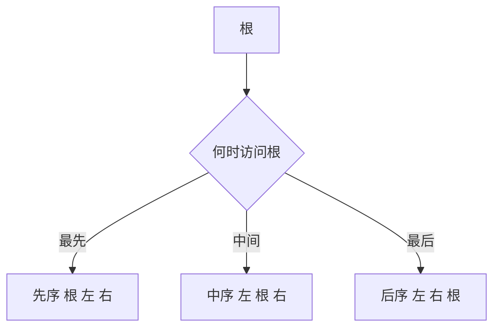

# 二叉树遍历

- **难度**：进阶 | **涉及章节**：第 5 章

## 一句话定义

遍历是按固定次序访问树中每个节点恰好一次；先序、中序、后序的区别只在「什么时候访问根」。

## 为什么重要

树的很多操作都必须先遍历：统计节点数、复制一棵树、释放整棵树、把树表达式还原成中缀式。遍历顺序选错，结果就错——例如释放节点必须用后序，否则先释放了父节点就找不到子节点。

## 图示



看图只需盯住根的三个位置：前、中、后，序列自然就出来了。

## 详解

示例树：

```
        A
       / \
      B   C
     / \   \
    D   E   F
```

- 先序 A、B、D、E、C、F
- 中序 D、B、E、A、C、F
- 后序 D、E、B、F、C、A

**复核方法**：先序首项 = 后序末项 = 根 A。在中序里找到 A，左边三个是左子树，右边两个是右子树。递归套用，三者互相验证。

**中序的特殊用途**：在二叉搜索树里，中序遍历得到升序序列。这也是「搜索树有序」这句话的准确含义。

## 常见误解

- 别以为只给中序就能重建树——必须再给先序或后序之一。
- 别以为三种遍历只是「输出顺序不同」——它们的用途完全不同：先序用于复制，中序用于排序输出，后序用于释放。

## 在书中出现的脉络

| 章节 | 语境 | 关键结论 |
|---|---|---|
| 2.3.1 | 遍历 | 三序定义与递归实现 |
| 2.3.2 | 二叉树表示 | 遍历依赖 LCHILD 与 RCHILD |
| 2.3.4 | 数学性质 | 路径长度与遍历深度相关 |

## 相关概念

- 前置：[栈、队列与链接分配](linked-allocation.md)
- 后续：[动态存储分配](dynamic-storage.md)
