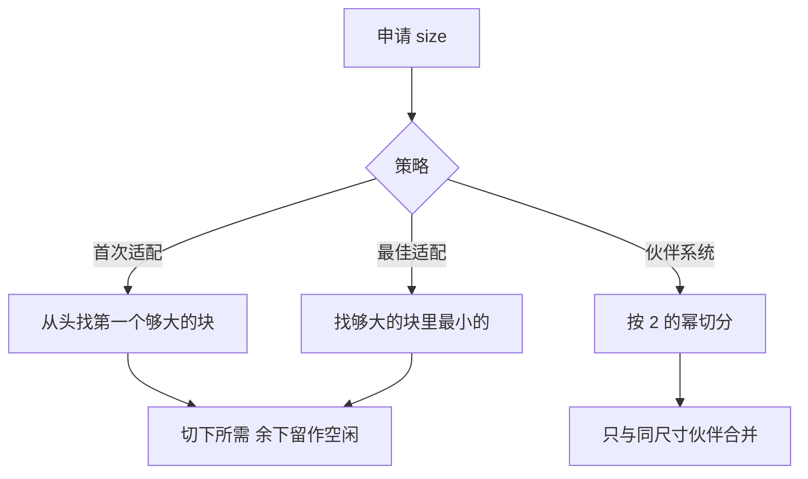

# 动态存储分配

- **难度**：高难 | **涉及章节**：第 5 章

## 一句话定义

动态存储分配是程序运行期间按需从内存池切出、并在用完后归还大小不一的块的过程。

## 为什么重要

所有动态数据结构都依赖它。链表每插入一个节点就要申请一块，删除就要归还。分配策略选错，会出现「明明还有空间却申请不到」的碎片问题；回收策略选错，会泄漏或长时间暂停。

## 图示

看图注意：三种策略的差别不在「能不能分」，而在「分完剩下的碎片长什么样」。

## 详解

- **首次适配**：扫描到第一个够大的块就切。快，但低地址容易积累小碎片。
- **最佳适配**：找最小的够大块。剩余碎片最小，但要扫全表。
- **边界标记**：每个块的头部与尾部各存块大小。释放时检查物理相邻的下一个块是否空闲，是则合并。没有尾部标记，就无法 O(1) 找到前一个块。
- **伙伴系统**：容量按 2 的幂。申请 5 得 8；释放时只与地址异或得到的「伙伴」合并。

**实例（伙伴系统）**：容量 16，申请 5。16 切成 8+8，取左 8；8 切成 4+4，4 不够，退回用 8。返回地址 0、长度 8。释放后若地址 8 空闲，合并回 16。

**碎片为什么不可避免**：申请与释放的顺序不可预知，空闲块会被已分配的块隔开，即使总空闲量够，也未必有一块连续空间够大。

## 常见误解

- 别以为「总空闲空间够」就能分配成功——必须有一块连续空间够大。
- 别以为最佳适配一定最省——它留下的碎片太小，往往无法再用，反而更差。
- 别以为边界标记只是为了调试——它是 O(1) 合并相邻块的前提。

## 在书中出现的脉络

| 章节 | 语境 | 关键结论 |
|---|---|---|
| 2.5 | 动态存储分配 | 首次适配与最佳适配 |
| 2.5 后半 | 边界标记 | 双向合并 |
| 习题 | 伙伴系统 | 按 2 的幂切分与合并 |

## 相关概念

- 前置：[二叉树遍历](binary-tree-traversal.md)
- 后续：卷3 外部排序的缓冲区管理
