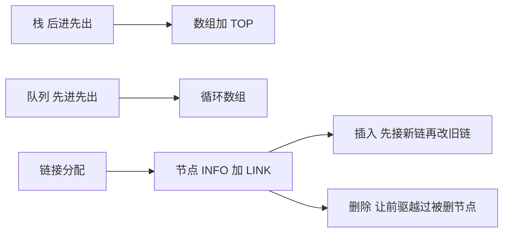

# 栈、队列与链接分配

- **难度**：进阶 | **涉及章节**：第 4 章

## 一句话定义

栈和队列是「只允许在固定端点操作」的线性表；链接分配是让每个节点自带下一个节点地址的存储方式，节点不必相邻。

## 为什么重要

这两件事合起来回答了「数据放在哪、怎么动」。栈是递归与表达式求值的底层结构，队列是广度优先搜索的底层结构，链接分配则是所有动态数据结构的起点——树、图、散列表的节点都靠它串起来。

## 图示

看两条路径的差别：数组靠下标定位，链表靠链定位；前者快在访问，后者快在插入删除。

## 详解

**栈**：`TOP` 指向栈顶，入栈先判满再 `TOP+1`，出栈先判空再 `TOP−1`。
**队列**：循环数组，`front` 指队首、`rear` 指队尾，判满用 `(rear+1) mod m = front`。
**链接分配**：
- 在 P 后插入 Q：`Q.LINK = P.LINK`，然后 `P.LINK = Q`。
- 删除 P 后的 Q：`P.LINK = Q.LINK`，再释放 Q。

**实例**：链 A→B→C，在 A 后插入 X。先 `X.LINK = A.LINK`（X 指向 B），再 `A.LINK = X`，得 A→X→B→C。若顺序颠倒，B 的地址丢失，链断。

## 常见误解

- 别以为链表插入永远 O(1)——按位置查找那一步是 O(n)。
- 别以为数组做队列只要两个下标——不循环就会假溢出。

## 在书中出现的脉络

| 章节 | 语境 | 关键结论 |
|---|---|---|
| 2.2.1 | 栈与队列 | 端点的限制决定行为 |
| 2.2.2 | 顺序分配 | 溢出与假溢出 |
| 2.2.3 | 链接分配 | 指针三步操作 |
| 2.2.4–2.2.5 | 循环与双链 | 用额外链换操作便利 |

## 相关概念

- 前置：[算法五准则](algorithm-criteria.md)
- 后续：[二叉树遍历](binary-tree-traversal.md)
