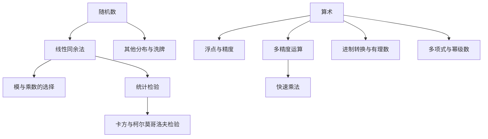

# 计算机程序设计艺术 卷2：半数值算法 点化学习系统

## 这本书在讲什么

这一卷处理两类「算不准」的东西。第 3 章讲随机数：计算机只能生成确定序列，那它凭什么冒充随机？答案是靠数论保证周期、靠统计检验保证分布。第 4 章讲算术：浮点数为什么会有误差、多精度乘法为什么要 O(n²)、多项式求值怎样从 O(n²) 降到 O(n)。两章的共同主题是——把「近似」变成可控的近似。

## 全书心智模型

## 学习路径（推荐顺序）

| 步骤 | 主题 | 章节 | 检查点 |
|---|---|---|---|
| 01 | 伪随机数怎么造 | ch01 | 能手算一个模 16 的线性同余序列并数出周期，说清满周期的三个条件 |
| 02 | 怎么证明它像随机数 | ch02 | 能算一次卡方统计量并与临界值比较，能写出逆变换法与洗牌的正确做法 |
| 03 | 浮点与多精度算术 | ch03 | 能解释 0.1 加 0.2 为何不等于 0.3，能算出两个 n 位整数朴素乘法的次数 |
| 04 | 进制、有理数与多项式 | ch04 | 能用秦九韶法则手算一个四次多项式，能说清快速乘法的递归式 |

## 章节索引

- 第 1 章：随机数是怎么造出来的（难度 ★★☆，约 5 小时）→ [chapters/ch01-随机数生成.md](chapters/ch01-随机数生成.md)
- 第 2 章：检验随机性，并把随机数用起来（难度 ★★☆，约 4 小时）→ [chapters/ch02-随机性检验与应用.md](chapters/ch02-随机性检验与应用.md)
- 第 3 章：浮点与多精度算术（难度 ★★★，约 6 小时）→ [chapters/ch03-浮点与多精度算术.md](chapters/ch03-浮点与多精度算术.md)
- 第 4 章：进制、有理数与多项式（难度 ★★★，约 5 小时）→ [chapters/ch04-进制有理数与多项式.md](chapters/ch04-进制有理数与多项式.md)

## 前置知识（零基础缺口补讲）

| 缺口 | 补讲位置 | 学完标志 |
|---|---|---|
| 同余与模运算 | ch01 概念 1 | 能解 5x ≡ 3 (mod 16) 这类简单同余式，能判断两个数模 m 是否同余 |
| 概率分布与期望 | ch02 概念 1 | 能说出均匀分布与正态分布的差别，能算骰子点数的期望 |
| 二进制与进位 | ch03 概念 2 | 能手算两个 8 位二进制数的竖式乘法 |

## 术语表 / 模式库 / 速查表

- 术语：[glossary.md](glossary.md)
- 模式库：[patterns.md](patterns.md)
- 速查表：[cheatsheet.md](cheatsheet.md)
- 测验：[quiz.md](quiz.md)
- 抽认卡：[flashcards.md](flashcards.md)

## 怎么学

打开同目录的 `taocp-v2学习伴侣.html`，按「学习路径」推进。每章读完做自测题，答对再走下一步。
