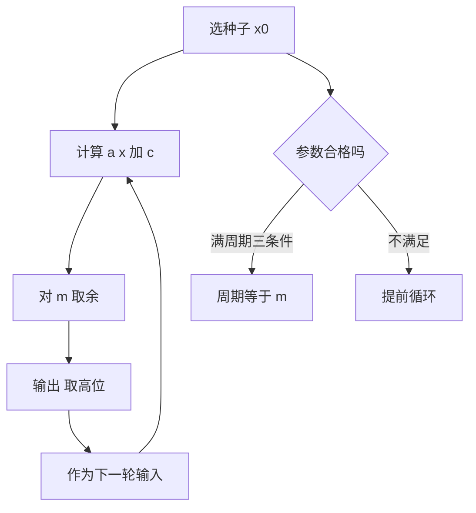

# 第 1 章：随机数是怎么造出来的

- **难度**：★★☆ | **预估学时**：5 小时 | **前置**：卷1 第 1 章（算法与代价）、卷1 第 2 章（同余与数论）

## 学习目标

学完本章，你能：
1. 说清「伪随机数」为什么能替代随机数，以及它替代不了什么。
2. 写出线性同余法的递推式，手算一小段序列并数出周期。
3. 用满周期的三个条件判断一组参数行不行。
4. 解释为什么线性同余的低位不能直接用，模取 2 的幂与取素数各有什么代价。

## 一句话核心

计算机造不出真随机，它造的是**周期极长、通过统计检验的确定序列**；随机性的保证来自数论，不来自算法有多复杂。

## 零基础讲解

### 概念 1：伪随机数到底「伪」在哪（难度：基础）

真随机来自物理过程（噪声、放射性衰变）。程序只能做确定运算，所以同一个种子必然产生同一串数。

这看起来是缺陷，实际是优点：**可复现**。调试模拟、跑对照实验、复现论文结果，都要求「同样的种子给同样的序列」。真正要避免的是另一件事——序列看起来有规律，比如每 10 个数循环一次，或者低位总是 0 和 1 交替。

所以「伪随机」的合格标准是两条：周期足够长（长到实验跑不完一个周期），统计性质足够像独立均匀分布（过得了检验）。

**类比**：掷骰子换成按一张极长的数字表往下读。表是印好的（确定），但你不知道从哪一行开始，读出来的数字看起来就是随机的。
**类比失效**：真骰子每次掷都独立；数字表只要知道位置就能预测下一个数。密码学场景里这一点是致命的，所以加密用的随机数不能用这种表。

### 概念 2：线性同余法（难度：基础）

最常用的一类发生器，递推只有一行：

x(n+1) = (a·x(n) + c) mod m

四个参数：模 m、乘数 a、增量 c、初值 x0。输出取 x(n) 本身，或取它除以 m 的小数。

**手算实例**：m = 16，a = 5，c = 3，x0 = 1。

| n | x(n) | 计算 |
|---|---|---|
| 0 | 1 | 初值 |
| 1 | 8 | 5×1+3 = 8，8 mod 16 = 8 |
| 2 | 11 | 5×8+3 = 43，43 mod 16 = 11 |
| 3 | 10 | 5×11+3 = 58，58 mod 16 = 10 |
| 4 | 5 | 5×10+3 = 53，53 mod 16 = 5 |
| 5 | 12 | 5×5+3 = 28，28 mod 16 = 12 |
| 6 | 15 | 5×12+3 = 63，63 mod 16 = 15 |
| 7 | 14 | 5×15+3 = 78，78 mod 16 = 14 |
| 8 | 9 | 5×14+3 = 73，73 mod 16 = 9 |
| 9 | 0 | 5×9+3 = 48，48 mod 16 = 0 |
| 10 | 3 | 5×0+3 = 3 |
| 11 | 2 | 5×3+3 = 18，18 mod 16 = 2 |
| 12 | 13 | 5×2+3 = 13 |
| 13 | 4 | 5×13+3 = 68，68 mod 16 = 4 |
| 14 | 7 | 5×4+3 = 23，23 mod 16 = 7 |
| 15 | 6 | 5×7+3 = 38，38 mod 16 = 6 |
| 16 | 1 | 5×6+3 = 33，33 mod 16 = 1 |

第 16 步回到初值 1，所以周期是 16，正好等于模 m。这一串把 0 到 15 全部取了一遍，叫**满周期**。

### 概念 3：满周期的三个条件（难度：进阶）

不是随便选 a、c 都能满周期。三个条件同时成立才够：

1. **c 与 m 互素**：gcd(c, m) = 1。
2. **a − 1 能被 m 的所有素因子整除**。
3. **若 m 被 4 整除，则 a − 1 也能被 4 整除**。

用上面的例子核对：m = 16 = 2⁴，素因子只有 2；c = 3 与 16 互素 ✓；a − 1 = 4 能被 2 整除 ✓；m 被 4 整除，4 也能被 4 整除 ✓。三条齐，所以满周期。

**为什么是这三条**（直觉版）：第 1 条保证增量能把序列推离 0 的循环，第 2、3 条保证乘数在二进制下「搅得够狠」，让低位也跟着变。

### 概念 4：模与乘数怎么挑（难度：进阶）

- **模取 2 的幂**：取余变成按位与，硬件上极快。代价是低位质量差——模 2^e 时最低位的周期只有 2，次低位只有 4。所以**要用高位，不要用低位**。
- **模取素数**：例如 m = 2^31 − 1。取余要真做除法，慢一点，但高位低位质量一样，且周期可达 m − 1。
- **纯乘同余（c = 0）**：模 2^e 时，乘数取 a ≡ 5 (mod 8)，周期可达 2^(e−2)。
- **势（potency）**：衡量乘数把低位搅乱的快慢。势不够，序列的低位会出现明显的短循环，即使整体周期很长。

**实例**：模 2^32、乘数取 5 的纯乘同余，周期约 2^30，看起来很长；但最低位的周期只有 2，直接用 `x % 2` 会得到 0、1、0、1 的死循环。

### 概念 5：其他发生器（难度：进阶）

- **平方取中法**：把上一个数平方，取中间几位。早期用过，但会退化到 0（一旦出现 0 就永远 0），已被淘汰。
- **滞后斐波那契法**：x(n) = x(n−k) + x(n−j) mod m，只用加法，适合硬件；理论分析比线性同余难。
- **组合发生器**：把两个发生器的输出相加或异或。周期是两者周期的最小公倍数量级，统计性质通常更好。

## 图示

**看图说明**：图上有一个闭环（生成）和一个判断（参数）。闭环转得快不代表序列好——判断分支不过关，闭环再快也只是在原地打转。

## 类比与实例

- 类比：线性同余像一台齿轮组。模 m 是齿轮的齿数，乘数 a 决定每次转几格，增量 c 决定起点偏移。齿数选得不好，齿轮会在几个位置之间来回咬，永远走不到别的齿。
- 类比失效：齿轮的周期一眼能数出来，序列的周期要靠数论算。而且现实中「走遍所有齿」也不等于「看起来随机」——顺序可能极有规律（例如每次固定加 5）。

**实例（判断参数）**：m = 8，a = 5，c = 4，x0 = 1。
- gcd(4, 8) = 4 ≠ 1，第 1 条就不过。实际序列：1 → (5+4)=9 mod 8 = 1，立刻回到初值，周期 1。这就是「条件不过关」的直接后果。

## 常见误解

- **别以为周期长就等于随机性好**——实际上周期 2^30 的序列也可能低位全是 0、1 交替。周期只是必要条件。
- **别以为取模 2 的幂又快又好**——实际上快是真，低位差也是真。要么取高位，要么换素数模。
- **别以为 `rand() % n` 就能得到均匀的 0 到 n−1**——实际上当 n 不整除周期时会偏斜，越靠近 n 的边界越明显。

## 自测题（答案）

1. 单选题：线性同余法满周期的条件不包括下列哪一条？
A. c 与 m 互素 B. a − 1 被 m 的所有素因子整除 C. m 必须是素数 D. m 被 4 整除时 a − 1 也被 4 整除
（答案：C；解析：模可以是 2 的幂，也可以是素数，条件里没有要求 m 必须是素数。）

2. 填空题：m = 16、a = 5、c = 3、x0 = 1 的线性同余序列，周期是 ___。
（答案：16；解析：序列走遍 0 到 15 后回到 1，周期等于模 16，属满周期。）

3. 简答题：为什么模 2^e 的线性同余发生器不能直接取最低位当随机位？
（答案：最低位的周期只有 2，会在 0、1 之间交替；第 k 位的周期最多 2^(k+1)，低位都短。解析：模 2 的幂时进位只向上传播，低位看不到高位的变化，所以要用高位。）

## 复习锚点

- 线性同余一行递推：x(n+1) = (a·x(n) + c) mod m。
- 满周期三条件：c 与 m 互素、a−1 被 m 的素因子整除、m 被 4 整除时 a−1 也被 4 整除。
- 模 2 的幂要取高位；模取素数则高低位质量一致。
