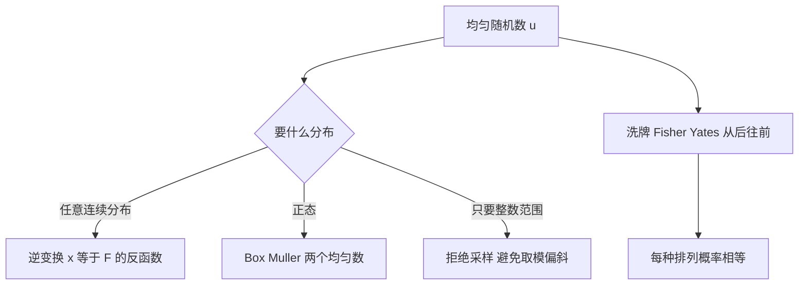

# 第 2 章：检验随机性，并把随机数用起来

- **难度**：★★☆ | **预估学时**：4 小时 | **前置**：第 1 章；基础概率

## 学习目标

学完本章，你能：
1. 用卡方统计量判断一组频数是否偏离均匀，并说出自由度怎么定。
2. 说出柯尔莫哥洛夫检验与卡方检验各自查什么。
3. 用逆变换法把均匀随机数变成指定分布的随机数。
4. 写出正确的洗牌算法，并解释常见写法为什么会偏。

## 一句话核心

检验不能证明「随机」，只能证明「没查出问题」；用途不同，需要的随机性质也不同。

## 零基础讲解

### 概念 1：卡方检验（难度：基础）

把取值范围分成 k 个格子，统计每个格子里实际落了多少个数，与「如果均匀应该落多少」比较。

统计量：χ² = Σ (观测数 − 期望数)² / 期望数。

**实例**：掷一枚骰子 60 次，六个面分别出现 8、12、9、11、10、10 次。期望每面 10 次。
χ² = (8−10)²/10 + (12−10)²/10 + (9−10)²/10 + (11−10)²/10 + (10−10)²/10 + (10−10)²/10
= (4 + 4 + 1 + 1 + 0 + 0)/10 = 1.0。

自由度 = 格子数 − 1 = 5。查表，5% 显著性水平的临界值约 11.07。1.0 远小于 11.07，所以没有理由认为骰子不均匀。

**自由度为什么减 1**：六个格子的频数加起来必须等于 60，知道五个就能推出第六个，独立信息只有 5 份。

**使用时的一条硬规矩**：每个格子的期望频数不能太小（一般要求不小于 5）。期望太小时卡方统计量不服从卡方分布，结论不可靠。解决办法是合并相邻格子。

### 概念 2：柯尔莫哥洛夫检验（难度：进阶）

卡方只看「每个格子多少」，不看「顺序」。柯尔莫哥洛夫检验比较的是**累积分布**：

把 n 个观测值排序，得到经验分布函数 F_n(x)（小于等于 x 的比例）。理论分布函数记 F(x)。统计量取两者差的最大值：

D = max |F_n(x) − F(x)|

D 越小越像。它的好处是直接看整体形状，不依赖分格；缺点是只对连续分布好用。

**两检验的分工**：卡方查「频数是否均匀」，柯尔莫哥洛夫查「形状是否吻合」。前者对局部的偏离敏感，后者对整体的偏移敏感。

### 概念 3：谱检验与多维相关（难度：进阶）

线性同余生成的数对 (x(n), x(n+1)) 落在平面上并不是漫布，而是落在若干条平行直线上。谱检验就是量这些直线之间的最大空隙：空隙越小，分布越像二维均匀。

**为什么会出现直线**：因为 x(n+1) 是 x(n) 的线性函数取余，相邻两个数满足一个线性关系，落在少数几条斜率为 a 的直线上。三维、四维同理，会落在超平面上。

这也是「乘数不能随便取」的一个原因：乘数选得差，直线少而稀，二维、三维的相关性就肉眼可见。

### 概念 4：把均匀数变成别的分布（难度：进阶）

**逆变换法**：设目标分布的累积分布函数是 F，取一个均匀随机数 u（0 到 1），令 x = F 的反函数在 u 处的值。

**实例（指数分布）**：F(x) = 1 − e^(−λx)，反解得 x = −ln(1−u)/λ。取 λ = 2、u = 0.5：
x = −ln(0.5)/2 = 0.6931/2 ≈ 0.3466。
核对：F(0.3466) = 1 − e^(−0.6931) = 1 − 0.5 = 0.5，正好对应 u = 0.5。

**Box-Muller 法（正态分布）**：取两个独立均匀数 u1、u2，
z = √(−2 ln u1) · cos(2π u2)。
这样得到的 z 服从标准正态分布。它的直觉是：半径由指数分布决定（−2 ln u1 开方），角度均匀，合起来就是二维正态。

### 概念 5：洗牌（难度：进阶）

要把 n 个元素随机重排，要求 n! 种排列等概率。

**正确做法（Fisher-Yates）**：从 i = n 递减到 2，随机取 j 在 1 到 i 之间（含），交换第 i 与第 j 个元素。

为什么对：第 i 步时，前 i 个位置里每个元素被换到位置 i 的概率都是 1/i，逐层乘起来每种排列的概率都是 1/n!。

**常见错误写法**：对每个 i 从 1 到 n，随机取 j 在 1 到 n 之间，交换 i 与 j。这样一共 n^n 种可能，而 n! 通常不整除 n^n，必然有排列比其他排列更常出现。n = 3 时共有 27 种路径要分给 6 种排列，27 不能被 6 整除，偏斜无法避免。

## 图示

**看图说明**：注意「取模」被单独标成需要拒绝采样的分支。这是实践里最常见的坑：直接 `% n` 会偏，尤其当 n 接近发生器周期时。

## 类比与实例

- 类比：卡方检验像检查一副麻将被摸过之后每个花色数量是否接近；柯尔莫哥洛夫检验像把整副牌按大小摊开，看分布曲线贴不贴合标准曲线。
- 类比失效：麻将牌数是固定的，随机数的分布是连续或离散无限多种；检验的临界值依赖样本量，样本越大越容易「查出问题」，即使偏差很小。

**实例（判断偏斜）**：某发生器输出 0 到 9，理论上每个 10%。实测 1000 次，0 出现 130 次，其余 9 个数字共 870 次、平均 96.7 次。
χ² ≈ (130−100)²/100 + 9×(96.7−100)²/100 ≈ 9 + 0.98 ≈ 9.98。
自由度 9，5% 临界值约 16.9。9.98 < 16.9，单看这一项还不算显著；但 0 的偏差已经很明显，值得再查低位。

## 常见误解

- **别以为检验通过就说明「真随机」**——实际上只说明这批数据没暴露问题。换一段、换一个维度可能就查出来了。
- **别以为卡方值越小越好**——实际上太小（接近 0）反而可疑，说明观测值与期望值贴合得不像随机抽样。
- **别以为洗牌只要「看起来乱」就行**——实际上要求每种排列等概率，错误写法产生的偏斜用肉眼看不出来，但用统计一测就现形。

## 自测题（答案）

1. 单选题：掷骰子 60 次，六面各 10 次，卡方统计量是多少？
A. 0 B. 1 C. 6 D. 10
（答案：A；解析：每项 (10−10)²/10 = 0，总和 0。注意统计量为 0 反而提示「过于整齐」，真实抽样很少这么巧。）

2. 填空题：卡方检验中，把范围分成 6 个格子，自由度是 ___。
（答案：5；解析：自由度 = 格子数 − 1 = 6 − 1 = 5，因为六个频数之和被样本量固定。）

3. 简答题：为什么「对每个 i 随机与 1 到 n 中某个位置交换」的洗牌不公平？
（答案：一共 n^n 条执行路径，而目标排列只有 n! 种，n^n 通常不能被 n! 整除，必然有排列被多算、有排列被少算。解析：正确做法是第 i 步只在 1 到 i 中取，路径数恰好是 n!，一一对应。）

## 复习锚点

- 卡方：Σ(观测−期望)²/期望，自由度 = 格子数 − 1，期望频数不小于 5。
- 柯尔莫哥洛夫看累积分布的最大差，查形状；卡方查频数。
- 洗牌从后往前，每步只在 1 到 i 中取。
