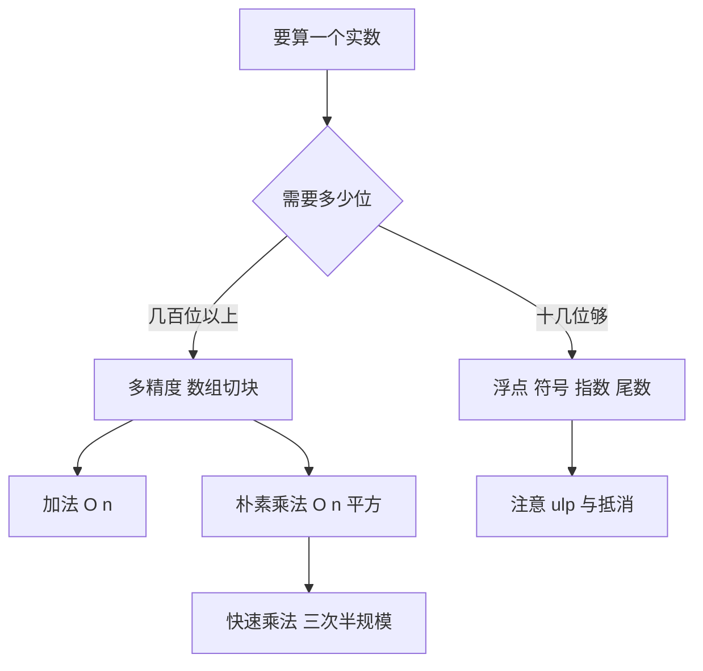

# 第 3 章：浮点与多精度算术

- **难度**：★★★ | **预估学时**：6 小时 | **前置**：第 1 章；二进制基础

## 学习目标

学完本章，你能：
1. 说清浮点数的三部分结构，解释为什么 0.1 加 0.2 不等于 0.3。
2. 举一个灾难性抵消的例子并说明原因。
3. 用数组表示大整数，写出多精度加法与朴素乘法的代价。
4. 说清快速乘法为什么能把 O(n²) 降到约 O(n^1.585)。

## 一句话核心

浮点数的本质是「用固定位数的科学计数法表示实数」，**能表示的数只有有限多个**；多精度算术的本质是「把大数切块，用整数运算模拟手算竖式」。

## 零基础讲解

### 概念 1：浮点数的三部分（难度：基础）

一个浮点数由三部分构成：

- **符号位**：正或负。
- **指数**：决定数量级，相当于科学计数法里的 10 的几次方，只不过底数是 2。
- **尾数**（也叫有效数字）：决定精度，相当于科学计数法里小数点后的那串数字。

双精度（64 位）里，尾数占 52 位，加上隐含的 1 位共 53 位有效二进制位。53 位约等于 15.95 位十进制数字，所以说双精度有「约 16 位有效数字」。

**类比**：浮点像一把只有 16 个刻度的尺子，量什么都能量，但只能记到 16 位。量一栋楼和量一颗螺丝，绝对精度不同，相对精度一样。
**类比失效**：尺子的刻度是均匀的，浮点数的刻度随指数变化——数值越大，相邻两个可表示数的间隔越大（这个间隔叫 ulp）。

### 概念 2：0.1 加 0.2 为什么不等于 0.3（难度：进阶）

0.1 在二进制下是无限循环小数：0.000110011001100…（1100 循环）。有限位的尾数只能截断，存进去的已经不是精确的 0.1，而是一个略大或略小的近似值。

0.2 同理。两个近似值相加，再舍入到最近的 53 位，结果可能是 0.30000000000000004。

**这不是程序的 bug，是表示方式的必然结果**。

**推论一**：不要用 `==` 比较两个浮点数，要比较差值是否小于容差。
**推论二**：判断「0.1 + 0.2 是否等于 0.3」这类问题，答案永远是「按位比较不等，按数学期望相等」。

**灾难性抵消**：两个相近的大数相减，有效位会被「抵消」掉。
实例：双精度下 1e16 + 1 的结果仍是 1e16。因为 1e16 附近的 ulp 是 2，加 1 不足半个 ulp，被舍入掉了。再减 1e16 得到 0，而数学上应该是 1。

### 概念 3：多精度加法的代价（难度：基础）

把大整数按基数 b 切块，存进数组，低位在前。例如十进制 123456 存成 [6, 5, 4, 3, 2, 1]（每块一位），或按千进制存成 [456, 123]。

**加法**：从低位到高位逐块相加，处理进位。n 块需要 n 次加法加 n 次进位判断，代价 O(n)。
**减法**：同理，借位从高位借。
**比较**：从最高块往下比，第一个不同的块决定大小。

### 概念 4：朴素乘法的代价（难度：进阶）

竖式乘法：用第二个数的每一位去乘第一个数的每一位，再把结果错位相加。

**实例**：47 × 23。
- 3 × 47 = 141
- 2 × 47 = 94，整体左移一位得 940
- 141 + 940 = 1081

代价：n 位乘 n 位，要做 n² 次单位乘法、约 n² 次加法。所以朴素多精度乘法是 O(n²)。

**为什么这很重要**：RSA 加密要乘几百位、几千位的整数，O(n²) 在 n = 4096 位时是 1600 万次单位乘法，太慢。这就是快速乘法的动机。

### 概念 5：快速乘法（难度：高难）

把两个 n 位数各切成高低两半：

X = X1·b^(n/2) + X0，Y = Y1·b^(n/2) + Y0

直接展开要算四次半规模乘法：X1Y1、X1Y0、X0Y1、X0Y0。

Karatsuba 的技巧是只算三次：

1. P1 = X1·Y1
2. P2 = X0·Y0
3. P3 = (X1 + X0)(Y1 + Y0)

中间项 X1Y0 + X0Y1 = P3 − P1 − P2，不用再乘。

于是 T(n) = 3T(n/2) + O(n)。展开得 T(n) = O(n^log2 3) ≈ O(n^1.585)。n = 4096 时，n^1.585 约 4.6×10⁵ 量级，比 n² 的 1.6×10⁷ 小一个多数量级。

**代价**：多做了几次加减法，但加减是 O(n)，比省下的一次 O(n²) 乘法划算。

### 概念 6：模算术（难度：进阶）

模 m 的算术只保留余数。加、减、乘都可以先算再取余；除法要先求逆元。

**实例**：模 7 下，3 × 5 = 15 ≡ 1，所以 3 的逆元是 5，5 的逆元是 3。要求 3 除 2（即 2 × 3 的逆元），就是 2 × 5 = 10 ≡ 3。

**为什么除法难**：不是所有数都有逆元。模 6 下，2 没有逆元，因为 2x ≡ 1 (mod 6) 无解（左边永远是偶数）。有逆元的充要条件是 gcd(a, m) = 1。

## 图示

**看图说明**：左边是「精度够用」的路径，右边是「精度必须自己管」的路径。两条路径的交界不在数值大小，而在所需有效位数——几百位的整数用浮点存，尾数根本不够。

## 类比与实例

- 类比：浮点像用科学计数法记测量值，只保留固定几位；多精度像用算盘，一位一位地拨，位子有多少就能算多少位。
- 类比失效：算盘的位数是硬件固定的，多精度数组可以按需加长；而浮点的尾数位数是硬性上限，加长不了。

**实例（多精度加法）**：按千进制算 987654 + 123456。
- 低位块：654 + 456 = 1110，写 110，进位 1
- 高位块：987 + 123 + 1 = 1111，写 1111
- 结果 1111110。核对十进制：987654 + 123456 = 1,111,110，对得上。

## 常见误解

- **别以为浮点误差是「程序写错了」**——实际上是二进制表示十进制小数的固有损失。
- **别以为 double 比 float 精确两倍**——实际上双精度尾数 53 位、单精度 24 位，有效位数差了约一倍，可表示的数值范围也差很多。
- **别以为快速乘法在所有规模上都更快**——实际上 n 很小时递归与加减开销超过收益，通常要设一个阈值，小规模退回朴素乘法。

## 自测题（答案）

1. 单选题：双精度浮点数的尾数（含隐含位）是多少位？
A. 24 B. 32 C. 53 D. 64
（答案：C；解析：双精度尾数 52 位加隐含的 1 位共 53 位，约 16 位十进制有效数字。）

2. 填空题：快速乘法的递归式 T(n) = 3T(n/2) + O(n) 给出的复杂度指数约为 ___（填三位小数）。
（答案：1.585；解析：指数是 log2 3 ≈ 1.58496，取三位是 1.585。）

3. 简答题：双精度下 1e16 + 1 − 1e16 的结果是多少？为什么？
（答案：0；解析：1e16 附近相邻可表示数的间隔 ulp 为 2，加 1 不到半个 ulp，被舍入回 1e16；再减 1e16 得 0，而数学上应为 1。）

## 复习锚点

- 浮点 = 符号 + 指数 + 尾数，尾数位数决定精度。
- 0.1 在二进制下无限循环，所以 0.1 + 0.2 ≠ 0.3 是必然。
- 朴素多精度乘法 O(n²)，快速乘法约 O(n^1.585)。
- 模运算的加减乘直接做，除法要先求逆元，条件是 gcd(a, m) = 1。
