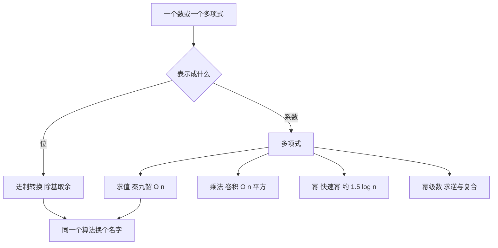

# 第 4 章：进制、有理数与多项式

- **难度**：★★★ | **预估学时**：5 小时 | **前置**：第 3 章（多精度）；卷1 第 2 章（求和与数论）

## 学习目标

学完本章，你能：
1. 用「除基取余」把十进制转成任意进制，用「乘基累加」转回来。
2. 说清有理数运算为什么必须先做约分，以及欧几里得算法的平均代价。
3. 用秦九韶法则（Horner）在 n 次乘加内算出一个 n 次多项式的值。
4. 说清多项式乘法与快速幂各自的代价。

## 一句话核心

这一章的所有算法都在做同一件事：**把「位」和「系数」当成可以逐位处理的对象**。进制转换处理位，多项式处理系数，形式完全同构。

## 零基础讲解

### 概念 1：进制转换（难度：基础）

**十进制转 b 进制（整数部分）**：不断用 b 去除，记下余数，直到商为 0，再把余数倒着读。

**实例**：100 转二进制。
- 100 ÷ 2 = 50 余 0
- 50 ÷ 2 = 25 余 0
- 25 ÷ 2 = 12 余 1
- 12 ÷ 2 = 6 余 0
- 6 ÷ 2 = 3 余 0
- 3 ÷ 2 = 1 余 1
- 1 ÷ 2 = 0 余 1

余数从后往前读：1100100。核对：64 + 32 + 4 = 100 ✓。

**b 进制转十进制**：从最高位开始，每次「当前值 × b + 下一位」。
1100100 转十进制：1 → 1×2+1=3 → 3×2+0=6 → 6×2+0=12 → 12×2+1=25 → 25×2+0=50 → 50×2+0=100 ✓。

注意这两步与多项式求值是同一个算法——1100100 就是多项式 1·2⁶ + 1·2⁵ + 0·2⁴ + … + 0·2⁰。

**小数部分**要反过来：不断乘 b，取整数部分，直到小数部分为 0 或达到所需位数。0.625 转二进制：0.625×2=1.25 取 1；0.25×2=0.5 取 0；0.5×2=1.0 取 1，得 0.101。核对：1/2 + 0 + 1/8 = 0.625 ✓。

### 概念 2：有理数算术（难度：进阶）

用分子分母一对整数表示分数，每次运算后约分。

- 加法：a/b + c/d = (ad + bc)/(bd)，然后约分。
- 乘法：ac/(bd)，约分。
- 比较：交叉相乘 ad 与 bc。

**为什么必须约分**：不约分的话，分子分母会指数级膨胀。连加 20 个分母互不相同的分数，不约分时分母是 20 个数的乘积，位数爆炸；约分后规模可控。

**约分的代价**：一次 gcd，用欧几里得算法。它的步数平均约为 0.84 倍的自然对数（ln n），也就是说 n 有 100 位十进制时，平均只要几百步。

**实例**：1/6 + 1/4 = (4 + 6)/24 = 10/24 = 5/12。不约分是 10/24，约分后 5/12，数值相同但分母小一半。

### 概念 3：多项式的表示与求值（难度：进阶）

n 次多项式写成 a(n)x^n + … + a1x + a0，用系数数组表示，数组下标就是次数。

**秦九韶法则（Horner）**：从最高次开始，每次「乘 x，再加下一个系数」。

**实例**：p(x) = 2x³ + 3x² + 5x + 7，求 p(2)。
- 取最高系数 2
- 2×2 + 3 = 7
- 7×2 + 5 = 19
- 19×2 + 7 = 45

直接代入核对：2×8 + 3×4 + 5×2 + 7 = 16 + 12 + 10 + 7 = 45 ✓。

代价：n 次乘法加 n 次加法，O(n)。若按定义逐项算幂，是 O(n²)。

### 概念 4：多项式除法与幂的计算（难度：进阶）

**多项式除法**：像整数长除法，用被除数的最高次项除以除数的最高次项，得到商的一项，乘回去减掉，重复。

**实例**：(x² + 3x + 2) ÷ (x + 1)。
- 最高项 x² ÷ x = x，商记 x
- x(x + 1) = x² + x，相减得 2x + 2
- 2x ÷ x = 2，商记 2
- 2(x + 1) = 2x + 2，相减得 0

商是 x + 2，余数 0。核对：(x + 1)(x + 2) = x² + 3x + 2 ✓。

**快速幂**：要算 x^15，不要连乘 15 次。用二进制展开 15 = 1111₂：
x → x² → x³ → x⁶ → x⁷ → x¹⁴ → x¹⁵，共 6 次乘法（3 次平方、3 次相乘）。通用地，指数为 n 时约需 1.5 log2 n 次乘法。

### 概念 5：幂级数（难度：高难）

幂级数是无穷次的多项式，用来近似函数：e^x = 1 + x + x²/2! + x³/3! + …。

**常见操作与代价**：
- 求值：截断到 n 项，用秦九韶，O(n)。
- 加法、减法：逐项，O(n)。
- 乘法（卷积）：第 k 项系数是 Σ a(i)b(k−i)，O(n²)。快速傅里叶变换可降到 O(n log n)。
- 复合 f(g(x))：朴素做法 O(n²) 甚至 O(n³)。
- 求逆：已知 f 求 g 使 fg = 1，逐项递推，O(n²)。

**为什么算法分析关心幂级数**：生成函数（卷1 第 2 章）就是形式幂级数。解递推式、算平均代价，最后都落到「求一个幂级数的系数」上。

## 图示

**看图说明**：最后一条箭头是这张图的关键——进制转换的「乘基累加」和多项式求值的「乘 x 加系数」是同一个算法。看懂这一层，两章内容就合成一章。

## 类比与实例

- 类比：多项式像一列火车，每节车厢装一个系数，次数就是车厢编号。求值就是从头走到尾，每节车厢做一次「乘 x 再加」。
- 类比失效：火车的车厢数有限，幂级数是无限节；截断到第 n 项的误差必须单独分析，类比里没有这一层。

**实例（快速幂）**：算 3^13。13 = 1101₂，即 8 + 4 + 1。

- 从 x = 3 开始（最高位 1 已计入）。
- 读到下一位 1：3² × 3 = 27（两次乘法）。
- 读到下一位 0：27² = 729（一次乘法）。
- 读到下一位 1：729² × 3 = 531441 × 3 = 1,594,323（两次乘法）。

合计 5 次乘法。核对：3^10 = 59,049，3^13 = 59,049 × 27 = 1,594,323 ✓。

## 常见误解

- **别以为进制转换只用除法**——整数部分用除，小数部分用乘，两者方向相反。
- **别以为多项式乘法就是系数逐个相乘**——实际上第 k 项系数是所有下标和为 k 的乘积之和（卷积）。
- **别以为 Horner 只省时间不省空间**——实际上它只用一个临时变量，空间也是 O(1)。

## 自测题（答案）

1. 单选题：十进制 100 的二进制表示是？
A. 1100100 B. 1001100 C. 1010100 D. 1110000
（答案：A；解析：64+32+4 = 100，对应位是第 6、5、2 位为 1，即 1100100。）

2. 填空题：用秦九韶法则算 p(x) = 2x³ + 3x² + 5x + 7 在 x = 2 处的值，结果是 ___。
（答案：45；解析：2 → 2×2+3=7 → 7×2+5=19 → 19×2+7=45，与直接代入 16+12+10+7=45 一致。）

3. 简答题：算 x^15 最少需要多少次乘法？给出过程。
（答案：6 次；解析：x²、x³、x⁶、x⁷、x¹⁴、x¹⁵ 各一次乘法，其中 x²、x⁶、x¹⁴ 是平方，其余是乘 x。）

## 复习锚点

- 整数转进制用除基取余、倒读；小数用乘基取整。
- 秦九韶：从最高次开始「乘 x 加系数」，O(n)。
- 快速幂按二进制位走，约 1.5 log2 n 次乘法。
- Horner 与进制转换是同一个算法。
