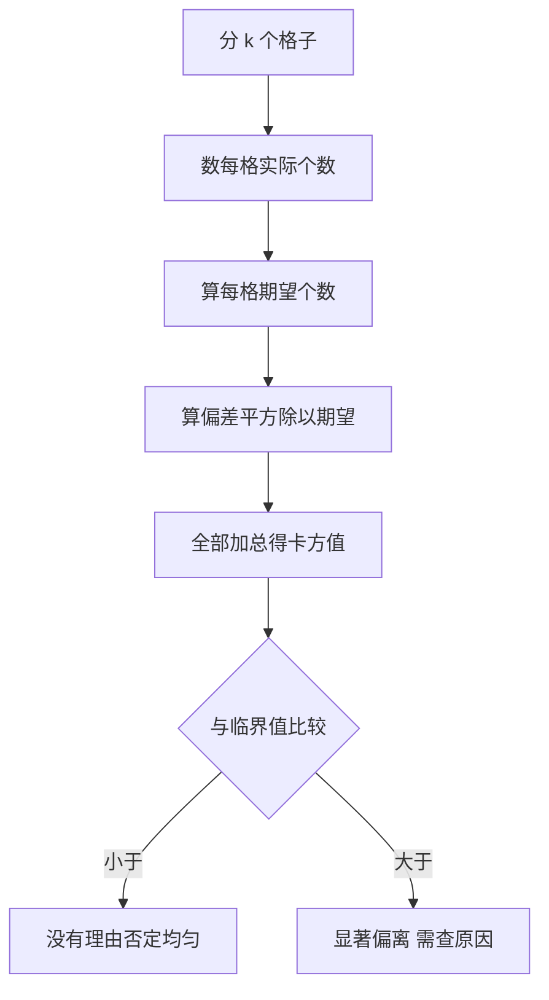

# 卡方检验

- **难度**：基础 | **涉及章节**：第 2 章

## 一句话定义

卡方检验比较观测频数与理论期望频数的偏差，把所有格子的「偏差平方除以期望」加起来得到一个统计量，再与临界值比较。

## 为什么重要

它是检验伪随机数均匀性最常用的工具，也是所有「实际分布是否符合预期」问题的通用模板。理解了它，就理解了假设检验的基本逻辑：先假设「没问题」，再看数据偏离得是否离谱。

## 图示

看最后的分叉：结论只有「没查出问题」与「查出问题」两种，不存在「证明均匀」。

## 详解

公式：χ² = Σ (O − E)² / E。

**实例**：骰子 60 次，六面计数 8、12、9、11、10、10，期望各 10。
χ² = (4+4+1+1+0+0)/10 = 1.0。自由度 5，5% 临界值 11.07，1.0 远小于它，不显著。

**自由度**：格子数减 1。因为频数总和被样本量固定，最后一个格子的值是推出来的。

**期望频数下限**：每格期望不小于 5，否则卡方分布近似失效，要合并格子。

## 常见误解

- 别以为卡方值小就一定好：接近 0 说明「整齐得不像抽样」。
- 别以为通过检验就证明随机：只证明这批数据没暴露问题。

## 在书中出现的脉络

| 章节 | 语境 | 关键结论 |
|---|---|---|
| 3.3.1 | 一般检验过程 | 卡方的构造与自由度 |
| 3.3.2 | 经验检验 | 对具体发生器做卡方 |
| 3.3.4 | 谱检验 | 另一种相关性的检验 |

## 相关概念

- 前置：[线性同余发生器](linear-congruential.md)
- 后续：卷3 排序的平均情况分析
