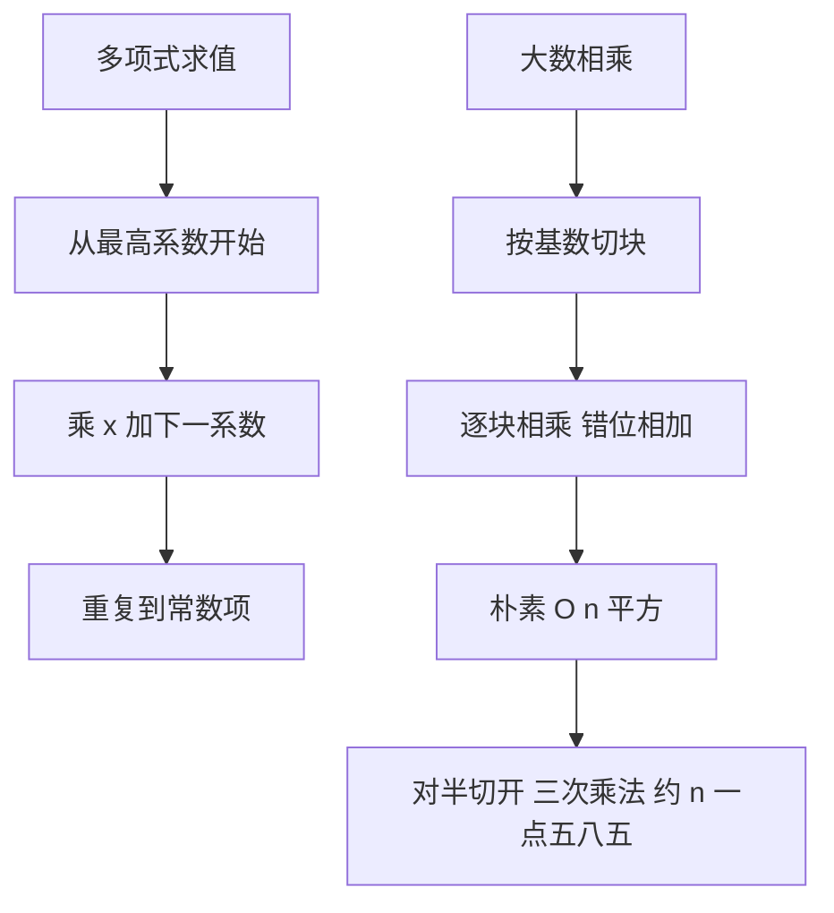

# 秦九韶法则与多精度乘法

- **难度**：进阶 | **涉及章节**：第 3、4 章

## 一句话定义

秦九韶法则（Horner）把 n 次多项式求值化成 n 次乘加；多精度乘法把大整数切块，用竖式逐块相乘，朴素代价 O(n²)。

## 为什么重要

这两件事看起来无关，其实共享同一个思路：**把高次问题拆成逐层递推**。秦九韶把「求幂」拆成「每层乘一次 x」；多精度乘法把「大数相乘」拆成「小块相乘再进位」。后者再往前走一步，就是快速乘法。

## 图示

看两条线的共同点：都是「从一端开始，每步只做一次小运算，把结果交给下一步」。

## 详解

**Horner 实例**：p(x)=2x³+3x²+5x+7，x=2。
2 → 2×2+3=7 → 7×2+5=19 → 19×2+7=45。直接代入也是 45，两条路必须对上。

**多精度实例**：按十进制竖式算 47×23。
3×47=141；2×47=94 左移一位得 940；141+940=1081。

**代价对照**：Horner 是 O(n)；朴素多精度乘法是 O(n²)；快速乘法用三次半规模乘法替代四次，得 T(n)=3T(n/2)+O(n)，即 O(n^1.585)。

## 常见误解

- 别以为 Horner 只适用于多项式：进制转换的「乘基累加」就是它。
- 别以为快速乘法总要更快：小规模时递归开销超过收益，要设阈值。

## 在书中出现的脉络

| 章节 | 语境 | 关键结论 |
|---|---|---|
| 4.3.1 | 经典算法 | 竖式乘法与进位 |
| 4.3.3 | 乘法有多快 | 快速乘法的递归式 |
| 4.6.4 | 多项式求值 | 秦九韶法则 |

## 相关概念

- 前置：[卡方检验](chi-square-test.md)
- 后续：卷4 组合计数的生成函数
