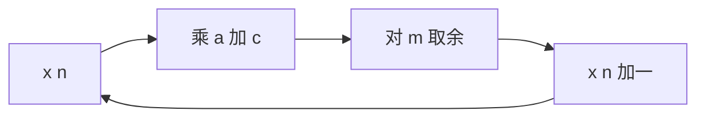

# 线性同余发生器

- **难度**：进阶 | **涉及章节**：第 1 章

## 一句话定义

线性同余发生器用一条递推产生伪随机序列：x(n+1) = (a·x(n) + c) mod m，用模运算把状态压在 0 到 m−1 之间。

## 为什么重要

它是历史上用得最广、分析得最透的伪随机数算法。理解它的三个参数如何决定周期，就理解了一个基本事实：伪随机性的质量有数论上的硬约束，不是调参调出来的。

## 图示

看这个环：状态只有 m 个可能值，所以周期必然不超过 m。满周期就是把 m 个值全走一遍。

## 详解

**参数的作用**：
- m 决定状态空间大小，也就是周期的上限。
- a 决定状态怎么跳。
- c 决定是否包含 0 这个状态；c = 0 时叫纯乘同余，0 是死点，必须避开。

**满周期三条件**：gcd(c, m) = 1；a−1 被 m 的所有素因子整除；m 被 4 整除时 a−1 也被 4 整除。

**实例**：m=16、a=5、c=3、x0=1，三条全满足，序列走遍 0 到 15，周期 16。

**取余的代价**：模取 2 的幂可用按位与代替除法，但低位周期短（第 k 位周期最多 2^(k+1)）；模取素数高低位都长，但要真除法。实践里常见做法是模取 2^31−1，或用两个发生器组合。

## 常见误解

- 别以为周期等于 m 就好：顺序可能极有规律，还要看谱检验。
- 别以为改种子能提高质量：种子只改变起点，不改周期结构。

## 在书中出现的脉络

| 章节 | 语境 | 关键结论 |
|---|---|---|
| 3.2.1 | 线性同余 | 递推式与满周期条件 |
| 3.2.1.3 | 势 | 乘数对低位的混合速度 |
| 3.3 | 检验 | 谱检验查多维相关性 |

## 相关概念

- 前置：卷1 第 2 章的模运算
- 后续：[卡方检验](chi-square-test.md)
