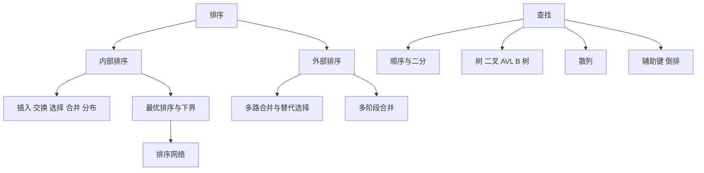

# 计算机程序设计艺术 卷3：排序与查找 点化学习系统

## 这本书在讲什么

这一卷只做两件事：排序与查找。但它不满足于「会写代码」，而是把每种方法的比较次数、移动次数、读写趟数都算到常数级，再用信息论给出 n log n 的下界，最后用散列把查找压到常数级。读完你会有一个判断标准：面对一个具体场景，选哪种结构、代价大概多少、什么时候会退化。

## 全书心智模型

## 学习路径（推荐顺序）

| 步骤 | 主题 | 章节 | 检查点 |
|---|---|---|---|
| 01 | 先看清排序的组合结构 | ch01 | 能数逆序对、算多重集排列数、说出平均游程数 |
| 02 | 五类内部排序与取舍 | ch02 | 能针对四个场景各选一种算法并说出理由 |
| 03 | 下界与排序网络 | ch03 | 能推出 log2 n! 下界，能用 0-1 原理验证小网络 |
| 04 | 外部排序 | ch04 | 能算合并趟数与替代选择的游程长度 |
| 05 | 查找结构与 B 树 | ch05 | 能算二分与 B 树的层数，解释 AVL 的最坏保证 |
| 06 | 散列与辅助键 | ch06 | 能按装载因子估算平均查找长度，解释墓碑的必要性 |

## 章节索引

- 第 1 章：排序的组合性质（难度 ★★☆，约 4 小时）→ [chapters/ch01-排序的组合性质.md](chapters/ch01-排序的组合性质.md)
- 第 2 章：内部排序——五类算法与它们的代价（难度 ★★★，约 7 小时）→ [chapters/ch02-内部排序.md](chapters/ch02-内部排序.md)
- 第 3 章：最优排序——比较次数的下界与排序网络（难度 ★★★，约 5 小时）→ [chapters/ch03-最优排序.md](chapters/ch03-最优排序.md)
- 第 4 章：外部排序——数据比内存大怎么办（难度 ★★★，约 5 小时）→ [chapters/ch04-外部排序.md](chapters/ch04-外部排序.md)
- 第 5 章：查找——从顺序扫到平衡树（难度 ★★★，约 6 小时）→ [chapters/ch05-查找.md](chapters/ch05-查找.md)
- 第 6 章：散列查找与辅助键（难度 ★★★，约 5 小时）→ [chapters/ch06-散列与辅助键.md](chapters/ch06-散列与辅助键.md)

## 前置知识（零基础缺口补讲）

| 缺口 | 补讲位置 | 学完标志 |
|---|---|---|
| 树的遍历与高度 | ch05 概念 3 | 能手写二叉树中序遍历，能说出满二叉树与完全二叉树的差别 |
| 对数的换底与阶乘估算 | ch03 概念 1 | 知道 log2 100 约等于 6.64，能用斯特林公式粗估 n! |
| 磁盘 I/O 的基本模型 | ch04 概念 1 | 能说出顺序读与随机读的差别，知道「按块读」的含义 |

## 术语表 / 模式库 / 速查表

- 术语：[glossary.md](glossary.md)
- 模式库：[patterns.md](patterns.md)
- 速查表：[cheatsheet.md](cheatsheet.md)
- 测验：[quiz.md](quiz.md)
- 抽认卡：[flashcards.md](flashcards.md)

## 怎么学

打开同目录的 `taocp-v3学习伴侣.html`，按「学习路径」推进。每章读完做自测题，答对再走下一步。
