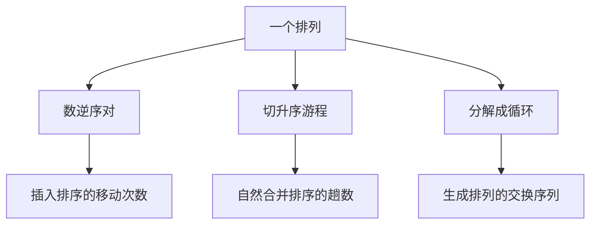

# 第 1 章：排序的组合性质

- **难度**：★★☆ | **预估学时**：4 小时 | **前置**：卷1 第 2 章（排列与二项式系数）

## 学习目标

学完本章，你能：
1. 数出一个排列里的逆序对，并说明它和插入排序移动次数的关系。
2. 算多重集排列的种数。
3. 说出「游程」是什么，以及随机排列的平均游程数。
4. 解释研究这些组合量对分析排序算法有什么用。

## 一句话核心

排序算法的平均代价，几乎都能写成「某个组合量的期望」；先把组合量算清楚，后面各节的复杂度公式才有依据。

## 零基础讲解

### 概念 1：逆序（反序）与逆序对（难度：基础）

在一个排列里，如果前面的数比后面的大，这一对就叫一个**逆序对**。

**实例**：排列 3, 1, 4, 2。
- (3,1)：3 > 1，是
- (3,4)：不是
- (3,2)：3 > 2，是
- (1,4)：不是
- (1,2)：不是
- (4,2)：4 > 2，是

共 3 个逆序对。

**它为什么重要**：插入排序每把一个元素往左挪一格，就消除恰好一个逆序对。所以**插入排序的移动次数 = 初始逆序对数**。

**平均逆序对数**：所有 n! 个排列平均下来是 n(n−1)/4。n = 4 时是 3，正好等于上面那个排列的逆序对数（巧合而已，不是每个排列都等于 3）。

### 概念 2：多重集的排列（难度：基础）

如果 n 个对象里有重复，全排列数要除以重复组的阶乘：

种数 = n! / (n1! n2! … nk!)

其中 ni 是第 i 类重复对象的个数。

**实例**：字母 A、A、B 三个字符的排列。3!/(2!1!) = 3，实际是 AAB、ABA、BAA 三种。
**实例**：A、A、B、B 四个字符：4!/(2!2!) = 6。

**为什么这样除**：把重复的对象先当成不同的，有 n! 种；每一种真实排列被重复数了 n1!×n2!×… 次（每个重复组内部怎么换都得到同一个排列）。

### 概念 3：游程（难度：进阶）

把排列从左往右扫，一段连续递增的最长子序列叫一个**升序游程**。整条排列可以切成若干游程。

**实例**：3, 5, 7, 1, 2, 9, 4 的升序游程是 [3,5,7]、[1,2,9]、[4]，共 3 段。

**平均游程数**：随机排列的期望升序游程数是 (n+1)/2。n = 7 时约 4 段，与上例的 3 段接近（样本只有一个，不必强求相等）。

**它为什么重要**：自然合并排序（natural merge sort）就是先找出这些游程，再把相邻游程两两合并。初始游程越少，合并趟数越少。这就是「输入已有的有序性」被利用的地方。

### 概念 4：置换的循环结构与对合（难度：进阶）

任何置换都能唯一分解成若干个互不相交的循环。例如把 1→3、3→2、2→1、4→4 写成 (1 3 2)(4)。

- 一个循环里元素的个数叫循环长度。
- 长度全为 1 的置换是恒等置换。
- **对合**是「做两次回到原样」的置换，它的循环长度只能是 1 或 2。

**实例**：交换 1 与 2、固定 3 的置换是 (1 2)(3)，做两次回到原样，是对合。
**用途**：卷4 生成排列时会用到「相邻交换」的格雷码路径，那条路径正是由对合式的交换序列构成的。

## 图示

**看图说明**：同一个排列可以量出三种「结构量」，各自对应一种排序或生成算法的代价。这张图说明为什么第 5 章要先把组合性质讲完再讲算法。

## 类比与实例

- 类比：逆序对像排队时「站错位置」的人数。每纠正一个人，就少一处错位；插入排序就是一个一个纠正。
- 类比失效：现实排队里两个人换位可能同时纠正多处错位（一次交换消除两个逆序对），逆序对与移动次数不再一一对应。这就是为什么交换类排序不能用「逆序对数」直接算代价。

**实例（游程与合并趟数）**：n = 16 的排列切成 8 段游程。第一趟两两合并变 4 段，第二趟 2 段，第三趟 1 段，共 3 趟。若切成 16 段（完全无序），则要 4 趟。游程越少越省。

## 常见误解

- **别以为逆序对数等于交换次数**——实际上一次交换最多消除两个逆序对，也可能一个都不消除（换错位置时）。
- **别以为平均逆序对数是 n²/4 就说明「平均情况很慢」**——实际上它恰好说明插入排序平均是 O(n²)，与实测一致。
- **别把游程当成「已经排好的段」**——游程只要求段内递增，段与段之间没有顺序关系。

## 自测题（答案）

1. 填空题：排列 4, 3, 2, 1 的逆序对数是多少？（填数字）
（答案：6；解析：每一对都是逆序，(4,3)(4,2)(4,1)(3,2)(3,1)(2,1) 共 6 个，正好是 C(4,2)=6。）

2. 单选题：A、A、B、B 四个字符共有多少种不同排列？
A. 4 B. 6 C. 12 D. 24
（答案：B；解析：4!/(2!2!) = 24/4 = 6。）

3. 简答题：为什么插入排序的移动次数恰好等于初始逆序对数？
（答案：每把第 i 个元素往左挪一格，它与左边那个更大的元素构成一个逆序对，挪过去就消除了这一个；挪到正确位置时它左边的都不大于它，逆序对清零。总移动次数等于被消除的逆序对总数。）

## 复习锚点

- 逆序对：前大后小的一对；平均 n(n−1)/4。
- 多重集排列数 = n! 除以各重复组阶乘。
- 升序游程的期望段数是 (n+1)/2，自然合并排序按游程工作。
