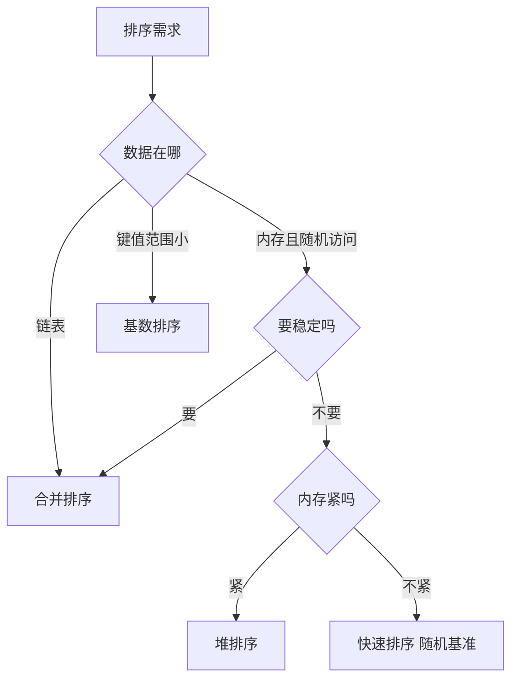

# 第 2 章：内部排序——五类算法与它们的代价

- **难度**：★★★ | **预估学时**：7 小时 | **前置**：第 1 章（逆序与游程）；卷1 第 1 章（复杂度）

## 学习目标

学完本章，你能：
1. 按「插入、交换、选择、合并、分布」五类给常见排序算法归类。
2. 说清快速排序平均 O(n log n)、最坏 O(n²) 的触发条件。
3. 解释堆排序为什么最坏也是 O(n log n)，代价在哪里。
4. 判断一个场景该用哪种排序：数据近乎有序、内存紧张、键值范围小。

## 一句话核心

内部排序的全部差别，可以归结为两个问题：**比较出多少信息、数据搬多少次**。五类算法就是五种不同的取舍。

## 零基础讲解

### 概念 1：插入类（难度：基础）

**直接插入**：把第 i 个元素插进前面已经排好的部分，从后往前找位置，边找边挪。

- 最好情况（已有序）：每个元素只比较一次，O(n)。
- 最坏情况（完全逆序）：移动次数是逆序对数 n(n−1)/2，O(n²)。
- 平均：O(n²)。
- 稳定：相等元素不会交换相对次序。

**折半插入**：找位置时用二分，比较次数降到 O(n log n)，但挪动仍是 O(n²)，总代价没变。

**希尔排序**：先按较大间隔分组做插入排序，再逐步缩小间隔。它是插入类里少见的能到 O(n^1.3) 左右的算法，但复杂度分析至今没有完全定论。

### 概念 2：交换类（难度：进阶）

**冒泡排序**：相邻比较，逆序就交换，每一趟把最大值推到末尾。O(n²)，稳定，几乎没有实用价值，但它是「逆序对」最直观的演示。

**快速排序**：选一个基准（pivot），把比它小的放左边、大的放右边，再对左右两段递归。

- 平均 O(n log n)：每次划分大致对半。
- 最坏 O(n²)：每次划分都极不均衡。典型触发是「输入已经有序，却取第一个元素当基准」。
- 空间 O(log n)：递归栈深度。
- 不稳定。

**避免最坏的两个办法**：随机选基准，或取头、中、尾三个数的中位数当基准。

### 概念 3：选择类（难度：进阶）

**直接选择**：每趟从剩余元素里找最小的，与当前位置交换。比较次数固定 n(n−1)/2，与输入无关；交换次数最多 n−1。不稳定。

**堆排序**：先把数组建成大顶堆（O(n)），再反复把堆顶与末尾交换、缩小堆、下沉调整。

- 建堆 O(n)，每次下沉 O(log n)，共 n 次，总 O(n log n)。
- 最坏也是 O(n log n)，这是它相对快排的优势。
- 原地排序，空间 O(1)；但不稳定，且常数比快排大，实际常比快排慢。

**实例（下沉一次）**：堆 [9, 7, 8, 3, 5]，把堆顶 9 与末尾 5 交换得 [5, 7, 8, 3, 9]，堆区缩小为前四个。5 下沉：与较大的孩子 8 交换，得 [8, 7, 5, 3]。堆恢复。

### 概念 4：合并类（难度：进阶）

**二路合并排序**：把数组对半切，两段各自排好，再合并。合并时两个指针各扫一遍，O(n)。

- 总代价：T(n) = 2T(n/2) + O(n)，展开得 O(n log n)。
- 稳定。
- 代价是需要 O(n) 的额外空间。

**为什么合并能做到 O(n)**：两段已经有序，每次只需比较两个队首，取小的那个，指针前移一格，不需要回头。

### 概念 5：分布类（难度：进阶）

**基数排序**：不比较元素大小，而是按「位」分配。从最低位开始，每一轮按该位把元素分到若干个桶，再按桶序收集；做完最高位，整体有序。

- 代价 O(d(n + k))，d 是位数，k 是基数。
- 当 d 很小、k 不大时，是线性时间。
- 稳定（这是它能从低位往高位做的前提）。

**实例**：对 12、3、25 按十进制基数排序。
- 个位分配：3 → 桶 3；12 → 桶 2；25 → 桶 5。收集：12、3、25。
- 十位分配：12 → 桶 1；3 → 桶 0；25 → 桶 2。收集：3、12、25。有序。

### 概念 6：怎么选（难度：进阶）

| 场景 | 选择 | 理由 |
|---|---|---|
| 数据近乎有序 | 直接插入 | 最好情况 O(n) |
| 内存极紧、要最坏有保证 | 堆排序 | 原地，最坏 O(n log n) |
| 通用、要求平均快 | 快速排序 | 常数小，缓存友好 |
| 要求稳定 | 合并排序 | 稳定且 O(n log n) |
| 键值范围小、位数少 | 基数排序 | 线性时间 |
| 链表结构 | 合并排序 | 不需要随机访问 |

## 图示

**看图说明**：先问「数据在哪」再问「要不要稳定」，这两个问题基本就决定了算法。剩下的差别是常数与实现难度。

## 类比与实例

- 类比：插入排序像整理一手扑克牌，一张张插进已经排好的牌里；合并排序像两组已经排好的牌，每次从两叠顶上看一张小的；基数排序像先按个位把牌分堆，再按十位分堆。
- 类比失效：扑克牌只有 52 张，牌数一大，手就不可能同时握住；真实算法的「手」是内存，容量与访问速度才是关键约束。

**实例（快排一次划分）**：数组 [5, 3, 8, 4, 2]，基准取 5。
- 3 < 5，留左边；8 > 5，留右边；4 < 5，与 8 交换 → [5, 3, 4, 8, 2]；2 < 5，与 8 交换 → [5, 3, 4, 2, 8]。
- 基准 5 与 2 交换 → [2, 3, 4, 5, 8]。
左边 [2,3,4] 全小于 5，右边 [8] 大于 5，划分完成。

## 常见误解

- **别以为快排最坏 O(n²) 只是理论**——实际上对已排序数据取首元素当基准，就会稳定触发。
- **别以为堆排序比快排快**——实际上它最坏有保证，但常数大、缓存不友好，平均常慢于快排。
- **别以为基数排序不需要「比较」就更快**——实际上它依赖键的位数与基数，键很长时 d 很大，未必比 O(n log n) 快。

## 自测题（答案）

1. 单选题：对已经升序排列的数组取首元素为基准做快排，复杂度是？
A. O(n) B. O(n log n) C. O(n²) D. O(log n)
（答案：C；解析：每次划分都一边空一边全，递归深度 n，总代价 n²。）

2. 填空题：堆排序建堆的代价是 O(___)。
（答案：n；解析：自底向上建堆的总代价是 O(n)，不是 O(n log n)，因为大部分节点在下层、下沉距离短。）

3. 简答题：为什么基数排序必须稳定？
（答案：低位排完后，高位相同的元素要保持低位的相对次序；若高位分配时打乱了低位结果，最终就不有序。）

## 复习锚点

- 五类：插入、交换、选择、合并、分布。
- 快排平均 O(n log n)、最坏 O(n²)；堆排序最坏 O(n log n)；合并稳定但要额外空间。
- 基数排序 O(d(n+k))，稳定的前提是从低位到高位。
