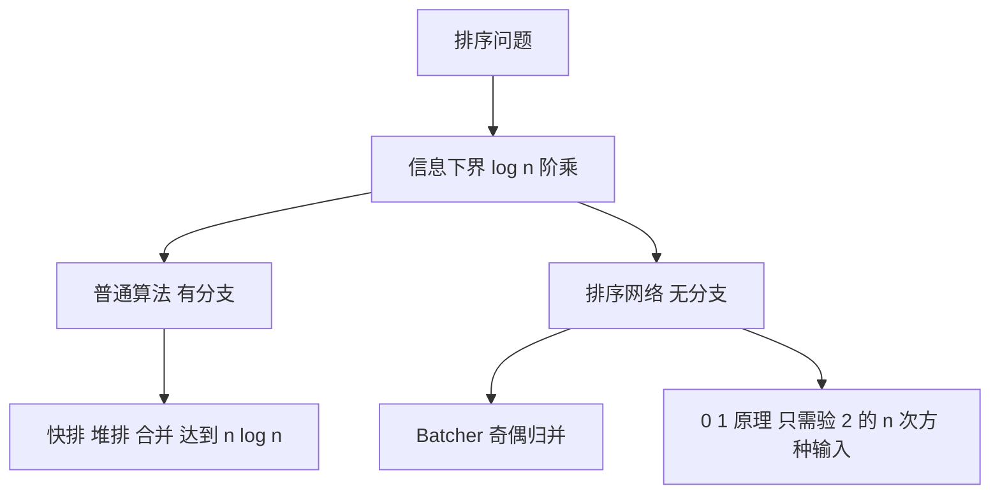

# 第 3 章：最优排序——比较次数的下界与排序网络

- **难度**：★★★ | **预估学时**：5 小时 | **前置**：第 2 章；log 与阶乘的估算

## 学习目标

学完本章，你能：
1. 用比较树推出「排序至少需要约 n log2 n 次比较」。
2. 算出小规模下确切的比较次数下界（如 3 个元素、5 个元素）。
3. 说清 0-1 原理，并解释它为什么能把检验工作从 2^n 类输入压到一类。
4. 说出排序网络与比较排序的根本差别。

## 一句话核心

n log n 不是某个算法的性能，而是**问题本身的信息量下限**；任何只靠比较的排序都逃不掉。

## 零基础讲解

### 概念 1：比较树与信息下界（难度：进阶）

把排序过程看成一棵判断树：
- 每个内部节点是一次比较（a 与 b 谁大）。
- 每条边是一个比较结果（小于或大于）。
- 每个叶子是一个可能的输出排列。

要正确排序 n 个元素，n! 种输入排列必须分别落到能输出正确结果的叶子上，所以叶子至少 n! 个。

一棵二叉树有 L 个叶子时，高度至少 log2 L。因此最坏情况的比较次数 ≥ log2(n!)。

**实例**：
- n = 3：log2 6 ≈ 2.58，向上取整得 3。3 次比较够（先比 a,b，再比 b,c，再按结果补一次）。
- n = 5：log2 120 ≈ 6.91，向上取整得 7。5 个元素最坏情况至少 7 次比较，且 7 次可以做到。
- n = 100：log2(100!) ≈ 525，而 n log2 n = 664，两者同阶。

**公式近似**：log2(n!) ≈ n log2 n − 1.4427 n + O(log n)。那个 1.44 的系数是 1/ln 2。

### 概念 2：最优排序与「节约一次比较」（难度：高难）

对小 n，Knuth 给出了确切的最优比较次数：

| n | 最坏情况最少比较次数 |
|---|---|
| 1 | 0 |
| 2 | 1 |
| 3 | 3 |
| 4 | 5 |
| 5 | 7 |
| 6 | 10 |

注意 5 个元素只要 7 次，而朴素插入排序最坏要 10 次。省下来的方式是「先做几次比较收集信息，再决定后面怎么比」，而不是固定流程。

**为什么 n 一大就难**：可能的比较策略爆炸式增长，最优策略难以构造，实践里用 O(n log n) 的算法接受一点点次优。

### 概念 3：排序网络（难度：高难）

排序网络是一组固定的比较器，每个比较器连接两根线，把较大的送到下方、较小的送到上方。**没有分支**，所有比较同时按层进行。

**它和普通排序的差别**：
- 普通排序的比较顺序依赖前面的结果（有分支）。
- 排序网络的比较顺序完全固定，适合硬件并行、GPU 实现。

**0-1 原理**：如果一个排序网络能把所有 2^n 种「只含 0 和 1」的输入排好，那么它能把任意输入排好。

**为什么成立**（直觉）：比较器的行为只取决于「谁大」。把任意输入按某个阈值切成 0/1，若网络对每种切法都排好，则原输入也排好。这条原理把检验从「所有排列」压到「2^n 种 0/1 串」，工作量小得多。

**Batcher 奇偶归并网络**：把两段已排序的序列按奇偶下标分开归并，递归构造。规模 O(n log² n)，深度 O(log² n)。

**实例（4 输入网络）**：比较 (1,2)、(3,4)，再比较 (1,3)、(2,4)，最后比较 (2,3)。四层比较器，能排好任意 4 个输入。

## 图示

**看图说明**：两条分支共享同一个下界。排序网络的优势不在比较次数更少（它通常更多），而在「无分支、可并行」。

## 类比与实例

- 类比：比较排序像查字典，查到一半就知道该往左还是往右翻；排序网络像洗牌机，不管牌面是什么，固定地把指定位置的两张牌比一下、大的放右边。
- 类比失效：洗牌机的动作固定，但它的比较器数量是人工设计的；真实的排序网络规模随 n 增长，设计本身是组合难题。

**实例（0-1 原理的用法）**：要验证一个 4 输入网络，不必测 24 种排列，只需测 16 种 0/1 串：0000、0001、…、1111。全部排好，就说明它对任意 4 个数字都正确。

## 常见误解

- **别以为 n log n 是所有排序的下限**——实际上只是「基于比较」的下限。基数排序不比较，可以到线性。
- **别以为排序网络比较次数少**——实际上它通常比最优比较排序多，胜在无分支和并行。
- **别以为 0-1 原理是近似**——实际上它是严格等价的判定条件。

## 自测题（答案）

1. 填空题：5 个元素排序，最坏情况至少需要多少次比较？（填数字）
（答案：7；解析：log2(5!) = log2 120 ≈ 6.91，向上取整为 7，且存在 7 次比较的最优算法。）

2. 单选题：排序网络的核心优势是？
A. 比较次数最少 B. 无分支、可并行 C. 不需要额外空间 D. 稳定
（答案：B；解析：网络结构固定，所有比较按层同时进行，适合硬件实现；比较次数通常反而更多。）

3. 简答题：0-1 原理为什么能把验证工作大幅减少？
（答案：只需验证 2^n 种 0/1 输入，而不是 n! 种排列；任意输入可按阈值切成 0/1，若每种切法都被排好，原输入也必被排好。）

## 复习锚点

- 比较排序下界 log2(n!)，约 n log2 n。
- 小 n 的最优比较次数：3 个元素 3 次，5 个元素 7 次。
- 0-1 原理：验 2^n 种 0/1 输入即可判定整个网络。
