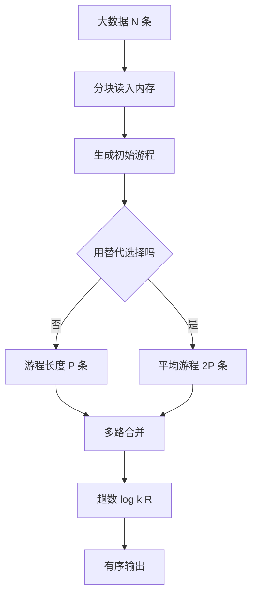

# 第 4 章：外部排序——数据比内存大怎么办

- **难度**：★★★ | **预估学时**：5 小时 | **前置**：第 2 章（合并排序）

## 学习目标

学完本章，你能：
1. 说清外部排序为什么以「读写次数」而不是「比较次数」衡量代价。
2. 算出给定初始游程数与路数时的合并趟数。
3. 解释替代选择为什么能把平均游程长度做到缓冲区容量的两倍。
4. 说出多阶段合并解决的现实问题。

## 一句话核心

外部排序的瓶颈不在 CPU，在磁盘；所以一切设计都围绕**减少读写趟数**，哪怕多花比较。

## 零基础讲解

### 概念 1：初始游程（难度：基础）

内存装不下全部数据，先分块读进来，每块内部排好，写回磁盘，形成一个**有序游程**（run）。这一步叫「生成初始游程」。

若内存能放 P 条记录，朴素做法每块产生长度 P 的游程；数据总量 N 条，就有 N/P 个游程。

**代价**：读一遍、写一遍，各 N 条。

### 概念 2：替代选择（难度：进阶）

朴素分块浪费了内存：块与块之间没有利用「刚写出去的最小元素可能比下一块的最大元素还小」这个事实。

**替代选择**的做法：把内存当成一个堆，先装满 P 条。每次取出堆顶（最小）写出，再从输入读一条进来：
- 若新读的比刚写的大，它可以留在当前游程里，堆调整后继续。
- 若新读的比刚写的小，它不能进当前游程，先存到「保留区」，等下一个游程用。

**效果**：随机输入下，平均游程长度约为 2P，也就是游程数减半，合并趟数少一趟。

**实例**：P = 4，输入序列 5, 2, 9, 1, 7, 3。
- 装满 [5,2,9,1] 建堆，堆顶 1。写出 1，读 7（7 > 1，可进当前游程）。
- 堆顶 2，写出 2，读 3（3 > 2，可进）。
- 堆顶 5，写出 5，输入已空，当前游程继续把堆里剩下的 7、9 写完 → 游程 [1,2,5,7,9]，长度 5，超过 P = 4。

### 概念 3：k 路合并与趟数（难度：基础）

把 k 个游程同时合并成一个：每次从 k 个游程的队首取最小的。用败者树或堆，每次取最小是 O(log k)。

**趟数公式**：R 个初始游程，k 路合并，趟数 = 向上取整的 log_k R。

**实例**：R = 1000，k = 4。
4⁴ = 256 < 1000，4⁵ = 1024 ≥ 1000，所以要 5 趟。

**每趟代价**：读 N 条、写 N 条（最后一遍只读不写）。总读写量约为 2N × 趟数。

**k 是不是越大越好**：k 大则趟数少，但 k 个输入缓冲区要占内存，每个缓冲区太小又会增加读块次数。实践里 k 常取几十到几百。

### 概念 4：多阶段合并（难度：高难）

磁带只能顺序读写，台数有限（历史上常见 3 到 6 台）。k 路合并需要 k 台输入加 1 台输出，台数一紧就做不了。

**多阶段合并**用「不均匀分配」解决：不要求每台磁带的游程数一样，而是按 Fibonacci 数分配，让合并过程中始终有一台空带可以当输出，轮流使用。

**实例（3 台磁带、Fibonacci 分配）**：初始游程数按 1、2、3、5、8… 分配，合并时把最短的两段并到空带上，始终维持「有一段空带」的状态。

**级联合并**是它的推广：允许更多磁带、更复杂的分配表，减少「空转」。

### 概念 5：反向读取与振荡（难度：高难）

磁带合并时，若能把上一次写的磁带反着读，就不必倒带，直接接着上一趟的尾部继续。**振荡排序**（oscillating sort）利用这一点，让读的方向在趟与趟之间交替，省掉倒带时间。

**这几节为什么今天还要看**：思路仍然适用于现代存储。SSD 虽然随机访问快，但顺序读写仍远快于随机；「减少趟数、尽量顺序」的原则没变。

## 图示

**看图说明**：两个箭头最终汇到同一个合并环节，但游程数不同——替代选择把 R 减半，直接省下一整趟读写。这就是它值得单独讲的原因。

## 类比与实例

- 类比：外部排序像整理一屋子书，桌子只能放 100 本。先把每 100 本排好堆成一摞，再把几摞同时摊开，每次取最小的一本放成大摞。
- 类比失效：书可以随手抽，磁盘不行；磁盘按块读，随机访问有寻道开销，所以「块大小」也是设计参数。

**实例（算总代价）**：N = 10⁸ 条，P = 10⁶ 条，k = 10。
- 朴素游程数 R = 100，趟数 log10 100 = 2。
- 用替代选择，R = 50，趟数 log10 50 ≈ 1.7，向上取整仍是 2 趟，但第二趟的输入少了一半。
- 总读写量：朴素约 2×10⁸×2 = 4×10⁸ 条记录，替代选择约 3×10⁸ 条。

## 常见误解

- **别以为外部排序比内部排序「算法更复杂」**——实际上核心就是合并排序加缓冲区管理，复杂的是调度。
- **别以为 k 越大越好**——实际上 k 受内存限制，缓冲区太小会让每次读的块变碎，反而更慢。
- **别以为多阶段合并已经过时**——实际上「不均匀分配 + 轮流用空带」的思想在分布式归并与日志合并树里仍在用。

## 自测题（答案）

1. 填空题：1000 个初始游程做 4 路合并，需要多少趟？（填数字）
（答案：5；解析：4⁴ = 256 不够，4⁵ = 1024 够，所以 5 趟。）

2. 单选题：替代选择在随机输入下的平均游程长度约为内存容量的多少倍？
A. 0.5 B. 1 C. 2 D. 4
（答案：C；解析：Knuth 的分析给出平均约 2P，P 为缓冲区可容纳的记录数。）

3. 简答题：多阶段合并要解决的是什么问题？
（答案：磁带台数有限，k 路合并需要 k 台输入加 1 台输出，台数不够；多阶段用 Fibonacci 式的不均匀分配，让合并过程中始终有一台空带可作输出。）

## 复习锚点

- 外部排序以读写趟数计代价；趟数 = log_k R。
- 替代选择让平均游程达 2P，游程数减半。
- 多阶段合并用不均匀分配解决磁带台数不足。
