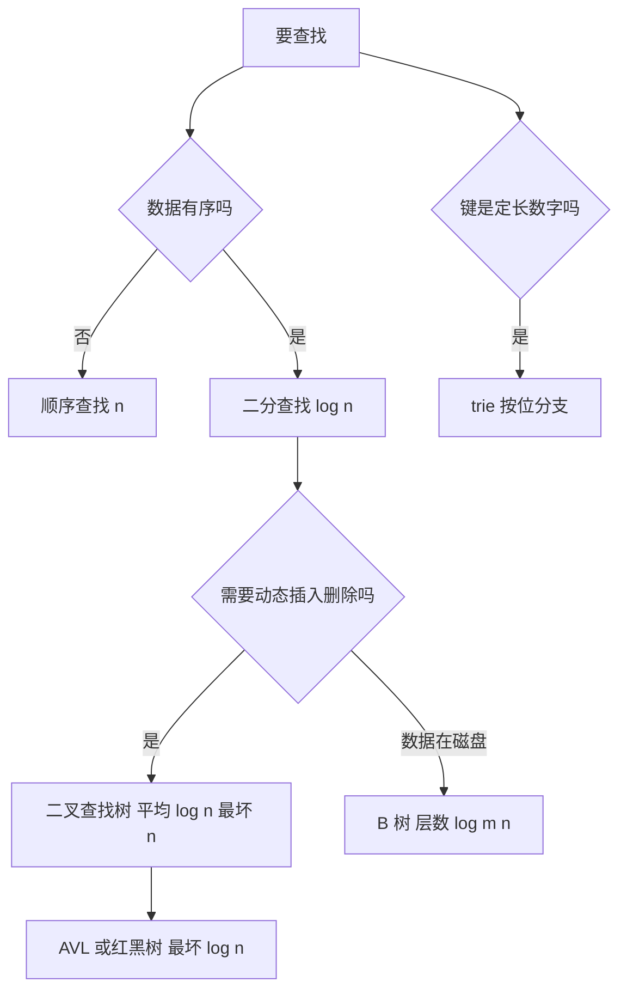

# 第 5 章：查找——从顺序扫到平衡树

- **难度**：★★★ | **预估学时**：6 小时 | **前置**：第 2 章；卷1 第 2 章（树的数学性质）

## 学习目标

学完本章，你能：
1. 算出顺序查找与二分查找的平均、最坏比较次数。
2. 解释二叉查找树平均 O(log n)、最坏 O(n) 的原因。
3. 说清 AVL 树靠什么把高度控制在约 1.44 log2 n。
4. 算出 B 树的层数，并解释为什么数据库索引用它而不是二叉树。

## 一句话核心

查找的代价取决于**数据怎么组织**：无序只能扫，有序能折半，树把折半变成动态结构，多路树把「层数」换成「扇出」。

## 零基础讲解

### 概念 1：顺序查找（难度：基础）

从第一个元素开始逐个比较，找到就返回。

- 成功查找平均比较次数：(n+1)/2（假设每个位置等概率被查）。
- 失败查找：n 次。
- **哨兵技巧**：把要查的键放在数组末尾当哨兵，循环里就不必每次判断「是否越界」，比较次数不变但每轮少一次判断。

**适用**：数据量小、无序、或只在链表上查找。

### 概念 2：二分查找（难度：基础）

要求数据**有序且能随机访问**。每次比较中间元素，排除一半。

- 最坏比较次数：约 log2 n 次（准确说是向上取整的 log2(n+1)）。
- 前提：有序；数组（链表不行，因为取中间要 O(n)）。

**实例**：在 1 到 9 中查 7。
- 中间是 5，7 > 5，看右半 6 到 9。
- 右半中间是 7（取下中位数），命中。共 2 次比较。
- 最坏是查 9 或 1，需要 4 次。

### 概念 3：二叉查找树（难度：进阶）

每个节点满足：左子树所有键小于它，右子树所有键大于它。查找时一路向下比较。

- 平均查找长度约 2 ln n ≈ 1.39 log2 n。
- 最坏 O(n)：按升序依次插入，树退化成一条链。
- 删除节点分三种情况：叶子直接删；只有一个孩子用孩子顶替；有两个孩子用中序后继（右子树最小）顶替。

**实例**：依次插入 3、1、5、2 得到：
- 3 为根，1 在左，5 在右，2 在 1 的右边。
查 2：3 → 1 → 2，3 次比较。

### 概念 4：平衡树（难度：高难）

AVL 树要求每个节点的左右子树高度差不超过 1。插入或删除破坏了平衡，就通过**旋转**恢复。

- 高度上界：约 1.44 log2(n+2) − 0.33，比二叉查找树的平均情况只差一点，但**最坏也有保证**。
- 四种失衡情形：左左、左右、右左、右右；左右与右左需要双旋。
- 代价：每次插入/删除最多 O(log n) 次旋转，常数比普通二叉查找树大。

**红黑树**是另一种平衡方案，平衡条件更松（最长路径不超过最短的两倍），插入删除的旋转次数更少，工程里更常用。

### 概念 5：多路树与 B 树（难度：高难）

二叉树的每个节点只有两个孩子，树高 log2 n；如果每个节点能有 m 个孩子，树高就是 log_m n。

**B 树**：每个节点存多个键、多个孩子，所有叶子在同一层。查找时在每个节点内部做一次二分或顺序比较，然后下到某个孩子。

**实例**：10 亿个键，每个节点 100 个孩子。
层数 ≈ log_100(10⁹) = 9/2 = 4.5，也就是 5 层左右。若用二叉树，要约 30 层。

**为什么数据库用 B 树**：每一层通常对应一次磁盘读。5 次读 vs 30 次读，差距是 6 倍。把「层数」压下来，就是把 I/O 次数压下来。

### 概念 6：数字查找（难度：进阶）

键是数字或字符串时，可以按「位」分支，而不是按大小比较。

- **基数查找树（trie）**：每个节点对应一位数字，路径拼起来就是键。查找代价与键长成正比，与元素个数关系不大。
- **数字查找树**：按键的二进制位分支，类似 trie 但更紧凑。

**适用**：键长固定、集合很大、需要前缀查询（如 IP 路由表、词典）。

## 图示

**看图说明**：三个判断依次收窄选择。最后一条分支提醒：键的结构本身也能当索引，不必只依赖大小比较。

## 类比与实例

- 类比：顺序查找像在一叠没编号的文件里翻；二分查找像查字典，每次翻到中间看该往前还是往后；B 树像图书馆先分楼层、再分书架、再分格子。
- 类比失效：字典的「中间」是物理页，翻页有成本；B 树把多个键塞进一个节点，正是为了把「翻页次数」压低到与层数同阶。

**实例（AVL 旋转）**：插入后出现「左左」失衡（左子树的左子树过高），做一次右旋：把左孩子提为根，原根变为它的右孩子，左孩子原来的右子树挂到原根的左边。旋转后高度恢复，中序顺序不变。

## 常见误解

- **别以为二分查找总比顺序查找快**——实际上 n 很小时（比如小于 10），二分的前期开销与分支预测损失可能让它更慢。
- **别以为二叉查找树平均 O(log n) 就够用**——实际上最坏会退化成链，必须加平衡机制。
- **别以为 B 树是为了「比较次数少」**——实际上它每个节点比较次数不少，省的是磁盘 I/O 次数。

## 自测题（答案）

1. 填空题：在 1 到 9 的有序数组里二分查找 7，需要多少次比较？（填数字）
（答案：2；解析：先比中间 5，7 大于 5；再在 6 到 9 中比中间 7，命中。）

2. 单选题：二叉查找树最坏情况下的查找代价是？
A. O(1) B. O(log n) C. O(n) D. O(n log n)
（答案：C；解析：按升序插入会退化成链，查找退化为顺序扫描。）

3. 简答题：10 亿个键，B 树每个节点 100 个孩子，大约几层？为什么这很重要？
（答案：约 5 层，因为 log_100(10⁹) = 4.5。每层通常一次磁盘读，5 次读远少于二叉树的约 30 次，直接决定索引的响应时间。）

## 复习锚点

- 顺序查找平均 (n+1)/2；二分最坏约 log2 n，但要求有序且可随机访问。
- 二叉查找树平均 1.39 log2 n，最坏 n；AVL 把最坏压到约 1.44 log2 n。
- B 树用高扇出把层数降到 log_m n，省的是 I/O。
