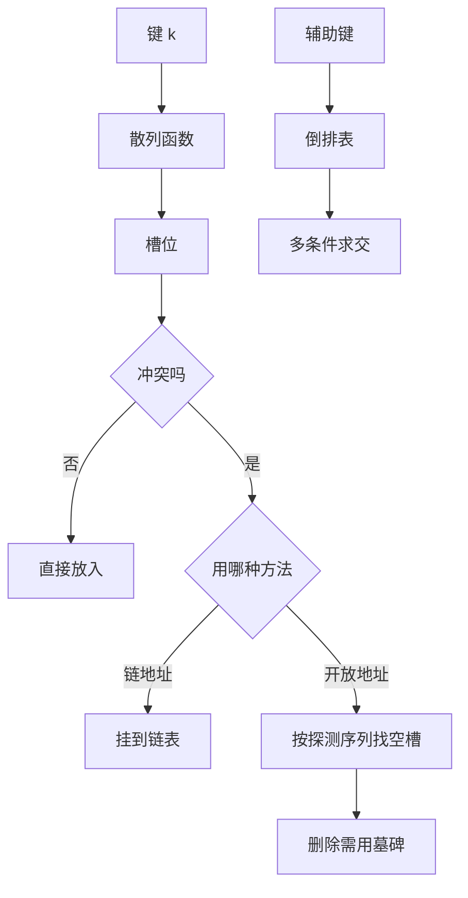

# 第 6 章：散列查找与辅助键

- **难度**：★★★ | **预估学时**：5 小时 | **前置**：第 5 章；模运算

## 学习目标

学完本章，你能：
1. 选一个像样的散列函数，并说清模为什么常取素数。
2. 比较链地址法与开放地址法的代价，用装载因子估算平均查找长度。
3. 解释线性探测的「一次聚集」问题，以及双散列怎么缓解。
4. 说清辅助键与倒排索引解决的问题。

## 一句话核心

散列把「比较」换成「计算」：不靠键的大小顺序，而靠一个函数把键直接映射到位置；代价从 log n 变成常数级，前提是冲突可控。

## 零基础讲解

### 概念 1：散列函数（难度：基础）

散列函数把键映射到 0 到 m−1 的槽位。理想情况下，不同键均匀落到不同槽。

**除法散列**：h(k) = k mod m。
- m 取素数，且离 2 的幂远一些。若 m = 2^p，则只取键的低 p 位，键的低位若有规律就会集中冲突。
- 实例：m = 13，键 18、41、22、44、59 分别落到 5、2、9、5、7。44 与 18 冲突。

**乘法散列**：h(k) = floor(m · frac(k · A))，A 常取黄金比例 0.618…。它对 m 的取值不敏感，m 可以取 2 的幂。

### 概念 2：链地址法（难度：基础）

每个槽挂一条链表，冲突的键依次挂上去。

- 装载因子 α = n/m（键数除以槽数）。
- 成功查找平均比较次数 ≈ 1 + α/2。
- 失败查找平均比较次数 ≈ α。
- 优点：实现简单，删除方便，α 可以大于 1。
- 缺点：链表指针占空间，缓存不友好。

**实例**：m = 5，α = 2（10 个键），成功查找平均约 1 + 1 = 2 次比较。

### 概念 3：开放地址法（难度：进阶）

所有键都存在表内，冲突时按某个探测序列找下一个空槽。

- **线性探测**：h, h+1, h+2, … 依次试。
- **二次探测**：h, h+1², h+2², … 跳着试。
- **双散列**：用第二个散列函数决定步长，步长与 m 互素才能遍历全表。

**线性探测的代价**：成功查找平均约 (1/2)(1 + 1/(1−α))。α = 0.5 时约 1.5 次；α = 0.9 时约 5.5 次，急剧恶化。

**一次聚集**：线性探测会把连续占用的槽连成一片，新键落进去后继续加长这片区域，后面的键越来越难找。二次探测与双散列就是为了打散这种连续块。

**删除的坑**：开放地址法不能直接把槽清空，否则会截断别人的探测链。要用「墓碑」标记，查找时跳过、插入时可复用。

## 概念 4：辅助键与倒排索引（难度：进阶）

主键唯一标识一条记录；**辅助键**是其他可用于查找的字段（如作者、日期、标签），可以有重复。

- **倒排文件**：为每个辅助键值建一个列表，记录包含该值的所有主键。查「作者=Knuth」就直接取出列表。
- **多键查询**：多个条件同时用时，对各列表求交；求交的代价取决于列表长度，短的先做。
- **组合键**：把多个字段拼成一个键再散列，适合精确匹配；范围查询仍要靠有序索引。

**实例**：三篇文章的主键 1、2、3，标签分别是 {算法, 数学}、{算法}、{数学}。
- 标签「算法」的倒排表：1、2。
- 标签「数学」的倒排表：1、3。
- 查「同时有算法与数学」：两表求交得 1。

## 图示

**看图说明**：上半部分是单键查找的两条路；下半部分说明辅助键走的是完全不同的结构——不是散列到槽，而是「键值 → 主键列表」的映射。

## 类比与实例

- 类比：散列像图书馆按书名的哈希值把书放进编号柜子；冲突就是两本书算到同一个柜子，只好在柜子里再排一层。
- 类比失效：图书馆的柜子大小固定，书多了必须换馆；散列表可以扩容重散列（rehash），但扩容那一下代价是 O(n)。

**实例（线性探测）**：m = 7，依次插入 10、17、24、31。
- 10 mod 7 = 3，放 3。
- 17 mod 7 = 3，冲突，试 4，放入。
- 24 mod 7 = 3，冲突，4 被占，试 5，放入。
- 31 mod 7 = 3，冲突，4、5 被占，试 6，放入。
四个键挤在 3 到 6 一段，这就是一次聚集。

## 常见误解

- **别以为散列查找永远是 O(1)**——实际上 α 接近 1 时开放地址法急剧退化，最坏可到 O(n)。
- **别以为 m 取 2 的幂很方便就没问题**——实际上它只取键的低位，键低位有规律时冲突严重。
- **别以为删除可以直接清空槽**——实际上会截断探测链，必须用墓碑。

## 自测题（答案）

1. 填空题：m = 13，键 44 的除法散列槽位是多少？（填数字）
（答案：5；解析：44 = 3×13 + 5，余数为 5。）

2. 单选题：链地址法在装载因子 α = 2 时，成功查找的平均比较次数约为？
A. 1 B. 2 C. 4 D. 8
（答案：B；解析：成功查找约 1 + α/2 = 1 + 1 = 2 次。）

3. 简答题：开放地址法为什么不能直接删除元素？
（答案：直接清空会截断后续键的探测链，使本来能找到的键查找失败；要用墓碑标记，查找时跳过、插入时可复用。）

## 复习锚点

- 除法散列 m 取素数，避开 2 的幂。
- 链地址成功查找约 1 + α/2；线性探测约 (1/2)(1 + 1/(1−α))。
- 开放地址删除要用墓碑；辅助键用倒排表。
