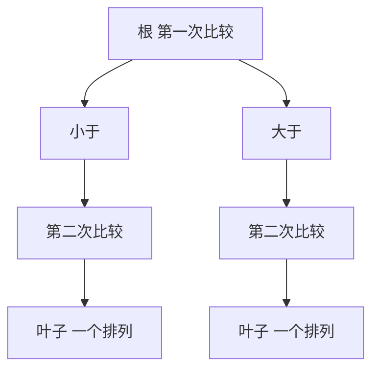

# 比较树下界

- **难度**：进阶 | **涉及章节**：第 3 章

## 一句话定义

把任何比较排序的执行过程画成一棵二叉树，叶子必须覆盖 n! 种输入排列，所以树高至少 log2(n!)，这就是比较排序的比较次数下界。

## 为什么重要

它是一条「不可能性」结论：不管多聪明的比较排序，最坏情况都至少要 log2(n!) 次比较。知道下界，才知道一个算法还有多少优化空间，也才知道该换思路（比如改用不比较的基数排序）。

## 图示

每个叶子对应一种可能的输出顺序；要覆盖 n! 种顺序，叶子数不能少，树就压不下来。

## 详解

**推导**：二叉树高度 h 最多有 2^h 个叶子。要 2^h ≥ n!，得 h ≥ log2(n!)。

**数值**：
- n = 3：log2 6 ≈ 2.58，取整 3。
- n = 5：log2 120 ≈ 6.91，取整 7。
- n = 10：log2(3628800) ≈ 21.8，取整 22。

**近似式**：log2(n!) ≈ n log2 n − 1.4427n + O(log n)。线性项系数 1.4427 就是 1/ln 2。

**适用边界**：只对「基于比较」的算法成立。基数排序按位分配，不受这条下界约束，可以做到 O(n)。

## 常见误解

- 别以为下界是「平均情况」：它是最坏情况的下界，平均情况可以更低（但一般仍同阶）。
- 别以为达到下界就说明算法最优：下界只约束比较次数，不约束移动次数、空间、缓存行为。

## 在书中出现的脉络

| 章节 | 语境 | 关键结论 |
|---|---|---|
| 5.3.1 | 比较次数最少 | 比较树模型与 log2(n!) 下界 |
| 5.3.4 | 排序网络 | 0-1 原理与网络规模 |

## 相关概念

- 前置：[逆序与排序代价](inversions-and-cost.md)
- 后续：第 2 章的合并排序
