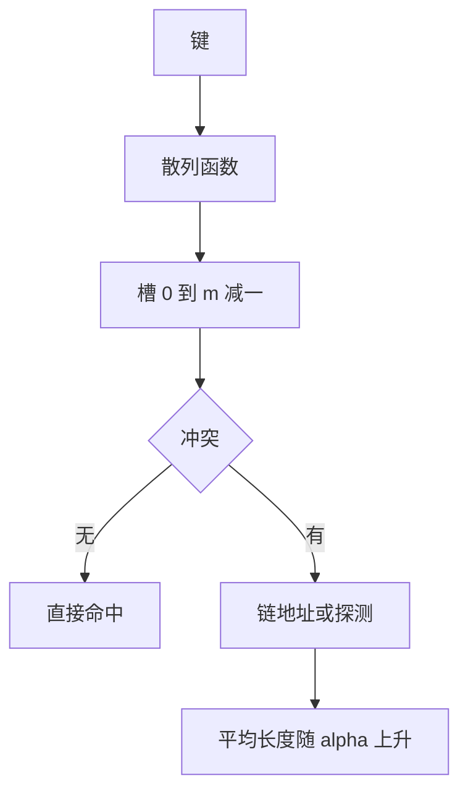

# 散列与装载因子

- **难度**：进阶 | **涉及章节**：第 6 章

## 一句话定义

散列用一个函数把键映射到槽位；装载因子 α = 键数/槽数衡量表的拥挤程度，直接决定平均查找长度。

## 为什么重要

它把查找从 O(log n) 压到常数级，是所有字典、缓存、数据库索引的基础。但它有明确的退化边界：α 一高，常数级就变成线性。

## 图示

图里的关键边是最后一条：冲突处理方式不变，α 一变，平均长度就变。

## 详解

**链地址法**：成功查找约 1 + α/2 次比较；失败查找约 α 次。α 可以大于 1。

**线性探测**：成功查找约 (1/2)(1 + 1/(1−α))。α = 0.5 时 1.5 次，α = 0.9 时 5.5 次。

**实例**：m = 7，插入 10、17、24、31，依次落在 3、4、5、6，形成一段连续占用，后续键落到这一段里要找更久。

**扩容**：α 超过阈值（常用 0.75）就加倍槽数并重新散列所有键，单次代价 O(n)，摊还后仍是常数。

**删除**：开放地址法要用墓碑，否则截断探测链。

## 常见误解

- 别以为散列查找永远 O(1)：那是在 α 受控且散列函数均匀的前提下。
- 别以为槽数取 2 的幂总是方便：它只取键的低位，键低位有规律时冲突集中。

## 在书中出现的脉络

| 章节 | 语境 | 关键结论 |
|---|---|---|
| 6.4 | 散列 | 散列函数、冲突处理与平均长度 |
| 6.5 | 辅助键 | 倒排表与多键查询 |

## 相关概念

- 前置：[比较树下界](comparison-tree-lower-bound.md)
- 后续：卷4 的位运算技巧
