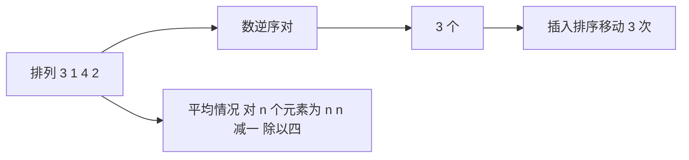

# 逆序与排序代价

- **难度**：基础 | **涉及章节**：第 1、2 章

## 一句话定义

逆序对是排列中「前大后小」的一对位置；逆序对总数直接等于插入排序需要移动的次数。

## 为什么重要

它把「排序有多难」从算法层面拉到了数据层面：同一份数据，逆序对少就好排，多就难排。平均逆序对数是 n(n−1)/4，这就是插入类排序平均 O(n²) 的来源。

## 图示

看这条链：数据的一个静态属性（逆序对数）直接等于一个算法的动态工作量（移动次数）。

## 详解

**计数方法**：对每个元素，数它右边比它小的元素个数，全部加起来。

**实例**：3, 1, 4, 2。3 右边比它小的有 1、2（2 个）；1 右边没有；4 右边有 2（1 个）；2 是最后一个。合计 3 个。

**与交换排序的区别**：一次相邻交换能消除恰好一个逆序对；但一次远距离交换可能消除两个，也可能一个都不消。所以「交换次数」不能直接等于逆序对数，只有插入排序的「挪动一格」是严格一一对应。

**上界**：完全逆序的排列有 n(n−1)/2 个逆序对，这是最大值，也是插入排序的最坏移动次数。

## 常见误解

- 别以为逆序对数相同的两个排列，排序代价也相同：快排的代价取决于基准选择，不只是逆序数。
- 别以为平均逆序对数是 n²/4 就说明「平均只比最坏快一倍」：常数确实只差一倍，但 n log n 算法能把这项彻底甩开。

## 在书中出现的脉络

| 章节 | 语境 | 关键结论 |
|---|---|---|
| 5.1.1 | 反序 | 逆序对的定义与平均 n(n−1)/4 |
| 5.2.1 | 插入排序 | 移动次数等于逆序对数 |
| 5.2.2 | 交换排序 | 一次交换最多消除两个逆序对 |

## 相关概念

- 后续：[比较树下界](comparison-tree-lower-bound.md)
