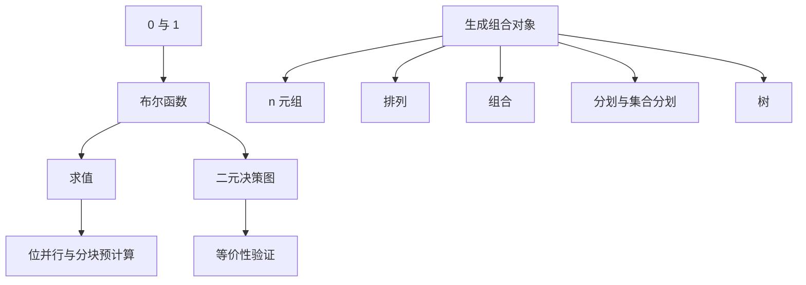

# 计算机程序设计艺术 卷4A：组合算法（一） 点化学习系统

## 这本书在讲什么

卷4A 处理「组合爆炸」这件事。第 7.1 节把 0 与 1 的运算讲到极致：布尔函数怎么表示、怎么求值、怎么用二元决策图压缩。第 7.2 节开始生成：n 元组、排列、组合、分划、树，怎么不重不漏地走遍全部可能。前者是「判断所有可能」，后者是「走遍所有可能」，两者合起来就是组合算法的骨架。

## 全书心智模型

## 学习路径（推荐顺序）

| 步骤 | 主题 | 章节 | 检查点 |
|---|---|---|---|
| 01 | 布尔代数与范式 | ch01 | 能写出三变量多数函数的真值表与极小项表达式 |
| 02 | 布尔函数求值 | ch02 | 能说清位并行与四 Russians 方法各省在哪 |
| 03 | 位技巧与决策图 | ch03 | 能用 x&(x-1) 数 1 的个数，能画两个变量的 BDD |
| 04 | 生成组合对象的框架 | ch04 | 能写出生成全部子集与全部组合的递归算法，能算规模 |

## 章节索引

- 第 1 章：0 与 1——布尔代数基础（难度 ★★☆，约 4 小时）→ [chapters/ch01-布尔代数基础.md](chapters/ch01-布尔代数基础.md)
- 第 2 章：布尔函数求值（难度 ★★★，约 5 小时）→ [chapters/ch02-布尔函数求值.md](chapters/ch02-布尔函数求值.md)
- 第 3 章：按位技巧与二元决策图（难度 ★★★，约 5 小时）→ [chapters/ch03-位运算与决策图.md](chapters/ch03-位运算与决策图.md)
- 第 4 章：生成组合对象的框架（难度 ★★★，约 6 小时）→ [chapters/ch04-生成组合对象.md](chapters/ch04-生成组合对象.md)

## 前置知识（零基础缺口补讲）

| 缺口 | 补讲位置 | 学完标志 |
|---|---|---|
| 二进制与位运算 | ch01 概念 1 | 知道按位与、或、异或、取反的含义，能手算 8 位二进制运算 |
| 递归与回溯 | ch04 概念 2 | 能写出求阶乘的递归，理解「进入一层、返回一层」的过程 |
| 组合计数 | ch04 概念 1 | 知道 C(n,k) 与 n! 的含义，能算 C(5,2)=10 |

## 术语表 / 模式库 / 速查表

- 术语：[glossary.md](glossary.md)
- 模式库：[patterns.md](patterns.md)
- 速查表：[cheatsheet.md](cheatsheet.md)
- 测验：[quiz.md](quiz.md)
- 抽认卡：[flashcards.md](flashcards.md)

## 怎么学

打开同目录的 `taocp-v4a学习伴侣.html`，按「学习路径」推进。每章读完做自测题，答对再走下一步。
