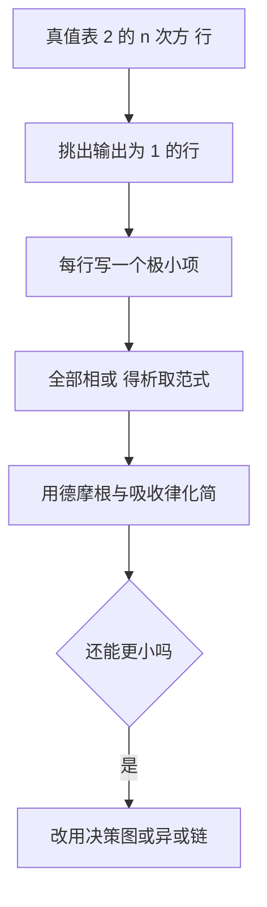

# 第 1 章：0 与 1——布尔代数基础

- **难度**：★★☆ | **预估学时**：4 小时 | **前置**：二进制与位运算

## 学习目标

学完本章，你能：
1. 写出 n 变量布尔函数的总数公式，并解释为什么是这个数。
2. 给一个函数写真值表，再从真值表写出析取范式。
3. 用德摩根律与吸收律化简表达式。
4. 说清「极小项」与「析取范式」的关系。

## 一句话核心

布尔函数只有两种输出，所以它的全部信息就是一张真值表；范式是把这张表翻译成代数表达式的标准方法。

## 零基础讲解

### 概念 1：布尔函数与它的数量（难度：基础）

布尔函数接受 n 个 0/1 输入，输出一个 0/1。

n 个变量共有 2^n 种输入组合；每一种组合的输出可以独立取 0 或 1，所以总共有 2^(2^n) 个不同的布尔函数。

**实例**：n = 1 时有 2^2 = 4 个函数：恒 0、恒 1、原样、取反。
**实例**：n = 2 时有 2^4 = 16 个函数，包括与、或、异或、蕴含等。
**推论**：n = 6 时是 2^64 个，已经数不清；所以「枚举所有布尔函数」只在小 n 可行。

**三变量多数函数**（三个输入里至少两个为 1 时输出 1）：

| x y z | 输出 |
|---|---|
| 000 | 0 |
| 001 | 0 |
| 010 | 0 |
| 011 | 1 |
| 100 | 0 |
| 101 | 1 |
| 110 | 1 |
| 111 | 1 |

### 概念 2：极小项与析取范式（难度：基础）

**极小项**是「每个变量恰好出现一次」的乘积项，例如 x∧¬y∧z。

把真值表里所有输出为 1 的行，各写成一个极小项，再全部相或，就得到**析取范式**（DNF）。

**实例**：上面的多数函数，输出为 1 的行是 011、101、110、111，对应极小项：
- ¬x∧y∧z
- x∧¬y∧z
- x∧y∧¬z
- x∧y∧z

四项相或就是它的析取范式。这个写法一定正确，但通常不是最短的。

**另一种范式**：把输出为 0 的行写成和的乘积，再全部相与，得到合取范式（CNF）。

### 概念 3：化简（难度：进阶）

**德摩根律**：¬(a∧b) = ¬a∨¬b，¬(a∨b) = ¬a∧¬b。整体取反，逐项取反，与或互换。

**吸收律**：a∨(a∧b) = a，a∧(a∨b) = a。

**实例**：化简 (x∧y)∨(x∧¬y)。
提取 x：x∧(y∨¬y) = x∧1 = x。所以这个表达式就是 x。
核对：y 取 0 或 1 时，两项总有一项为真，结果只取决于 x ✓。

**实例**：化简 x∨(x∧y) = x（吸收律）。

**系统化简**：奎因—麦卡斯基方法先找「尽量大的乘积项」，再挑最少的一组覆盖所有 1。它保证最优，但最坏代价指数级。

### 概念 4：为什么范式在实践里常常不够用（难度：进阶）

析取范式的项数可能指数多。n 个变量的奇偶函数（异或链）用 DNF 表示要 2^(n−1) 个极小项，而用异或链只需 n−1 个运算。

这说明「表示方式」决定了规模。第 3 章的二元决策图就是为了解决「有些函数用公式写必然爆炸」这个问题。

## 图示

**看图说明**：范式是一条「必定正确但可能很长」的路线；最后的判断提醒，表示方式本身也是算法设计的一部分。

## 类比与实例

- 类比：真值表像一份逐条记录的规定手册，每种情况一条；范式是把这些条目改写成一句逻辑公式。
- 类比失效：手册的条目可以随便加，公式不行——同样的函数，不同写法长度能差指数级。

**实例（写范式）**：f = x⊕y。真值表里输出为 1 的是 (0,1) 与 (1,0)，极小项是 ¬x∧y 与 x∧¬y，所以 f = (¬x∧y)∨(x∧¬y)。这就是异或的标准展开。

## 常见误解

- **别以为析取范式就是「最简式」**——实际上它只是标准形式，项数可能远多于最优写法。
- **别以为 2^(2^n) 只是个大数字**——实际上它说明 n 稍大就无法枚举全部函数，必须靠结构化的表示。
- **别以为化简只是「好看」**——实际上项数直接决定电路面积与求值代价。

## 自测题（答案）

1. 填空题：3 个变量的布尔函数共有多少个？（填数字）
（答案：256；解析：2^(2^3) = 2^8 = 256。）

2. 单选题：三变量多数函数在输入 101 时输出？
A. 0 B. 1 C. 不确定 D. 取决于变量顺序
（答案：B；解析：101 里有两个 1，满足「至少两个为 1」，输出 1。）

3. 简答题：把 (x∧y)∨(x∧¬y) 化简，并说明用了什么规则。
（答案：结果为 x。提取公因子 x 得 x∧(y∨¬y)，而 y∨¬y = 1，故为 x；用到了分配律与「一个变量与其否定相或恒为真」。）

## 复习锚点

- n 变量布尔函数共 2^(2^n) 个。
- 真值表输出为 1 的行 → 极小项 → 相或得析取范式。
- 德摩根：整体取反、逐项取反、与或互换。
