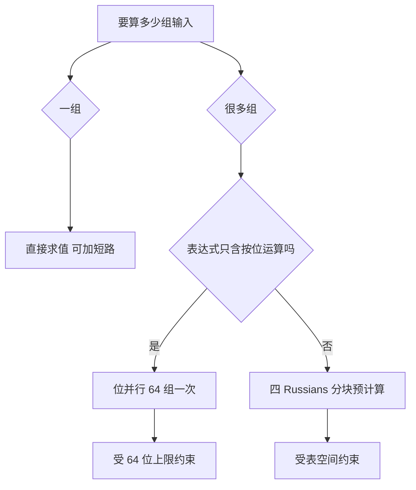

# 第 2 章：布尔函数求值

- **难度**：★★★ | **预估学时**：5 小时 | **前置**：第 1 章

## 学习目标

学完本章，你能：
1. 说清「按表达式求值」的代价，以及短路求值省在哪里。
2. 用位并行一次算 64 组输入，并说明它的限制。
3. 说出四 Russians 方法的预计算与总代价。
4. 判断一个场景该用哪种求值策略。

## 一句话核心

求值的核心矛盾是「要算多少组输入」；位并行与分块预计算都是把重复劳动合并，用空间或位宽换时间。

## 零基础讲解

### 概念 1：直接求值与短路（难度：基础）

给定表达式与一组输入，按运算顺序算。代价与表达式大小成正比。

**短路求值**：a∧b 中若 a 为假，b 不必算；a∨b 中若 a 为真，b 不必算。

**实例**：f = (x > 0) ∧ (1/x > 2)。当 x = 0 时，左边为假，短路后不会去算 1/x，避免了除零。这不是优化，而是正确性的保证。

**代价的不确定性**：短路让最坏情况与平均情况不同。最坏仍要算全部，最好只算一部分。

### 概念 2：位并行（难度：进阶）

一个 64 位机器字里，每一位可以独立当一个布尔值。于是 64 组输入可以打包成 64 个字，一次按位运算同时算 64 组。

**实例**：要算 f = x∧y 在 64 组输入上的结果，只需一条按位与指令。

**限制**：
- 每组输入的变量必须排在同一位上（第 i 组的所有变量都在第 i 位）。
- 表达式里只能有按位运算；一旦需要「第 i 组的结果影响第 j 组」，位并行就失效。
- 64 位是硬上限，超过要拆成多字。

**为什么它快**：原本 64 次运算变成 1 次，理论上 64 倍加速；实际受限于打包与拆包的开销，通常几十倍。

### 概念 3：四 Russians 方法（难度：高难）

名字来自四位俄罗斯数学家。思路是「把变量分块，预计算每块的所有可能取值」。

**做法**：
1. 把 n 个变量切成若干块，每块 k 个变量。
2. 对每块，枚举 2^k 种取值，算出这块对应的函数片段，存成表。
3. 求值时，每块查一次表，把结果拼起来。

**代价**：
- 预计算：约 (n/k) × 2^k。
- 每次求值：约 n/k 次查表与拼接。

**实例**：n = 64，k = 8。预计算 8 块 × 256 种 = 2048 次；每次求值只需 8 次查表。相比逐位算 64 次，快了约 8 倍；相比对 2^64 组输入逐一求值，这是把「指数」压成「线性 × 常数」。

**k 怎么选**：k 太大，2^k 的表存不下；k 太小，加速不明显。典型的平衡点是 k 取 8 到 16。

### 概念 4：三种策略的取舍（难度：进阶）

| 策略 | 适合 | 代价 | 限制 |
|---|---|---|---|
| 直接求值 | 单组或少量输入 | O(表达式大小) | 无 |
| 短路 | 有提前终止的分支 | 最坏不变，平均变好 | 依赖求值顺序 |
| 位并行 | 大量输入、同一表达式 | 约 1/64 | 需要打包，不能跨界依赖 |
| 四 Russians | 大量输入、变量多 | 预计算 + 线性查表 | 表占空间 |

## 图示

**看图说明**：判断点有两个——输入规模、表达式是否「纯净」。两个都偏向批量时，才轮到并行或预计算。

## 类比与实例

- 类比：位并行像把 64 封信装进一个信封一起寄；四 Russians 像把常用短语预先印好，写信时直接贴。
- 类比失效：信封有重量上限（64 位），短语表有印刷成本（2^k 空间）；两条路都有硬约束，不是免费的。

**实例（位并行算多数函数）**：3 个变量 x、y、z 打包成三个 64 位字，多数函数 = (x∧y)∨(x∧z)∨(y∧z)。三次按位与、两次按位或，就算完 64 组输入。

## 常见误解

- **别以为短路求值只是优化**——实际上它常常是正确性的一部分（避免除零、避免空指针）。
- **别以为位并行能加速所有函数**——实际上只要有一个跨位的数据依赖，整个方案就失效。
- **别以为四 Russians 方法只是「查表」**——实际上预计算的表要按块重建，输入变化时要重算。

## 自测题（答案）

1. 单选题：一个 64 位字最多能同时打包多少组布尔输入？
A. 8 B. 16 C. 32 D. 64
（答案：D；解析：每一位一组，64 位即 64 组。）

2. 填空题：四 Russians 方法中，n 个变量切成每块 k 个，预计算规模约为 (n/k) 乘以 ___。
（答案：2^k；解析：每块枚举 k 个变量的全部 2^k 种取值。）

3. 简答题：位并行求值在什么情况下会失效？
（答案：当表达式需要「某一位的结果影响另一位」时失效，例如跨组的加法进位、查表、或依赖其他组值的分支；位并行要求 64 组完全独立。）

## 复习锚点

- 短路求值：与运算遇假即停，或运算遇真即停。
- 位并行：64 组一次，条件是各组独立、只含按位运算。
- 四 Russians：分块预计算 2^k，求值时逐块查表。
