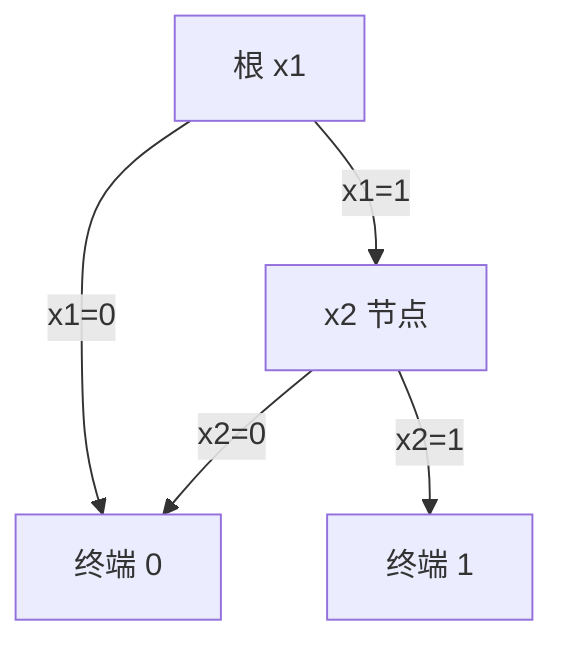

# 第 3 章：按位技巧与二元决策图

- **难度**：★★★ | **预估学时**：5 小时 | **前置**：第 1、2 章；二进制补码

## 学习目标

学完本章，你能：
1. 用 x&(x−1) 数一个整数的二进制里 1 的个数，并说明它为什么快。
2. 说清 BDD 的「有序」与「归约」两条规则。
3. 给一个两变量函数画出它的 BDD。
4. 解释变量顺序为什么能让 BDD 从线性涨到指数。

## 一句话核心

位运算把「逐位判断」变成「一次并行」；BDD 把「公式爆炸」变成「共享子图」，但它的成败取决于变量顺序。

## 零基础讲解

### 概念 1：几个必须会的位技巧（难度：基础）

- **清掉最低位的 1**：x & (x−1)。减一会把最低位的 1 变成 0、把它右边的 0 全变成 1，再与原来的 x 相与，最低位的 1 就被清掉。
- **取最低位的 1**：x & (−x)。补码下 −x 是「取反加一」，只有最低位的 1 那一位保持为 1。
- **判断是否 2 的幂**：x > 0 且 x & (x−1) = 0。
- **数 1 的个数**：反复 x &= x−1，循环几次就有几个 1。

**实例**：x = 7（二进制 111）。
- 7 & 6 = 110 = 6（清掉最低位的 1）
- 6 & 5 = 100 = 4
- 4 & 3 = 0
三次循环，所以 7 里有 3 个 1 ✓。

**为什么快**：循环次数等于 1 的个数，而不是位宽。对稀疏的位串，比逐位扫描快得多。

### 概念 2：位反转与交换（难度：进阶）

**交换两个变量的值**：a ^= b; b ^= a; a ^= b。利用异或「两次相同运算还原」的性质，不需要临时变量。

**位反转**（把 8 位 10110001 变成 10001101）：用分治，先交换相邻位，再交换相邻两位一组，再交换四位一组。三步完成，每步都是掩码加移位。

**为什么用分治**：逐位移位要 n 步；分治只要 log n 步。这和 FFT 的位反转重排是同一个技巧。

### 概念 3：二元决策图（难度：高难）

BDD 是一张有向无环图，表示布尔函数：
- 每个非终端节点标一个变量，有两条出边：变量取 0 走 low，取 1 走 high。
- 终端只有两个：0 和 1。
- 从根出发，按输入变量的取值一路走，走到哪个终端就是函数值。

**两条规则**：
- **有序**：从根到叶，变量顺序固定（比如 x1 在 x2 之上）。
- **归约**：合并结构相同的子图；若一个节点的 low 与 high 指向同一个节点，删掉它。

**实例**：f = x1 ∧ x2。
根是 x1：low 直接到 0（x1 为 0 时整个为 0）；high 到节点 x2；x2 的 low 到 0，high 到 1。共 3 个非终端/终端节点。

**规模对比**：n 个变量的与函数，BDD 只要 n+2 个节点；真值表要 2^n 行。

### 概念 4：变量顺序的威力（难度：高难）

同一个函数，换一个变量顺序，BDD 的节点数可能差指数级。

**经典例子**：f = (x1∧y1) ∨ (x2∧y2) ∨ … ∨ (xn∧yn)。

- 顺序取 x1, x2, …, xn, y1, …, yn：在处理 y 之前，x 的每种取值组合都要保留一条路径，规模约 2^n。
- 顺序取 x1, y1, x2, y2, …：每一对 (xi, yi) 处理完就能确定这一项是否为真，规模线性。

**实践含义**：BDD 的可用性取决于能否找到好的变量顺序，而这个顺序没有通用的高效算法，只能靠启发式（按变量出现频率、按电路结构）。

### 概念 5：BDD 用来做什么（难度：进阶）

- **等价性验证**：两个电路是否功能相同，把两个 BDD 建出来比较是否同构。
- **符号模型检验**：把状态转移关系建成 BDD，搜索可达状态。
- **组合计数**：在 BDD 上做动态规划，数满足条件的赋值个数。

## 图示

**看图说明**：这张图表示 x1∧x2。注意 x1 的 low 直接到 0——只要 x1 为假，结果一定是假，不必再看 x2。这就是「归约」删掉的冗余。

## 类比与实例

- 类比：BDD 像一张换乘地图，每个站按「这个变量取 0 还是 1」选下一站，最后到达「真」或「假」两个终点。相同的小区间被合并成同一段，地图就变短了。
- 类比失效：地图的合并靠地理相邻，BDD 的合并靠子图结构完全相同；顺序换一下，可合并的部分就变了。

**实例（验证恒真）**：f = x ∨ ¬x。根 x，low 到 1、high 到 1。两条边指向同一节点，按归约规则删掉根，直接得终端 1。这就是 BDD 判断重言式的方式。

## 常见误解

- **别以为 BDD 总是比真值表小**——实际上顺序选得差，BDD 可能和真值表一样大。
- **别以为归约只是「优化」**——实际上不归约就不是「规范形式」，无法用于等价性比较。
- **别以为 x&(x−1) 只用来数 1**——实际上它还能判断 2 的幂、枚举子集、做位图压缩。

## 自测题（答案）

1. 填空题：二进制 7 里有几个 1？（填数字）
（答案：3；解析：7 = 111，三个 1；用 x&(x−1) 循环三次归零。）

2. 单选题：BDD 能用于等价性验证，关键靠哪条性质？
A. 有序 B. 归约后的规范形式 C. 变量个数少 D. 终端只有两个
（答案：B；解析：在固定变量顺序下，归约后的 BDD 是唯一规范形式，两个函数等价当且仅当 BDD 同构。）

3. 简答题：为什么变量顺序会影响 BDD 的大小？
（答案：顺序决定了「还没处理的变量组合」需要保留多少条路径；顺序差时，大量中间组合无法合并，规模指数增长。）

## 复习锚点

- x&(x−1) 清最低位的 1；循环次数即 1 的个数。
- BDD 两规则：有序、归约；归约后是规范形式。
- 变量顺序决定 BDD 大小，可能差指数级。
