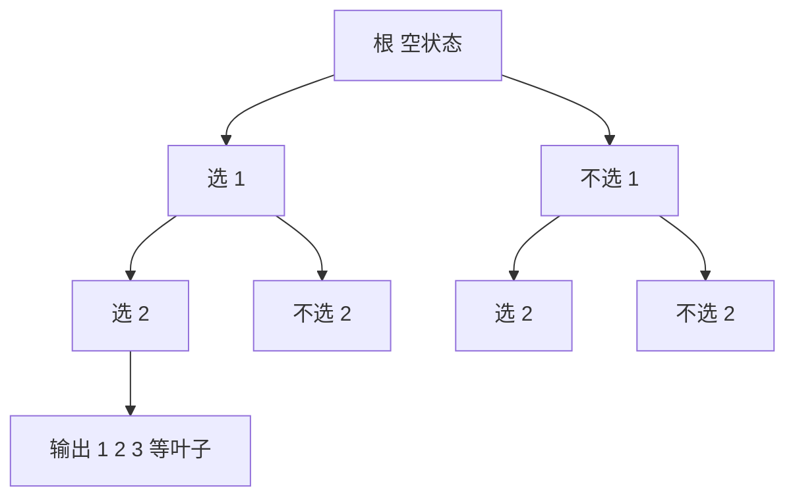

# 第 4 章：生成组合对象的框架

- **难度**：★★★ | **预估学时**：6 小时 | **前置**：第 1 章；递归与基本计数

## 学习目标

学完本章，你能：
1. 说出组合问题的五个基本类型，并判断一个问题属于哪类。
2. 用递归与二进制计数两种方式生成全部子集，并核对数量。
3. 生成 C(n,k) 的全部组合，说明「不重不漏」靠什么保证。
4. 写出带剪枝的回溯框架，并说明剪枝为什么不会漏解。

## 一句话核心

生成算法的正确性只有两条标准：**不重复、不遗漏**；效率则取决于能否用「下一个」直接从前一个算出来（格雷码、字典序）。

## 零基础讲解

### 概念 1：组合问题的五个类型（难度：基础）

面对「所有可能」时，先问自己要的是哪一种：

1. **存在性**：有没有解？
2. **构造**：给出一组解。
3. **计数**：有多少组解？
4. **生成**：把全部解列出来。
5. **优化**：在全部解里找最好的。

**实例**：n 皇后问题。存在性=有没有摆法；构造=给一个摆法；计数=有多少种摆法；生成=列出全部；优化=在带权版本里找最优。

**为什么先分类**：五类的算法差别极大。计数用公式，生成要遍历，优化常要搜索加剪枝。分类错了，方法就全错。

### 概念 2：生成全部子集（难度：基础）

n 个元素的集合有 2^n 个子集。两种生成方式：

**二进制计数法**：从 0 数到 2^n − 1，每个数看成一个位掩码，第 i 位为 1 表示选第 i 个元素。

**实例**：{1,2,3}，掩码 000 到 111：
- 000 → 空集
- 001 → {1}
- 010 → {2}
- 011 → {1,2}
- 100 → {3}
- 101 → {1,3}
- 110 → {2,3}
- 111 → {1,2,3}

共 8 个，与 2³ = 8 对得上。

**递归法**：对每个元素，选或不选，进入下一层；层数到 n 时输出。

两种方法生成顺序不同，数量一定相同。**核对数量是必须做的一步**，它是最便宜的正确性检查。

### 概念 3：格雷码（难度：进阶）

二进制计数每次可能变多位（011 → 100 变了三位）。**格雷码**要求相邻编码只差一位。

**3 位格雷码**：000、001、011、010、110、111、101、100。

**构造规律**：n 位格雷码 = 0 前缀的 (n−1) 位格雷码 + 1 前缀的 (n−1) 位格雷码倒序。

**为什么有用**：相邻状态只改一位，生成时只需一次「翻转某个元素」，代价从 O(n) 降到 O(1)；硬件上也避免多位同时跳变。

### 概念 4：生成组合 C(n,k)（难度：进阶）

从 n 个里选 k 个。按字典序生成：每个组合用递增下标表示，如 1、2、3。

**下一个组合的求法**：
1. 从右往左找第一个还能加大的位置（它没到上限 n−k+i）。
2. 该位置加 1。
3. 它右边的位置依次设为紧邻的递增值。

**实例**：n = 5、k = 2。从 1,2 开始：
1,2 → 1,3 → 1,4 → 1,5 → 2,3 → 2,4 → 2,5 → 3,4 → 3,5 → 4,5，共 10 个，与 C(5,2) = 10 一致。

**不重不漏的保证**：字典序的「下一个」是唯一的，且严格递增，所以既不重复也不遗漏。

### 概念 5：分划与树（难度：高难）

**整数分划**：把 n 写成若干个正整数之和，顺序不计。n = 4 的分划有 5 个：4、3+1、2+2、2+1+1、1+1+1+1。
**集合分划**：把集合切成若干非空块。3 个元素有 5 种分划。
**树的生成**：n 个节点的有标号树数量是 n^(n−2)（凯莱公式）；生成时要避免同构重复，通常用「父节点编号小于子节点」的规范表示。

**共同的难点**：这些对象的「同构」判定比「相等」复杂，生成时必须先固定一个规范形式，否则同一对象会被多次输出。

### 概念 6：回溯框架（难度：进阶）

```
搜索(状态)：
  若 状态 已完整：输出，返回
  对 每个候选选择：
      若 选择 可行：
          做出选择
          搜索(新状态)
          撤销选择
```

**剪枝**：若当前状态已经不可能补成合法解，直接返回。

**为什么剪枝不会漏解**：剪掉的都是「无论后面怎么选都不合法」的分支，合法解不会经过这些分支。

**实例**：生成 3 个元素的全排列，已选 1、1（重复）时立即剪枝，不会生成 1,1,2 这种非法排列。

## 图示



**看图说明**：每个分叉是「选或不选」，叶子的总数就是 2^n。这棵树把「生成全部子集」变成了「遍历一棵满二叉树」。

## 类比与实例

- 类比：生成全部组合像在超市试吃，每样东西「拿或不拿」，走完一圈就得到全部购物方案。
- 类比失效：试吃有成本，生成算法的主要成本是「输出」本身；当解的数量指数增长时，任何算法都救不了。

**实例（数量核对）**：生成 {1,2,3,4} 的全部 2 元素组合，应得 C(4,2) = 6 个：12、13、14、23、24、34。若程序输出 7 个，必定有重复。

## 常见误解

- **别以为生成算法只要「能输出」就行**——实际上不重不漏是硬要求，数量必须与公式对上。
- **别以为格雷码只是「好看」**——实际上它把相邻状态的改变量降到一位，是很多生成算法的加速基础。
- **别以为回溯一定要搜遍全树**——实际上剪枝能砍掉大量分支，前提是剪枝条件正确。

## 自测题（答案）

1. 填空题：{1,2,3,4} 的全部子集有多少个？（填数字）
（答案：16；解析：2^4 = 16，含空集与全集。）

2. 单选题：3 位格雷码序列的第三个编码是？
A. 010 B. 011 C. 100 D. 101
（答案：B；解析：序列为 000、001、011、010、110、111、101、100，第三个是 011。）

3. 简答题：生成 C(5,2) 的全部组合，怎么保证不重不漏？
（答案：用递增下标表示组合，按字典序求「下一个」：从右往左找第一个还能加大的位置加一，右侧依次设为紧邻值；序列严格递增且覆盖全部，因此不重不漏，总数应为 10。）

## 复习锚点

- 五类问题：存在、构造、计数、生成、优化。
- 子集 2^n 个；组合 C(n,k) 个；生成后必须核对数量。
- 回溯 = 做选择、递归、撤销；剪枝砍掉必然不合法的分支。
