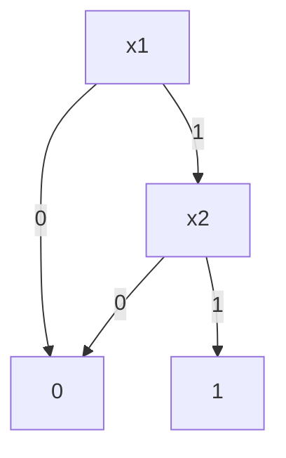

# 二元决策图

- **难度**：高难 | **涉及章节**：第 3 章

## 一句话定义

二元决策图（BDD）是按固定变量顺序分支、并合并相同子图的有向无环图；归约后的 BDD 是布尔函数的唯一规范形式。

## 为什么重要

它解决了「公式写法指数爆炸」的问题：有些函数用 DNF 要 2^(n−1) 项，用 BDD 只要线性个节点。规范形式还让「两个函数是否等价」变成「两张图是否同构」。

## 图示

这是 x1∧x2 的 BDD：x1 为 0 直接到 0；为 1 才看 x2。

## 详解

**两条规则**：
- 有序：根到叶的变量顺序固定。
- 归约：合并同构子图；low 与 high 相同的节点删掉。

**构造**：从真值表自底向上合并，或用 apply 操作对两个 BDD 做与、或、非。

**实例**：x∨¬x 的 BDD 在归约后直接变成终端 1，说明它是重言式。

**规模**：与函数结构和变量顺序都有关。n 个变量的与函数只要 n+2 个节点；而 (x1∧y1)∨…∨(xn∧yn) 在坏顺序下要指数个节点，好顺序下线性。

**代价**：建图与操作的时间与图的大小成正比；顺序选错，图就爆。

## 常见误解

- 别以为 BDD 一定比真值表小：坏顺序下一样大。
- 别以为归约是可选的优化：不归约就没有规范形式，无法用于等价性判断。

## 在书中出现的脉络

| 章节 | 语境 | 关键结论 |
|---|---|---|
| 7.1.4 | 二元决策图 | 有序、归约、规范形式 |
| 7.1.4 | 应用 | 等价性验证与模型检验 |

## 相关概念

- 前置：[布尔函数与范式](boolean-normal-form.md)
- 后续：[组合生成与回溯](generation-backtracking.md)
