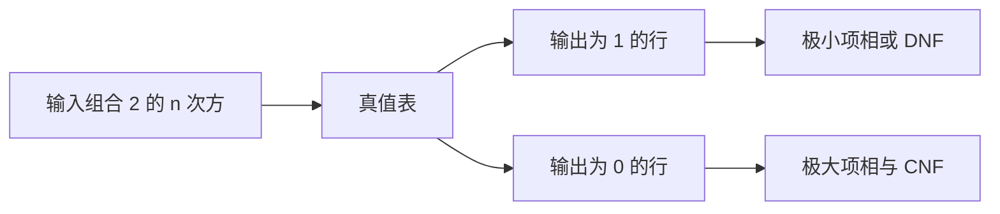

# 布尔函数与范式

- **难度**：基础 | **涉及章节**：第 1 章

## 一句话定义

布尔函数是输入若干 0/1、输出一个 0/1 的函数；范式是把它的真值表翻译成「乘积项之和」或「和项之积」的标准写法。

## 为什么重要

它是数字电路、程序条件判断、数据库查询、SAT 求解的共同语言。范式保证「任何布尔函数都能写出来」，化简决定「写出来有多大」。

## 图示

两条路径等价，只是从哪一侧看表。

## 详解

**函数总数**：2^(2^n)。因为 2^n 种输入，每种输出独立取 0/1。

**极小项**：每个变量恰好出现一次（原样或取反）的乘积项。n 个变量有 2^n 个极小项，每个只在一种输入下为 1。

**DNF**：把函数值为 1 的那些极小项相或。**CNF**：把函数值为 0 的那些极大项相与。

**实例**：多数函数（三变量）的 DNF 是 ¬x∧y∧z ∨ x∧¬y∧z ∨ x∧y∧¬z ∨ x∧y∧z。

**化简**：用德摩根、吸收、分配把项数压下来。例如 (x∧y)∨(x∧¬y) = x。

## 常见误解

- 别以为 DNF 是最简形式：它只是标准形式，项数可能指数多。
- 别以为化简只是美观：项数决定电路面积与求值代价。

## 在书中出现的脉络

| 章节 | 语境 | 关键结论 |
|---|---|---|
| 7.1.1 | 布尔代数基础 | 真值表、范式、化简 |
| 7.1.2 | 布尔函数求值 | 范式用于求值 |
| 7.1.4 | 决策图 | 范式爆炸时改用 BDD |

## 相关概念

- 后续：[二元决策图](binary-decision-diagram.md)
