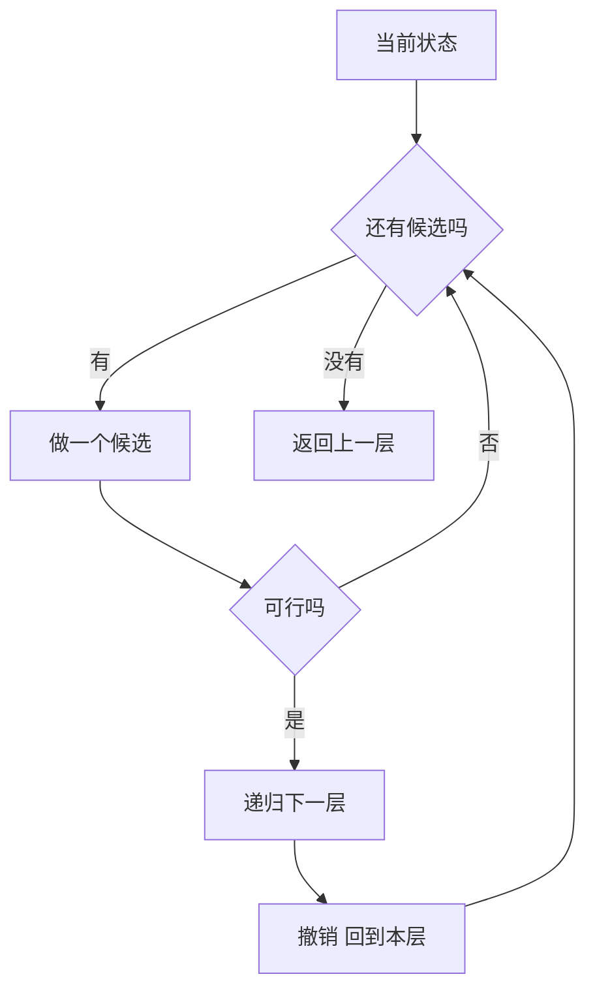

# 组合生成与回溯

- **难度**：进阶 | **涉及章节**：第 4 章

## 一句话定义

组合生成是把某一类对象的全部实例按固定规则列出来；回溯是「做选择、递归、撤销」的通用框架，配合剪枝避免无用分支。

## 为什么重要

它是穷举类算法（数独、八皇后、SAT、调度）的骨架。生成算法的质量不看「能不能列出来」，看「是否不重不漏、能否从前一个直接算出下一个」。

## 图示

看这个环：每次只前进或后退一步，整棵树被系统性地走一遍。

## 详解

**五个类型**：存在、构造、计数、生成、优化。先分类再选算法。

**子集生成**：二进制计数法（掩码 0 到 2^n−1）或递归「选/不选」。数量必为 2^n。

**组合生成**：按字典序，找最右可增位、加一、右侧填紧邻值。C(5,2)=10 个。

**格雷码**：相邻只差一位，3 位序列 000、001、011、010、110、111、101、100。

**剪枝的正确性**：只剪「无论后续怎么选都不合法」的分支，合法解不经过这些分支。

## 常见误解

- 别以为生成只要输出就行：必须核对数量，数量对不上就是重复或遗漏。
- 别以为回溯必须遍历全树：剪枝能砍掉大部分，但前提是条件正确。

## 在书中出现的脉络

| 章节 | 语境 | 关键结论 |
|---|---|---|
| 7.2 | 生成组合对象 | 五类问题与生成框架 |
| 7.2.1 | 生成 n 元组 | 二进制计数与格雷码 |
| 7.2.1.2 | 生成排列 | 字典序与相邻交换 |

## 相关概念

- 前置：[二元决策图](binary-decision-diagram.md)
- 后续：卷4B 的排列生成
