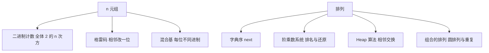

# 计算机程序设计艺术 卷4B：生成所有元组和排列 点化学习系统

## 这本书在讲什么

这一册只讲两个对象：所有 n 元组、所有排列。看起来简单，但「不重不漏、每次只改一点、代价摊还到常数」这三条要求把算法逼到了极致。字典序的 next 算法、格雷码、Heap 算法、阶乘数系统，都是围绕这三条要求打磨出来的。

## 全书心智模型

## 学习路径（推荐顺序）

| 步骤 | 主题 | 章节 | 检查点 |
|---|---|---|---|
| 01 | 生成所有 n 元组 | ch01 | 能手写 3 位格雷码，说明它相对二进制计数的优势 |
| 02 | 生成所有排列 | ch02 | 能用 next 算法从 1 2 3 走到 3 2 1，能算一个排列的排名 |

## 章节索引

- 第 1 章：生成所有 n 元组（难度 ★★☆，约 4 小时）→ [chapters/ch01-生成n元组.md](chapters/ch01-生成n元组.md)
- 第 2 章：生成所有排列（难度 ★★★，约 6 小时）→ [chapters/ch02-生成排列.md](chapters/ch02-生成排列.md)

## 前置知识（零基础缺口补讲）

| 缺口 | 补讲位置 | 学完标志 |
|---|---|---|
| 阶乘与排列数 | ch02 概念 2 | 知道 3!=6、4!=24，能解释为什么 n 个元素有 n! 种排列 |
| 递归与循环不变式 | ch01 概念 2 | 能说明一个循环每轮结束时什么条件保持成立 |

## 术语表 / 模式库 / 速查表

- 术语：[glossary.md](glossary.md)
- 模式库：[patterns.md](patterns.md)
- 速查表：[cheatsheet.md](cheatsheet.md)
- 测验：[quiz.md](quiz.md)
- 抽认卡：[flashcards.md](flashcards.md)

## 怎么学

打开同目录的 `taocp-v4b学习伴侣.html`，按「学习路径」推进。每章读完做自测题，答对再走下一步。
