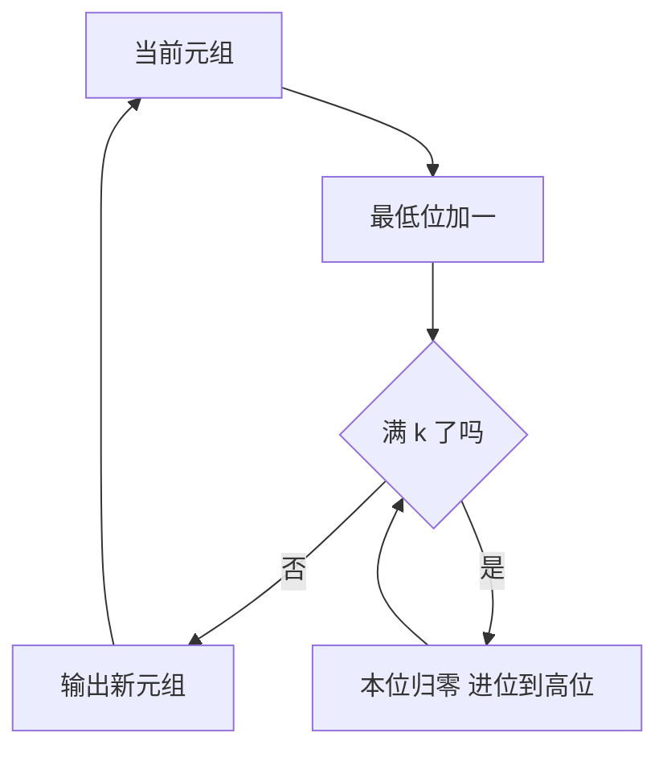

# 第 1 章：生成所有 n 元组

- **难度**：★★☆ | **预估学时**：4 小时 | **前置**：卷4A 第 4 章；二进制

## 学习目标

学完本章，你能：
1. 说出 k 进制 n 位元组的总数，并用「里程表」方式逐一生成。
2. 用 g = b ⊕ (b>>1) 把普通二进制转成格雷码，并说明反向转换。
3. 解释格雷码为什么让「生成下一个」的代价摊还到常数。
4. 处理每一位进制不同的混合基计数。

## 一句话核心

n 元组的生成本质就是**计数器**：每一位独立进位。全部技巧都围绕「怎样让每次进位只改一位」。

## 零基础讲解

### 概念 1：元组与计数（难度：基础）

n 元组是 n 个位置各取一个值的序列。若每位有 k 种取值，总数是 k^n。

**实例**：3 位二进制元组，k=2、n=3，共 8 个：000、001、010、011、100、101、110、111。

**里程表方式**：把最低位加一，满 k 进位到高位。汽车里程表就是这么工作的。

**代价**：单次「加一」平均摊还 O(1)。因为最低位每步都变、次低位每两步变一次、第 i 位每 k^i 步变一次，总变化次数是 n + n/k + n/k² + … < 2n。

### 概念 2：格雷码（难度：进阶）

二进制计数有时一次要改多位（011 → 100 改了三位）。格雷码要求相邻只差一位。

**3 位格雷码**：000、001、011、010、110、111、101、100。

**转换公式**：g = b ⊕ (b >> 1)。也就是格雷码的第 i 位 = 二进制第 i 位与第 i+1 位的异或。

**实例**：b = 6（110）。b>>1 = 011，异或得 101 = 5。序列里第 6 个（从 0 数）正是 101 ✓。

**反向转换**：b 的最高位等于 g 的最高位；之后 b 的第 i 位 = b 的第 i+1 位 ⊕ g 的第 i 位。写成循环就是不断「异或右移」。

**为什么省**：相邻格雷码只差一位，生成时只需翻转一个元素，O(1)；而且这一位是哪一位可以直接从步数算出来。

### 概念 3：反射构造（难度：进阶）

不用公式也能生成：n 位格雷码由两部分拼成——
1. n−1 位格雷码，前面加 0；
2. n−1 位格雷码**倒序**，前面加 1。

**实例**：1 位是 0、1；2 位是 00、01、11、10；3 位是 000、001、011、010、110、111、101、100 ✓。

**为什么倒序**：正序末尾是 0 开头的最大的一个，倒序开头是 1 开头的最大的一个，两者只差最高位，衔接处也只改一位。

### 概念 4：混合基（难度：进阶）

每一位的进制不同，例如时间：时（24）、分（60）、秒（60）。总数是各位进制之积。

**实例**：两位、第一位 3 种取值、第二位 4 种取值，共 12 个元组。生成时低位满 4 进一，高位满 3 归零。

**用途**：多维数组的下标展开、密码表遍历、参数组合枚举。

## 图示

**看图说明**：进位可能连续发生，但摊还下来每次输出只改常数位。这就是「摊还 O(1)」的来源。

## 类比与实例

- 类比：n 元组生成像里程表，低位转一圈高位进一格；格雷码像一种特制的表，每转一格只有一个数字变化。
- 类比失效：里程表的数字是十进制，格雷码的「一位变化」是二进制位；十进制下不存在「相邻只改一个数字」的完整循环（除了一部分特殊构造）。

**实例（格雷码生成）**：从 0 数到 7，用 g = b⊕(b>>1) 得 0、1、3、2、6、7、5、4，写成三位二进制就是 000、001、011、010、110、111、101、100，相邻确实只差一位。

## 常见误解

- **别以为格雷码是「另一种二进制数」**——实际上它只是一个编码序列，同一个数值在格雷码下写法不同。
- **别以为二进制计数每次只改一位**——实际上 011 到 100 改了三位，这正是格雷码要解决的问题。
- **别以为混合基很少用**——实际上多维数组、日期时间、参数组合都是混合基。

## 自测题（答案）

1. 填空题：3 位二进制元组共有多少个？（填数字）
（答案：8；解析：2^3 = 8，从 000 到 111。）

2. 单选题：3 位格雷码序列的第五个（从 0 数）编码是？
A. 010 B. 110 C. 111 D. 100
（答案：B；解析：序列 000、001、011、010、110、111、101、100，第五个是 110。）

3. 简答题：格雷码相对普通二进制计数，优势在哪？
（答案：相邻两个编码只差一位，生成下一个只需翻转一个元素，代价 O(1)，且硬件上不会出现多位同时跳变的毛刺。）

## 复习锚点

- k 进制 n 位元组共 k^n 个，按里程表进位。
- 格雷码 g = b⊕(b>>1)，相邻只差一位。
- 反射构造：0 前缀正序 + 1 前缀倒序。
