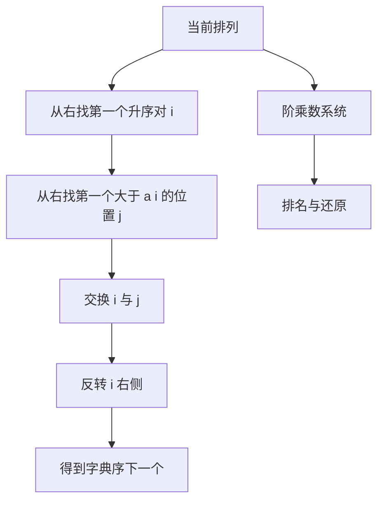

# 第 2 章：生成所有排列

- **难度**：★★★ | **预估学时**：6 小时 | **前置**：第 1 章；阶乘

## 学习目标

学完本章，你能：
1. 用字典序的 next 算法从 1 2 3 一路走到 3 2 1。
2. 用阶乘数系统给任意排列算排名，也能从排名还原排列。
3. 说清 Heap 算法为什么只用 n!−1 次交换。
4. 区分全排列、圆排列、带重复元素的排列。

## 一句话核心

排列生成的两条主线是**字典序**（能排名、能随机访问）与**相邻交换**（每次改动最小）；两者的交点就是阶乘数系统。

## 零基础讲解

### 概念 1：总数与字典序（难度：基础）

n 个不同元素有 n! 种排列。字典序按第一个不同位置的大小决定先后。

**1 2 3 的六个排列**：123、132、213、231、312、321。

**next 算法**（求字典序的下一个）：
1. 从右往左找第一个「比右边小」的位置 i（即 a[i] < a[i+1]）。
2. 从右往左找第一个「比 a[i] 大」的位置 j。
3. 交换 a[i] 与 a[j]。
4. 把 i 右边的部分整体反转（原来递减，反转后递增）。

**实例**：从 1 2 3 出发。
- i = 2（2 < 3），j = 3，交换得 1 3 2，右侧只有一个元素，反转不变 → 132 ✓。
- 从 1 3 2：i = 1（1 < 3），j = 3（2 > 1），交换得 2 3 1，反转右侧 3 1 得 1 3 → 231 ✓。

**为什么第 4 步是反转**：i 右边原本是递减的（因为 i 是最右的升序对），反转后变成递增，正是字典序最小的后缀。

### 概念 2：阶乘数系统与排名（难度：进阶）

给排列编号，用「第 i 位有几个比它小的元素还在右边」作为该位的数字。

**排名公式**：rank = Σ c(i) × (n−i)!，其中 c(i) 是位置 i 右边比 a[i] 小的元素个数。

**实例**：排列 2 3 1。
- 位置 1 是 2，右边比它小的有 1，c=1，权 (3−1)! = 2 → 2
- 位置 2 是 3，右边比它小的有 1，c=1，权 (3−2)! = 1 → 1
- 位置 3 是 1，右边没有，c=0
- 排名 = 2 + 1 = 3（从 0 开始），即第 4 个，与 123、132、213、231 的顺序一致 ✓。

**反向**：已知排名 r，从高位开始，第 i 位取「第 r / (n−i)! 个还没用过的元素」，余数继续。

**为什么用阶乘数系统**：它把「第几个排列」变成一个可计算的数，不需要从头数。n = 10 时 10! = 3,628,800，仍在整数范围内；n = 20 就超出 64 位。

### 概念 3：Heap 算法（难度：高难）

Heap 算法递归生成排列，只用相邻交换，总交换次数恰好 n!−1。

**结构**：
- n = 1 时输出唯一排列。
- n > 1 时，对 i 从 1 到 n：先递归生成前 n−1 个元素的排列；若 n 为奇数，交换第 1 与第 n 个；若 n 为偶数，交换第 i 与第 n 个。

**为什么交换次数正好 n!−1**：每输出一个新排列至少需要一次交换，而算法每次交换都产生一个新排列，所以交换次数等于「排列数减一」。

**实例**：n = 3。递归 n=2 输出 123、213；交换 1 与 3 得 321，递归输出 321、231；交换 1 与 3 得 132，递归输出 132、312。共 6 个，5 次交换 ✓。

### 概念 4：圆排列与重复元素（难度：进阶）

- **圆排列**：首尾相接，旋转视为同一种，种数为 (n−1)!。因为固定一个元素的位置后，其余 (n−1) 个随便排。
- **带重复元素**：n 个元素中有重复组，种数为 n!/(n1!n2!…)。生成时要跳过重复分支，否则会输出重复排列。

**实例**：A、A、B 的排列是 3!/2! = 3，即 AAB、ABA、BAA。

## 图示

**看图说明**：左侧是「一步一步走」，右侧是「直接跳到第 k 个」。两条路都可行，选哪条取决于你要遍历还是要随机访问。

## 类比与实例

- 类比：字典序生成像翻字典，每次只改动尽量靠后的部分；阶乘数系统像给每个词编一个号码，不用翻就能直接跳到那一页。
- 类比失效：字典的编号是人为定的，排列的编号由阶乘权决定；n 一大，号码就超过整数范围。

**实例（还原排列）**：n = 4，排名 5（从 0 开始），还原。
- 5 / 3! = 0 余 5，第 1 位取第 0 个未用元素 → 1
- 5 / 2! = 2 余 1，第 2 位取第 2 个未用元素（未用 2,3,4，第 2 个是 4）→ 4
- 1 / 1! = 1 余 0，第 3 位取第 1 个未用元素（未用 2,3，第 1 个是 3）→ 3
- 最后剩 2 → 2
排列为 1 4 3 2。核对：4 个元素排名 5，前五个是 1234、1243、1324、1342、1423，第六个是 1432 ✓。

## 常见误解

- **别以为 next 算法要重新排序后缀**——实际上后缀原本递减，只需反转，O(n) 而不是 O(n log n)。
- **别以为 Heap 算法交换次数多**——实际上恰好 n!−1 次，已经是最少。
- **别以为圆排列就是「少一个元素」**——实际上它是把旋转视为等价，除以 n，得 (n−1)!。

## 自测题（答案）

1. 填空题：1 2 3 的字典序下一个排列是什么？（写成三个数字，不加空格）
（答案：132；解析：最右升序对是 2<3，交换得 132，右侧单元素无需反转。）

2. 单选题：4 个元素的圆排列有多少种？
A. 4 B. 6 C. 12 D. 24
（答案：B；解析：(4−1)! = 3! = 6，旋转视为同一种。）

3. 简答题：Heap 算法生成 n 个元素的全排列，一共做多少次交换？
（答案：n!−1 次。每输出一个新排列至少一次交换，而算法每次交换都产生新排列，故交换次数等于排列数减一。）

## 复习锚点

- 全排列 n!，圆排列 (n−1)!，带重复 n!/(n1!…)。
- next：找最右升序对、交换、反转后缀。
- 排名用阶乘数系统，n 一大就溢出。
