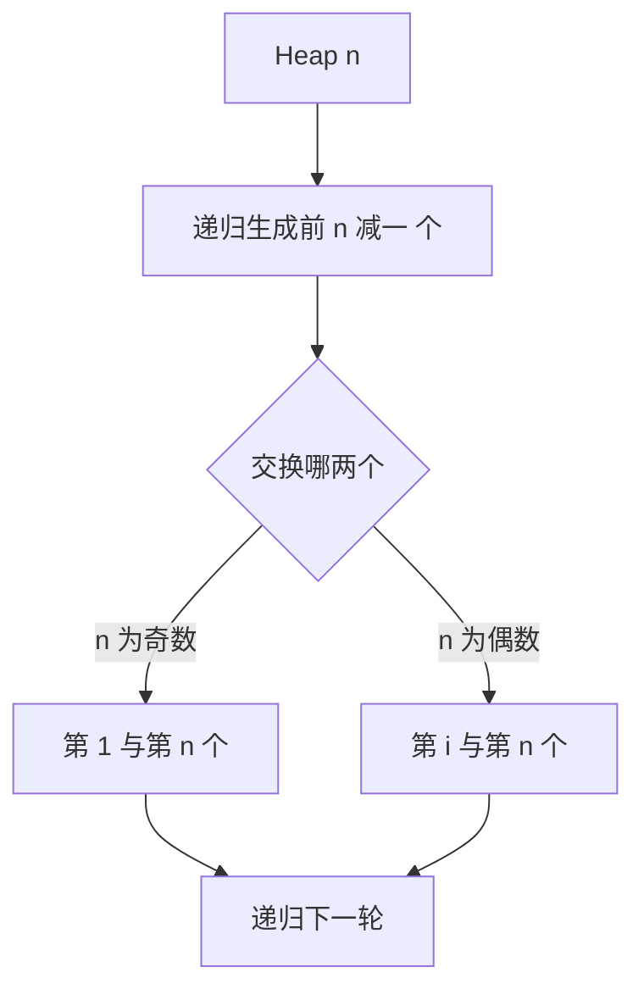

# 相邻交换生成

- **难度**：进阶 | **涉及章节**：第 2 章

## 一句话定义

相邻交换生成让每两个相邻排列只差一次元素交换；Heap 算法用恰好 n!−1 次交换走遍全部 n! 个排列。

## 为什么重要

它把「每个排列的生成代价」压到一次交换，且不需要额外空间。对需要逐状态处理、状态间差异要小的场景（如旅行商问题的局部搜索、排列编码的硬件测试）特别合适。

## 图示

图中的判断是 Heap 算法唯一「反直觉」的地方：奇偶决定交换对象。

## 详解

**结构**：n = 1 输出唯一排列；n > 1 时循环 i，每次递归生成前 n−1 个的排列，然后按奇偶交换。

**交换次数**：n!−1。理由：每次交换都产生一个新排列，而新排列总数是 n!−1。

**实例（n=3）**：123、213（递归 n=2）；交换 1 与 3 得 321，递归得 321、231；再交换 1 与 3 得 132，递归得 132、312。共 6 个，5 次交换。

**与字典序的差别**：字典序的相邻排列可能差多个位置；Heap 的相邻排列只差一次交换。

## 常见误解

- 别以为 Heap 算法需要额外数组：它原地交换，空间 O(n) 只是递归栈。
- 别以为交换次数越少运行越快：递归调用与输出本身也有代价。

## 在书中出现的脉络

| 章节 | 语境 | 关键结论 |
|---|---|---|
| 7.2.1.2 | 生成排列 | 相邻交换与 Heap 算法 |

## 相关概念

- 前置：[字典序与阶乘数系统](lexicographic-factorial.md)
