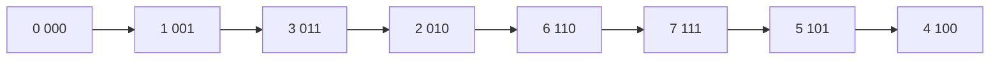

# 格雷码

- **难度**：基础 | **涉及章节**：第 1 章

## 一句话定义

格雷码是一种二进制编码序列，任意相邻两个编码只差一位；把普通二进制 b 转成格雷码用 g = b ⊕ (b>>1)。

## 为什么重要

它把「计数器每次可能改多位」变成「每次只改一位」。这既省生成代价，也避免硬件多位同时跳变产生的毛刺；在旋转编码器、卡诺图、状态机编码里都能见到。

## 图示

看图：每一步只有一个位翻转，走完一圈回到起点也只差一位。

## 详解

**转换**：g = b ⊕ (b >> 1)。
**逆转换**：从最高位开始，b 的最高位等于 g 的最高位；逐位往下，b(i) = b(i+1) ⊕ g(i)。

**实例**：b = 6（110），b>>1 = 011，g = 101（5）。

**反射构造**：n 位格雷码 = 0 前缀的 (n−1) 位格雷码 + 1 前缀的 (n−1) 位格雷码倒序。3 位得 000、001、011、010、110、111、101、100。

**代价**：生成下一个只需翻转一位，O(1)；总翻转次数约 2^n，摊还 O(1)。

## 常见误解

- 别以为格雷码是「另一种数值」：它只是编码序列，数值不变，写法变了。
- 别以为任意长度都能「相邻只差一位且首尾也差一位」：循环格雷码需要额外的构造（如平衡格雷码）。

## 在书中出现的脉络

| 章节 | 语境 | 关键结论 |
|---|---|---|
| 7.2.1.1 | 生成 n 元组 | 二进制计数与格雷码 |
| 7.2.1.2 | 生成排列 | 相邻交换的思想来源 |

## 相关概念

- 后续：[相邻交换生成](adjacent-swap-generation.md)
