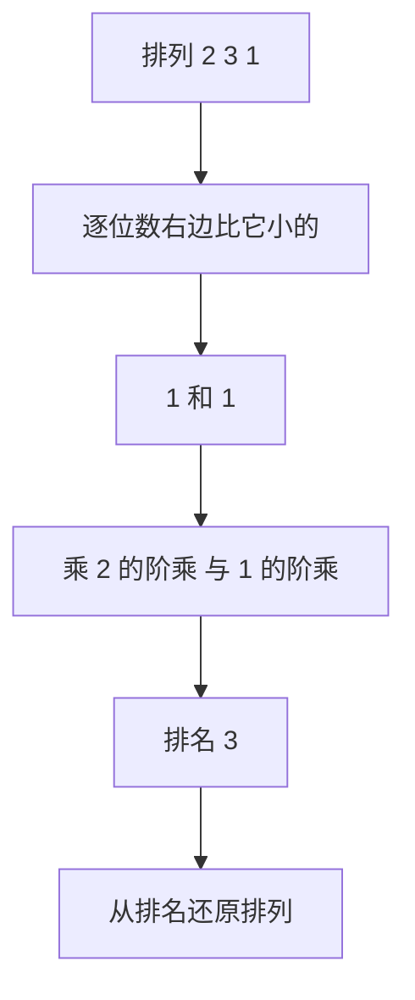

# 字典序与阶乘数系统

- **难度**：进阶 | **涉及章节**：第 2 章

## 一句话定义

字典序按「第一个不同位置的大小」排序；阶乘数系统用「右边比它小的元素个数 × 阶乘权」给排列编号，使「第几个排列」可算。

## 为什么重要

它把「遍历所有排列」和「直接取第 k 个排列」统一起来：遍历用 next，随机访问用编号。密码学、组合测试、随机抽样都要用到。

## 图示

看这条链：排列 → 数字 → 排列，两个方向都可算。

## 详解

**next 四步**：找最右升序对 i；找最右大于 a[i] 的 j；交换；反转 i 右侧。

**排名公式**：rank = Σ c(i)×(n−i)!，c(i) 是位置 i 右边比 a[i] 小的元素数。

**实例**：2 3 1 的排名 = 1×2! + 1×1! + 0 = 3（从 0 开始），是第四个排列。

**还原**：依次用 rank 除以 (n−1)!、(n−2)!…，商是「未用元素中的下标」。

**边界**：n ≤ 20 时 n! 还在 64 位范围内；再大就要用大整数。

## 常见误解

- 别以为 next 要重排后缀：后缀递减，反转即可。
- 别以为排名从 1 开始：Knuth 的编号从 0 开始，差一位就会错开整个序列。

## 在书中出现的脉络

| 章节 | 语境 | 关键结论 |
|---|---|---|
| 7.2.1.2 | 生成排列 | 字典序 next 算法 |
| 7.2.1.2 | 排名 | 阶乘数系统 |

## 相关概念

- 前置：[格雷码](gray-code.md)
- 后续：[相邻交换生成](adjacent-swap-generation.md)
