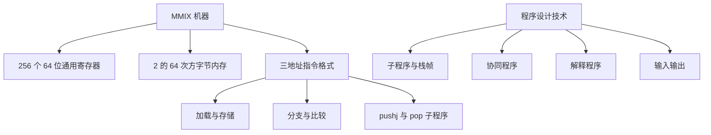

# 计算机程序设计艺术 MMIX 增补 点化学习系统

## 这本书在讲什么

MMIX 是 Knuth 为 TAOCP 设计的 64 位 RISC 机器，取代了早期的 MIX。这一册包含两部分：第一部分从零介绍 MMIX 的寄存器、指令格式、汇编与程序设计技术；第二部分是「增补」，把卷1 至卷3 中受 MIX 限制的章节按 MMIX 重写。读它的价值不在背指令，而在看清「抽象算法落到具体机器上要多做哪些事」——寄存器分配、栈帧、参数传递、I/O。

## 全书心智模型

## 学习路径（推荐顺序）

| 步骤 | 主题 | 章节 | 检查点 |
|---|---|---|---|
| 01 | MMIX 的寄存器与指令 | ch01 | 能解释三地址指令各字段，能写出一次加载加一次加法 |
| 02 | 汇编、子程序与协同程序 | ch02 | 能说清 pushj/pop 如何保存返回地址，能解释协同程序与子程序的区别 |
| 03 | 卷1 至卷3 的 MMIX 重写 | ch03 | 能说出链接分配、随机数、排序在 MMIX 上各多了哪些机器级操作 |

## 章节索引

- 第 1 章：MMIX 的寄存器、内存与指令（难度 ★★☆，约 4 小时）→ [chapters/ch01-MMIX架构.md](chapters/ch01-MMIX架构.md)
- 第 2 章：汇编、子程序与协同程序（难度 ★★★，约 5 小时）→ [chapters/ch02-汇编与子程序.md](chapters/ch02-汇编与子程序.md)
- 第 3 章：卷1 至卷3 的 MMIX 重写（难度 ★★★，约 5 小时）→ [chapters/ch03-经典算法的MMIX重写.md](chapters/ch03-经典算法的MMIX重写.md)

## 前置知识（零基础缺口补讲）

| 缺口 | 补讲位置 | 学完标志 |
|---|---|---|
| 二进制与十六进制 | ch01 概念 1 | 能手算 0x10 等于 16，能读 8 位一组的二进制 |
| 栈与函数调用 | ch02 概念 2 | 能说出调用时返回地址存在哪、局部变量存在哪 |

## 术语表 / 模式库 / 速查表

- 术语：[glossary.md](glossary.md)
- 模式库：[patterns.md](patterns.md)
- 速查表：[cheatsheet.md](cheatsheet.md)
- 测验：[quiz.md](quiz.md)
- 抽认卡：[flashcards.md](flashcards.md)

## 怎么学

打开同目录的 `mmix学习伴侣.html`，按「学习路径」推进。每章读完做自测题，答对再走下一步。
