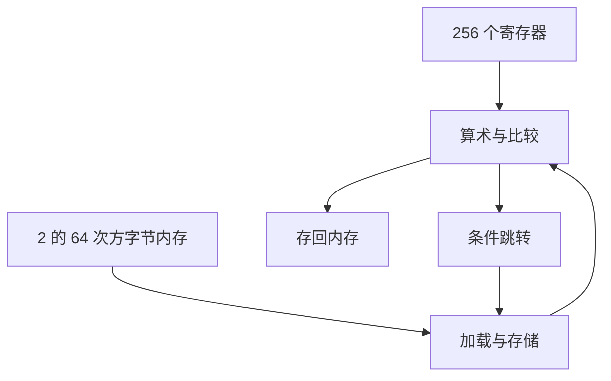

# 第 1 章：MMIX 的寄存器、内存与指令

- **难度**：★★☆ | **预估学时**：4 小时 | **前置**：二进制与十六进制

## 学习目标

学完本章，你能：
1. 说出 MMIX 的寄存器数量、位宽与内存规模。
2. 解释三地址指令的三个操作数字段各指什么。
3. 写出「加载—相加—存储」三条指令，并说清偏移量的单位。
4. 用比较加条件跳转写出一个循环的骨架。

## 一句话核心

MMIX 是一台极简的 64 位机器：**256 个寄存器、2^64 字节内存、每条指令 32 位**；所有算法都要落成「加载、运算、存储、跳转」这四类动作。

## 零基础讲解

### 概念 1：寄存器与内存（难度：基础）

MMIX 有 256 个通用寄存器，每个 64 位，编号 0 到 255。

**0 号寄存器恒为 0**：读它永远得 0，写它不生效。这不是缺陷，是设计——需要一个常数零时不必单独加载。

内存按字节编址，共 2^64 字节，采用大端序（高位字节放在低地址）。一个字是 8 字节，所以相邻两个字地址差 8。

**实例**：地址 0x100 处存着 8 字节的数，下一个数在 0x108，不是 0x101。地址算术里最容易错的就是这个「乘 8」。

**为什么用 64 位**：Knuth 设计 MMIX 时，32 位已经不够表示大整数与大数据集；64 位让「一个寄存器装一个指针」成为常态。

### 概念 2：指令格式（难度：基础）

一条 MMIX 指令 32 位，分四个字段：opcode、x、y、z，各 8 位（opcode 占高 8 位）。

- opcode 说明做什么。
- x 通常是目的寄存器。
- y、z 是源寄存器，或 y 是源、z 是立即数。

**三地址的含义**：一条指令同时给出两个源和一个目的，例如
`ADD $1, $2, $3` 表示 $1 = $2 + $3。

**立即数变体**：`ADD $1, $2, 5` 表示 $1 = $2 + 5，省掉一个寄存器。

**实例**：`ADD $3, $1, $2` 把 $1 与 $2 相加放进 $3，$1、$2 不变。三地址让「不破坏源操作数」成为默认。

### 概念 3：加载与存储（难度：基础）

- `LDO $1, $2, 16`：把内存地址（$2 + 16）处的 8 字节读进 $1。
- `STO $1, $2, 16`：把 $1 的 8 字节写到（$2 + 16）。

**偏移量单位是字节**，不是字。访问数组第 i 个 8 字节元素，偏移是 i×8。

**实例**：数组基址在 $2，读第 3 个元素（下标从 0 起）：
偏移 = 3×8 = 24，指令是 `LDO $1, $2, 24`。

### 概念 4：比较与分支（难度：基础）

`CMP $1, $2, $3` 比较 $2 与 $3，把结果（小于、等于、大于）记在 $1 里。

条件跳转：
- `BZ $1, 标签`：$1 为 0 时跳。
- `BP $1, 标签`：$1 为正时跳。
- `BN $1, 标签`：$1 为负时跳。

**循环骨架**（求数组前 n 项之和，$1 是首地址，$2 是 n）：

```
      SET  $3, 0          # 和清零
      SET  $4, $2         # 计数 = n
LOOP  BZ   $4, DONE       # 计数为 0 就结束
      SUB  $4, $4, 1      # 计数减一
      LDO  $5, $1, 0      # 取当前元素
      ADD  $3, $3, $5     # 累加
      ADD  $1, $1, 8      # 指针后移一个元素
      JMP  LOOP
DONE  ...
```

**为什么用倒计数**：BZ 只判断「等于零」，倒着数到 0 正好是结束条件，省掉一次比较。正着数要判「下标 < n」，就得多一条 CMP 加 BP。这个技巧在汇编里很常见。

## 图示



**看图说明**：数据在寄存器和内存之间往返，运算只在寄存器里做。这就是 load-store 架构的基本循环。

## 类比与实例

- 类比：寄存器像工作台，内存像仓库；所有加工都在工作台上，仓库只负责存取。
- 类比失效：工作台只有 256 个格子，仓库有 2^64 字节；真实程序要不停地在台面与仓库之间搬，搬运次数往往决定速度。

**实例（一次访存加法）**：把内存 0x100 与 0x108 的两个数相加，结果存到 0x110。
```
LDO $1, $0, 0x100
LDO $2, $0, 0x108
ADD $3, $1, $2
STO $3, $0, 0x110
```
$0 恒为 0，所以「基址 + 偏移」直接就是绝对地址。

## 常见误解

- **别以为 $0 可以当普通寄存器用**——实际上它恒为 0，写进去的数据读不出来。
- **别以为地址加一就是下一个元素**——实际上元素是 8 字节，地址要加 8。
- **别以为 MMIX 的指令很长**——实际上每条只有 32 位，操作数靠寄存器编号塞进 8 位字段。

## 自测题（答案）

1. 填空题：MMIX 有多少个通用寄存器？（填数字）
（答案：256；解析：编号 0 到 255，每个 64 位，0 号恒为 0。）

2. 单选题：`LDO $1, $2, 16` 中 16 的单位是？
A. 位 B. 字节 C. 字（8 字节） D. 页
（答案：B；解析：MMIX 的偏移量按字节计，访问第 k 个 8 字节元素要写 k×8。）

3. 简答题：三地址指令的好处是什么？
（答案：一条指令同时给出两个源与一个目的，源操作数不被破坏，减少为保存中间值而做的搬移。）

## 复习锚点

- 256 个 64 位寄存器，$0 恒为 0；内存 2^64 字节，大端，按字节编址。
- 指令 32 位，opcode + x + y + z。
- 偏移量按字节，元素间隔 8。
