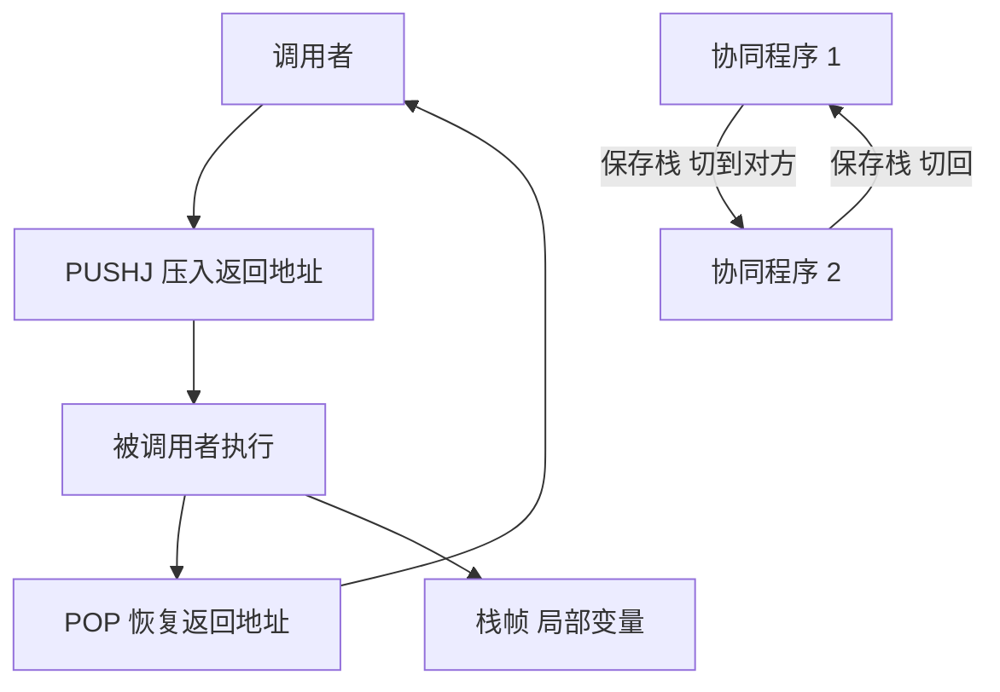

# 第 2 章：汇编、子程序与协同程序

- **难度**：★★★ | **预估学时**：5 小时 | **前置**：第 1 章

## 学习目标

学完本章，你能：
1. 读懂一段 MMIX 汇编的标签、指令与伪指令。
2. 说清 PUSHJ 与 POP 如何配合栈保存返回地址。
3. 画出一个栈帧的布局，说明参数、返回地址、局部变量各在哪。
4. 说出协同程序与子程序的根本差别。

## 一句话核心

调用不是「跳过去再跳回来」这么简单：**返回地址必须压栈**，否则嵌套调用立刻覆盖；协同程序则把「执行到一半的状态」也保存下来。

## 零基础讲解

### 概念 1：汇编的基本写法（难度：基础）

一行汇编通常三段：标签、助记符、操作数。

```
LOOP  ADD  $1, $1, $2    # 注释
```

**伪指令**：不生成机器码，只告诉汇编器怎么安排内存。
- `LOC 数据地址`：设定后续代码或数据的地址。
- `GREG 名称`：申请一个全局寄存器。
- `BYTE`、`WYDE`、`TETRA`、`OCTA`：依次定义 1、2、4、8 字节的数据。

**实例**：
```
X     GREG  0
Y     OCTA  100
```
X 是一个全局寄存器，Y 是一片 8 字节内存，初值 100。

### 概念 2：子程序与返回地址（难度：进阶）

`PUSHJ $X, 标签` 做三件事：
1. 把 $X 的旧值压栈。
2. 把返回地址（下一条指令的地址）写进 $X。
3. 跳到标签。

`POP $X, 0` 从栈顶弹回 $X，恢复旧值。

**为什么要压栈**：如果返回地址存在固定寄存器里，A 调用 B、B 又调用 C，C 的返回地址会覆盖 B 的返回地址，B 就回不去了。压栈让每一层各存一份。

**实例（两层调用）**：
- A 执行 PUSHJ $9, B：$9 的旧值入栈，$9 变成 A 的返回地址。
- B 执行 PUSHJ $9, C：$9 再次入栈（现在栈里有两份），$9 变成 B 的返回地址。
- C 执行 POP $9, 0：弹回 B 的返回地址，跳回 B。
- B 执行 POP $9, 0：弹回 A 的返回地址，跳回 A。

### 概念 3：栈帧布局（难度：进阶）

一次调用在栈上占一块区域，叫栈帧。典型布局（从高地址到低地址）：

| 区域 | 内容 |
|---|---|
| 调用者的栈帧 | 参数、局部变量 |
| 返回地址 | PUSHJ 压入 |
| 被调用者保存的寄存器 | 旧值 |
| 被调用者的局部变量 | 数组、临时值 |

**约定**：参数放在高编号寄存器里传，超过寄存器数量的参数走栈；返回值放固定寄存器。

**为什么要有约定**：调用方与被调用方必须对「参数在哪、返回值在哪、哪些寄存器会被破坏」达成一致，否则各写各的就对不上。

### 概念 4：协同程序（难度：高难）

普通子程序是「调用—执行—返回」的关系；协同程序是**对称**的：A 运行到一半暂停，切到 B；B 运行到一半暂停，切回 A，两边都从上次停的地方继续。

**实现要点**：
- 每个协同程序有自己的栈与寄存器保存区。
- 切换时保存当前栈指针与关键寄存器，恢复对方的。
- 切换动作可以写成一个宏，本质是「换栈 + 跳转」。

**实例**：生产者—消费者。生产者生成一个数据就暂停，切给消费者；消费者取走后再切回生产者。两边代码都写成顺序流程，不必写成状态机。

**与子程序的区别**：子程序返回后，调用点的局部状态还在；协同程序切换后，对方的局部状态也还在，两边的「执行到一半」都要保留。

### 概念 5：解释程序（难度：进阶）

解释程序逐条读取指令、解析字段、执行对应操作。它本身是一段程序，用 MMIX 指令模拟 MMIX 指令。

**代价**：模拟一条指令通常要几条到几十条真实指令；所以解释执行比直接运行慢一个数量级。

**用途**：Knuth 用它来跑 MIX 程序、做教学演示、调试。理解它的构造，就理解了「指令」到底是怎么被机器执行的。

### 概念 6：输入输出（难度：进阶）

MMIX 用文件操作指令打开、读、写文件，设备通过特殊寄存器交互。字符设备与块设备的差别体现在「一次读多少」上。

**实践要点**：I/O 是整台机器里最慢的部分，算法设计要尽量把 I/O 合并成大块（这与卷3 外部排序的思想一致）。

## 图示



**看图说明**：上半是「一去一回」的调用，下半是「来回交替」的切换。两者的共同点是都要保存上下文，差别在保存多少。

## 类比与实例

- 类比：子程序像打电话问一件事，问完挂断；协同程序像两个人接力写同一份文档，一个人写累了交给另一个，交接时把笔和纸的位置都交代清楚。
- 类比失效：电话挂断后你可以做别的事，协同程序切换后两边都停在原地等对方；真实程序里协同程序的栈是各自独立的，不能共用。

**实例（PLUS 子程序）**：
```
PLUS  LDO  $1, $0, X     # 取 X
      LDO  $2, $0, Y     # 取 Y
      ADD  $3, $1, $2    # 相加
      STO  $3, $0, Z     # 存结果
      POP  $9, 0         # 返回
```
调用方写 `PUSHJ $9, PLUS`，返回后从下一条继续。

## 常见误解

- **别以为 PUSHJ 只是跳转**——实际上它同时压栈并写入返回地址，是「调用」而不是「跳转」。
- **别以为协同程序就是多线程**——实际上它是单线程内的显式切换，没有并发与抢占。
- **别以为解释程序很慢就没用**——实际上它让「换一台机器」变成「换一段解释代码」，是虚拟机的雏形。

## 自测题（答案）

1. 单选题：PUSHJ $9, SUB 的作用是？
A. 只跳转 B. 压栈 $9 的旧值、写入返回地址、跳转 C. 只压栈 D. 只保存返回地址
（答案：B；解析：PUSHJ 同时完成压栈、写返回地址与跳转三件事。）

2. 填空题：两层嵌套调用时，栈里最少保存几份返回地址？（填数字）
（答案：2；解析：每一层各存一份，否则内层会覆盖外层的返回地址。）

3. 简答题：协同程序与子程序的根本差别是什么？
（答案：子程序是调用—返回的单向关系；协同程序是对称的交替关系，切换时双方的执行状态都要保留，各自有独立的栈。）

## 复习锚点

- PUSHJ：压栈、写返回地址、跳转；POP 恢复。
- 栈帧存返回地址、保存的寄存器、局部变量。
- 协同程序 = 显式切换 + 双方状态保留。
