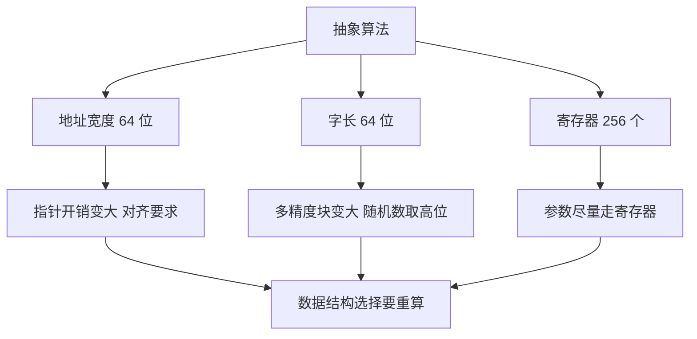

# 第 3 章：卷1 至卷3 的 MMIX 重写

- **难度**：★★★ | **预估学时**：5 小时 | **前置**：第 1、2 章；卷1 至卷3 的相关章节

## 学习目标

学完本章，你能：
1. 说出 MMIX 重写相比 MIX 多出的三类机器级工作。
2. 解释 64 位字长对多精度算术与随机数发生器的影响。
3. 说清链接结构在 64 位地址下的新问题。
4. 把卷3 的外部排序映射到 MMIX 的 I/O 与内存约束上。

## 一句话核心

算法本身没变，变的是**常数与边界**：地址宽了 4 倍、字长长了一倍、寄存器多了，但「每条指令只能做一件事」这条约束没变，所以抽象算法落到机器上总要补一堆搬运与检查。

## 零基础讲解

### 概念 1：为什么要有「增补」（难度：基础）

卷1 至卷3 的早期版本用 MIX，一种 32 位、6 位字节的假想机器。MIX 的字节是 6 位，不能直接表示 ASCII；地址空间也小。MMIX 换成 64 位、8 位字节、256 个寄存器，原来的程序要按新规格重写。

**增补的内容**：卷1 的 1.3.3 排列的应用、1.4.4 输入输出；卷2 的信息结构（顺序分配、链接分配、循环链表、双链表、数组、二叉树遍历与表示、垃圾回收、动态存储）；卷3 的随机数、算术、排序各章。

**为什么值得读**：它把「数据结构在真实机器上长什么样」讲清楚了。链表不只是一种抽象，它还涉及指针宽度、对齐、缓存行。

### 概念 2：链接结构在 64 位地址下（难度：进阶）

**链接分配**：每个节点存数据加一个指向下一个节点的指针。

- MIX 时代指针占 2 字节左右，节点很小；MMIX 下指针占 8 字节，一个节点的开销翻了几倍。
- 地址对齐：8 字节的数最好放在 8 的倍数地址上，否则某些访问会变慢。
- 空指针用 0 表示，但 0 也是合法地址，所以要有约定：地址 0 保留不用。

**实例**：存 100 万个 8 字节整数。
- 用数组：约 8 MB，连续存放，缓存友好。
- 用链表：每个节点 8 字节数据加 8 字节指针，约 16 MB，且节点分散，遍历时缓存命中率低。

**结论**：64 位下链表的相对开销比 32 位更明显，「能用数组就别用链表」这句话更有分量。

### 概念 3：循环链表与双链表（难度：进阶）

- **循环链表**：尾节点指回头节点，删除时不必特判「是不是最后一个」。
- **双链表**：每个节点存前驱与后继两个指针，删除已知节点是 O(1)；代价是每个节点多 8 字节，插入删除要改四个指针。

**实例（双链表删除）**：设节点 p，前驱 prev、后继 next。
`prev.next = next; next.prev = prev;` 两条赋值，O(1)。单链表做不到，因为找不到前驱。

### 概念 4：二叉树与垃圾回收（难度：高难）

**二叉树表示**：每个节点存左指针、右指针、数据。也可以只存两个指针加一个「线索」标志，用空指针指向中序前驱/后继（线索二叉树），省掉递归栈。

**遍历**：递归遍历要用栈；Morris 遍历用线索把树临时改成链表，空间 O(1)。

**垃圾回收**：MMIX 的堆没有自动回收，要自己标记—清除或引用计数。
- 标记—清除：从根出发标记所有可达节点，再扫一遍释放未标记的。
- 引用计数：每个节点记被引用次数，归零就释放；循环引用会泄漏。

### 概念 5：随机数与算术（难度：进阶）

**随机数**：MMIX 是 64 位机器，线性同余可以直接用 2^64 取模（溢出自动截断）。取高位比取低位好，这与卷2 的结论一致。

**多精度**：一个字 64 位，n 位十进制数只需 n/19 个左右的字（因为 2^64 约 1.8×10^19）。乘法仍是 O(n²)，但 n 是以 64 位为单位计的，实际常数比按十进制位算小得多。

### 概念 6：排序与 I/O（难度：进阶）

卷3 的外部排序在 MMIX 上要处理：
- 记录大小与块大小的匹配（一次读一个块，块内多条记录）。
- 缓冲区数量受 256 个寄存器与内存限制。
- 比较用 CMP 加条件跳转，或专用比较指令。

**映射关系**：卷3 的「趟数 = log_k R」不变；变的是每趟的实际耗时，由 I/O 带宽与块大小决定。

## 图示

**看图说明**：三条约束各自影响不同层面，最后都汇到「数据结构与算法选择要按新常数重算」这一步。

## 类比与实例

- 类比：把 32 位程序改写成 64 位，像把一间 30 平米的房子换成 60 平米——家具（算法）没变，但摆放方式（数据结构）与走动路线（缓存）都要重新考虑。
- 类比失效：房子换大只是空间变多，64 位还改变了「一个字能装多少东西」，多精度与随机数的实现细节都跟着变。

**实例（估算）**：10 万条记录、每条 64 字节、内存 64 MB。
- 内存能放 100 万条，整批一次读入即可，不需要外部排序。
- 若记录变成 1024 字节，10 万条就是 100 MB，超过内存，必须走外部排序。

## 常见误解

- **别以为 64 位只是「地址更大」**——实际上字长、寄存器数量、对齐要求都变了，实现细节全要重算。
- **别以为链表在 64 位下更好用**——实际上指针开销翻倍，缓存更不友好。
- **别以为增补只是「换个指令集」**——实际上它把抽象数据结构的机器代价讲清楚了，是卷1 至卷3 的落地注解。

## 自测题（答案）

1. 单选题：MMIX 相比 MIX，字长与字节宽度的变化是？
A. 32 位到 64 位，6 位字节到 8 位字节 B. 16 位到 32 位 C. 不变 D. 64 位到 128 位
（答案：A；解析：MMIX 是 64 位机器，字节 8 位；MIX 是 32 位、6 位字节。）

2. 填空题：双链表删除一个已知节点需要修改几个指针？（填数字）
（答案：2；解析：前驱的 next 与后继的 prev，两条赋值。）

3. 简答题：为什么 64 位下「能用数组就别用链表」这句话更有分量？
（答案：指针从约 2 字节变成 8 字节，节点开销成倍增加；节点分散导致缓存命中率低，遍历更慢；数组连续存放，空间与缓存都更省。）

## 复习锚点

- MMIX 重写改变的是常数与边界：地址 64 位、字长 64 位、寄存器 256 个。
- 链接结构的指针开销在 64 位下显著变大。
- 外部排序的趟数公式不变，变的是每趟的实际耗时。
