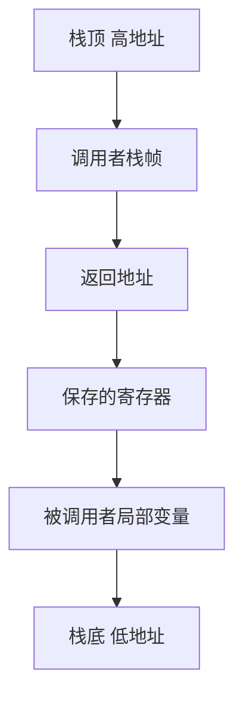

# 子程序与栈帧

- **难度**：进阶 | **涉及章节**：第 2 章

## 一句话定义

子程序调用靠 PUSHJ 把返回地址与旧寄存器压栈，靠 POP 恢复；每次调用在栈上占一块区域，叫栈帧。

## 为什么重要

它是「函数」这个抽象在机器上的真实形态。理解栈帧，才能理解递归为什么耗栈、尾调用为什么能优化、栈溢出是怎么发生的。

## 图示

从高到低依次是：调用者区域、返回地址、保存的寄存器、局部变量。

## 详解

**PUSHJ 三件事**：压入 $X 旧值、把返回地址写进 $X、跳转。
**POP 一件事**：从栈顶弹回 $X。

**嵌套调用**：每层各存一份返回地址，内层不会覆盖外层。

**参数与返回值**：按约定放寄存器或栈；返回值放固定寄存器。

**实例**：PLUS 子程序取 X、Y 相加存 Z，最后 `POP $9, 0` 返回。

## 常见误解

- 别以为返回地址存固定寄存器就行：嵌套调用会覆盖，必须压栈。
- 别以为栈帧只有局部变量：返回地址与保存的寄存器也占空间。

## 在书中出现的脉络

| 章节 | 语境 | 关键结论 |
|---|---|---|
| 1.4.1' | 子程序 | PUSHJ/POP 与栈帧 |
| 1.4.2' | 协同程序 | 栈的切换 |

## 相关概念

- 前置：[MMIX 指令格式](mmix-instruction-format.md)
- 后续：[协同程序](coroutine.md)
